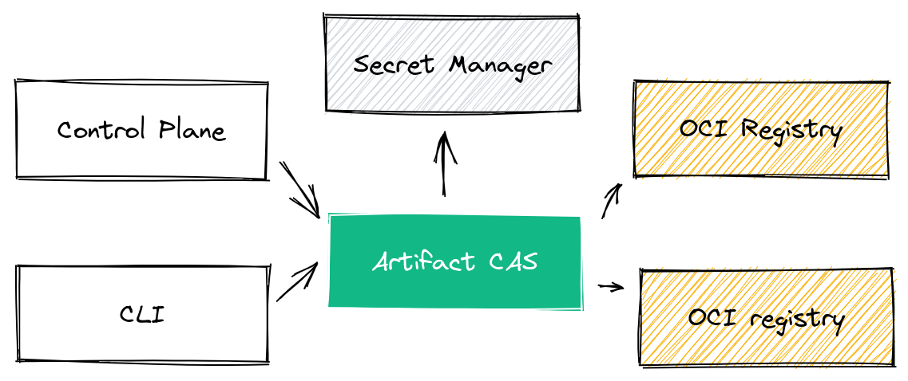

# Artifact Content Addressable Storage (CAS) Proxy

The artifact proxy is a **Content-Addressable Storage (CAS) Proxy** that sits in front of different storage backends.

Clients such as the Chainloop Control Plane or the CLI use this proxy to make sure that **uploaded artifacts are immutable and uniquely identifiable by their content digest (sha256sum)**.

NOTE: At the moment of this writing, only an [OCI](https://opencontainers.org/) storage backend is supported. In the future you should potentially expect Object Storage Support (i.e AWS s3) as well.



The project is a [Go](https://go.dev/) service that leverages [protocol buffers](https://github.com/protocolbuffers/protobuf) and [gRPC](https://grpc.io/) for its streaming API, [wire](https://github.com/google/wire/) for dependency injection and the [Kratos framework](https://github.com/go-kratos/kratos) for additional utilities such middlewares, configuration management or error handling.

The proxy API implements a [bytestream gRPC service](https://pkg.go.dev/google.golang.org/api/transport/bytestream). This enables an efficient, and modern, streaming API on top of HTTP/2.

Its structure contains the following top to down layers.

- API definition layer `./api/`. proto definitions and generated code for the external gRPC API
- Server layer `./internal/server`. Definition and registration of the HTTP and gRPC servers and middlewares.
- Service layer `./internal/service`. Implementation of the protocol buffer services.

## System Dependencies

The CAS proxy **has only one running dependency**. A secret storage backend to retrieve the OCI repository credentials. Currently, we support [Hashicorp Vault](https://www.vaultproject.io/), [AWS Secrets Manager](https://aws.amazon.com/secrets-manager/) AND [GCP Secret Manager](https://cloud.google.com/secret-manager).

This secret backend is used to download OCI repository credentials (repository path + key pair) during upload/downloads. This makes the Artifact CAS multi-tenant by default since the destination OCI backend gets selected at runtime.

## AuthN/AuthZ

The Artifact CAS API expects each request to contain a [JSON Web Token](https://auth0.com/docs/secure/tokens/json-web-tokens) with references to a) what operation is this token allowed to do (download or upload) and b) a reference to where the CAS can find the target OCI credentials.

Currently, this token is generated by the Control Plane and used on demand. You can find the generator we use to craft those tokens [here](../../internal/robotaccount/cas/robotaccount.go).

The token gets signed by the control plane with a private key and verified by the CAS with the previously configured public key.

Note: there are plans to support [JWKS endpoints](https://auth0.com/docs/secure/tokens/json-web-tokens/json-web-key-sets) to enable easy rotation of credentials.

## Client

The client code can be found [here](/internal/casclient/)

## Runbook

We use `make` for most development tasks. Run `make -C app/artifact-cas` to see a list of the available tasks.

### Run the project in development

Refer to [development guide](../../devel/README.md) for more information but in a nutshell.

```
# Run external dependency (Vault for secret management)

docker compose -f devel/compose.yml up

# Run the service
make -C app/artifact-cas run
```

Next, follow the steps that can be found [here](../../devel/README.md#4---using-the-cli-pointing-to-the-local-environment) to configure the CLI

Once configured you can try to perform a file upload and download.

```sh
cd app/cli
go run main.go --insecure artifact upload -f [FILE] # will return a sha256 digest

# download
go run main.go --insecure artifact download -d [sha256:...]
```


### Shared endpoint

The CAS HTTP port, `8001`, is the shared endpoint, mirroring the control plane (spec D-020). One standard HTTP listener owns every connection and dispatches each request: native gRPC (HTTP/2 + an `application/grpc*` content type) goes through an in-process `httputil.ReverseProxy` to a private native gRPC server bound to an ephemeral loopback address, and everything else uses the existing HTTP routes. ByteStream keeps the grpc-go native transport: the proxy streams the request body into the private connection, whose HTTP/2 flow-control window paces the proxy's reads, so no unbounded read-ahead exists in either direction. Earlier designs on this branch measured why: the per-request `grpc.Server.ServeHTTP` adapter peaked at ~1.25 GiB of live heap for a 1 GiB upload, and connection classification (cmux) could not serve the all-HTTP/2 upstream that a single-location ingress produces. Mixed native-gRPC and plain-HTTP requests share one upstream connection in any order, as on the control plane. CAS does not add gRPC-Web or Connect.

The private native server runs the same services and interceptors as the legacy listener and is independent of it. The native gRPC listener on `9001` remains enabled by default, with its existing independent TLS configuration and flag; the shared endpoint works with it disabled. `server.http.timeout` continues to apply to HTTP routes; proxied gRPC requests bypass the HTTP route middleware. Shutdown drains the HTTP server first — including every proxied gRPC stream — then stops the private native server.

To test with your existing development infrastructure:

```sh
make -C app/artifact-cas run

# In another terminal, use a per-command CAS endpoint override.
# Existing CLI authentication and the control-plane endpoint come from your config.
go run ./app/cli --insecure --artifact-cas localhost:8001 artifact upload -f /path/to/artifact
# Use the returned digest:
go run ./app/cli --insecure --artifact-cas localhost:8001 artifact download -d sha256:DIGEST
```

The development CAS public key and credentials service must match the control plane that issues these temporary CAS tokens. If another CAS already occupies these ports, start this binary with a copy of your CAS configuration and unused addresses. Do not replace the running service or edit the CLI config just to run a comparison.

Change only the per-command override to `localhost:9001` to compare with the native listener. Once all direct clients and the control-plane CAS connection have been moved, `server.legacy_grpc_listener: false` disables the native listener; the shared endpoint's private native server keeps running on its loopback address either way. Leave the legacy listener enabled during evaluation. Optional `server.http.tls_config` configures TLS for the shared endpoint; both certificate and private key must be set. It does not inherit `server.grpc.tls_config`.

The chart's `cas.ingress` mirrors the control plane: one catch-all route on one hostname, one Service port, one certificate, and an HTTP/2 (gRPC) upstream — so native gRPC, browser downloads, and status probes all arrive on the shared listener, including mixed requests on one upstream connection. The ingress keeps the legacy ingress's `100m` body limit and `3M` client buffer default. Override the body limit to `0` or a suitable larger value for a 1 GiB ingress experiment.

`cas.ingressAPI`, `cas.serviceAPI`, and the control plane's connection to the legacy CAS Service keep their existing settings. F5 same-host routing and Traefik's per-Service scheme still need qualification.

The HTTP server applies its 60-second header timeout; proxied gRPC streams carry no such deadline. Metrics remain plaintext on their separate listener; `server.http_metrics.tls_config` is rejected.

Run the isolated functional checks without Vault or an object store:

```sh
go test -race ./app/artifact-cas/internal/server ./app/artifact-cas/cmd ./deployment/chainloop -count=1
```

To check the chart through a real ingress-nginx controller, use a disposable local kind cluster on Linux with Docker:

```sh
kind create cluster --name cas-cmux --kubeconfig /tmp/cas-cmux-kubeconfig
kubectl --kubeconfig /tmp/cas-cmux-kubeconfig apply -f https://raw.githubusercontent.com/kubernetes/ingress-nginx/controller-v1.15.1/deploy/static/provider/kind/deploy.yaml
kubectl --kubeconfig /tmp/cas-cmux-kubeconfig label node cas-cmux-control-plane ingress-ready=true
kubectl --kubeconfig /tmp/cas-cmux-kubeconfig -n ingress-nginx wait --for=condition=Available deployment/ingress-nginx-controller --timeout=120s
kubectl --kubeconfig /tmp/cas-cmux-kubeconfig -n ingress-nginx patch configmap ingress-nginx-controller --type merge -p '{"data":{"worker-processes":"1"}}'
CAS_INGRESS_KUBECONFIG=/tmp/cas-cmux-kubeconfig \
CAS_INGRESS_BACKEND_IP="$(docker network inspect kind --format '{{json .IPAM.Config}}' | jq -r '.[] | select(.Subnet | contains(":") | not) | .Gateway')" \
go test -race ./app/artifact-cas/internal/server -run '^TestCASIngressNGINX$' -count=1 -v
kind delete cluster --name cas-cmux
```

The test requires one controller worker so both protocols exercise the same keepalive cache. It creates and deletes a namespace containing the rendered CAS Service and Ingress objects. Its CAS server runs in the test process, reachable through the kind bridge gateway. It checks authenticated ByteStream upload/download, reflection, status, and repeated HTTP downloads with HTTP/1.1 and HTTP/2 clients. The controller sends HTTP/1.1 to the CAS for both browser protocols. This does not qualify other controllers or production object storage.

Compare real ByteStream upload and download paths over TCP with a synthetic 1 GiB zero-filled artifact, streamed from a fixed-size buffer and checked by SHA256. Both listeners use the same file-backed test backend and real CAS staging and authentication. Select a disk-backed temporary directory; `/tmp` can be tmpfs.

```sh
mkdir -p "$HOME/.cache/chainloop-cas-bench"
TMPDIR="$HOME/.cache/chainloop-cas-bench" go test ./app/artifact-cas/internal/server \
  -run '^$' -bench '^BenchmarkCASByteStreamTransport$' -benchtime=1x -count=3 -timeout=10m
```

`CAS_BENCH_BYTES` changes the artifact size for shorter experiments. Benchmark throughput and total allocated bytes come from Go's benchmark runner. `peak-heap-MiB` samples live heap every 10 ms for the combined client and server process; it is neither server-only RSS nor a bounded-memory proof. This controlled transport comparison does not establish the original R-003 requirement of throughput within 10% of the current release with representative object storage, or cover slow readers, concurrent streams, ingress, TLS throughput, or the complete R-002 authentication matrix.


#### Observed local results

Three 1 GiB transfers per operation, Go 1.27.2, grpc-go 1.84.0, Linux amd64, disk-backed btrfs staging. These medians come from the [raw benchmark output](experiments/shared-endpoint-benchmark.txt).

| Listener | Operation | Throughput (MB/s) | Sampled peak live heap (MiB) |
| --- | --- | ---: | ---: |
| Native gRPC (`:9001`) | Upload | 233.92 | 29.13 |
| Shared endpoint (`:8001`, proxy) | Upload | 212.89 | 32.45 |
| Native gRPC (`:9001`) | Download | 192.82 | 30.82 |
| Shared endpoint (`:8001`, proxy) | Download | 177.11 | 42.78 |

ByteStream keeps the native transport behind the proxy: median upload throughput on the shared endpoint was 9.0% lower and median download throughput 8.1% lower than the legacy listener — within the R-003 10% shape, with a thin margin — and sampled peak live heap stayed bounded (~32-43 MiB against ~29-32 MiB native), not growing with artifact size. The extra hop costs the double HTTP/2 framing and one copy. Filesystem caching, synthetic content, the combined client/server process, and local machine load limit extrapolation to production; the release and object-store qualification remains open.

Earlier designs on this branch measured the alternatives. The per-request `grpc.Server.ServeHTTP` adapter peaked at ~1278 MiB of live heap on a 1 GiB upload: grpc-go's [handler transport reads the HTTP body in a separate goroutine](https://github.com/grpc/grpc-go/blob/v1.84.0/internal/transport/handler_server.go#L434) into an [unbounded receive buffer](https://github.com/grpc/grpc-go/blob/v1.84.0/internal/transport/transport.go#L90), so read-ahead is not bounded by the application's pace. Connection classification through cmux matched native throughput (upload +3.3%, download −4.3%) but could not serve the all-HTTP/2 upstream of a single-location ingress: a silent matcher deadlocks grpc-go clients, the SETTINGS-writing matcher poisons plain-HTTP/2 connections (GOAWAY, PROTOCOL_ERROR), and pooled mixed connections fail. Both results are preserved in the PR #3663 history.

### Run tests

```
make test
```

### Build binary

```
make build
```

### Generate API code from protocol buffer defintions (\*.proto)

We use buf.io to lint and generate proto files. Make sure you [install buf](https://docs.buf.build/installation) first. Once done, generating the API code is as easy as executing

```
make api
```

### Update configuration schema

The service runtime configuration is implemented by using [kratos built-in config module](https://go-kratos.dev/en/docs/component/config/).

Meaning that the configuration schema is defined at `internal/conf/conf.proto`.

To regenerate it run:

```
make config
```

### Update dependency injection

In order to enforce inversion of control and prevent import cycles we use [wire](https://github.com/google/wire/) for dependency injection.

Wire has a fairly steep learning curve, so we recommend taking a look [at their tutorial](https://github.com/google/wire/blob/main/_tutorial/README.md). In practice, in this project you will find a couple of wire_gen.go files (i.e `cmd/wire_gen.go`) and different provider defined.

If you need to re-generate the injection code after a change just run `make generate`

## Contribution guidelines

Please make sure to review the [Contribution guidelines](../../CONTRIBUTING.md) and feel free to reach out if you have any questions!

Welcome!
