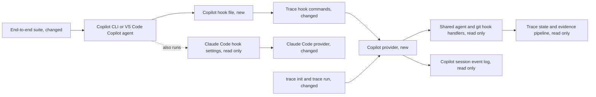

<!--
AGENT INSTRUCTIONS. Keep this comment. Read it before you change this file.

This plan says how to build the spec in the `spec:` field, or the ticket in the `ticket:` field when there is no spec. The spec holds the design and its reasons. This plan holds only the steps.

When you build a milestone, build only its steps. Each milestone merges by itself, as one PR. Cite the milestone (M1) and its requirements (R-001) in the PR. Before you add a step, a file, a dependency, an option, or a mechanism that this plan does not name, stop and ask the human. A vague word such as "secure" means the baseline the product already has for the same need, not a new mechanism.

When the code shows that a step does not work, stop and tell the human. Change this plan only after the human agrees. A change to a requirement or a decision goes in the spec, through br:eng-spec.

Do not answer an open question of this plan by yourself. Propose an answer to the human.
-->

# Plan issue-3800: GitHub Copilot support in Chainloop Trace

## Overview

Add a Copilot provider to Chainloop Trace, built like the Codex provider. It installs one hook file that Trace owns in the Copilot hook folder, as the Pi provider owns its extension file. The shared agent and git hook handlers stay as they are. The provider gives only the Copilot parts: hook input, transcript copy, transcript parser, and price table. The Claude Code provider gets a guard for Copilot payloads, like its existing guard for Cursor payloads. Milestone 2 adds skills, spec pointers, and pasted images with the Codex extension pattern.

## Architecture and impact

- Copilot provider: hook install and uninstall, hook input for both payload forms, transcript copy and parse, cost, announcements, and in M2 the three extensions.
- Copilot hook file: the hook entries that Copilot CLI and VS Code read. Trace owns the whole file.
- Trace hook commands: the `copilot` hook subcommands that the hook file calls.
- Claude Code provider: ignores a Copilot payload, so a Copilot session gives one record.
- trace init and trace run: the Copilot flag, the wizard choice, and the trust note.
- End-to-end suite: a Copilot column that runs Copilot CLI.

| Impact on | What changes |
|-----------|--------------|
| Users and other parts of the product | New Copilot choice in `trace init` and `trace run`. Repositories with Claude Code hooks stop recording Copilot sessions as Claude Code sessions. |
| Data and migrations | None. New provider name `copilot` in session records and evidence. The evidence schema does not change. |
| Configuration and deployment | New repository file in the Copilot hook folder, written by `trace init`. No server change. |
| Compatibility | Other providers do not change. The Claude Code guard skips only payloads that Claude Code never sends. |
| Rollback | Revert the PR. Users remove the Copilot hook file with `trace uninstall` or by hand. |

## Milestones

| # | Milestone | Requirements | Depends on |
|---|-----------|--------------|------------|
| M1 | Core Copilot provider | R-001, R-002, R-003, R-004, R-005, R-006, R-007, R-010 | none |
| M2 | Copilot skills, spec pointers, and pasted images | R-008, R-009, R-010 | M1 |

### M1: Core Copilot provider

Developers select Copilot in `trace init` or `trace run`, and Trace records their Copilot CLI and VS Code sessions as evidence, with attribution and estimated cost. The milestone adds the provider, its hook commands and flags, the Claude Code guard, the end-to-end column, and the compatibility tables. It follows the Codex provider for transcript copy, parse, and pricing, and the Pi provider for file ownership.

**Done when:** after a push, a Copilot CLI session in a test repository gives evidence with conversation, models, tokens, cost, tools, and attributed lines. A Claude Code hook gives no record for the same session. Checked by the provider unit tests, the Claude Code test for a Copilot payload, and the end-to-end suite for the Copilot column. A person also checks one VS Code session in a repository with `trace init --copilot --claude`.

Technical details

Changes:

**Copilot provider**

- `app/cli/internal/trace/copilot/provider.go`: `Name = "copilot"`, `var _ trace.Provider = (*Provider)(nil)`. Snapshot attribution strategy, as Codex. `SupportsSessionStartBanner` true, `SupportsSessionStartInstruction` true, `SupportsPromptReminder` false (spec Constraints). `AnnounceToUser` writes `additionalContext` in the post-tool response (R-007).
- `app/cli/internal/trace/copilot/hooks.go`: `InstallHooks`, `InstallHooksForTraceRun` (no `sessionEnd`), `UninstallHooks`, `HooksInstalled`, `SettingsFile` for `.github/hooks/chainloop-trace.json`. Format `{"version": 1, "hooks": {<event>: [{"type": "command", "bash": ...}]}}`. Events: `sessionStart`, `preToolUse`, `postToolUse`, `sessionEnd`. No `agentStop`: it fires at each turn, and no provider hooks a turn end (see the `session.idle` note in `opencode/hooks.go`). Each `bash` command is wrapped with `trace.GuardHookCommand`, so the hook exits with success when the CLI is not installed. Ownership as in `pi/hooks.go` (`allowUnowned` for `trace run`), but the proof is the marker `chainloop trace hook copilot` in every entry, matched through the guard wrapper as in `codex/hooks.go`: install refuses a file with an entry without the marker, except for `trace run`. Uninstall deletes the file only when every entry has the marker (R-002, D-002).
- `app/cli/internal/trace/copilot/hooks.go`: `ReadHookInput` decodes a typed struct that accepts camelCase and snake_case keys (`sessionId`/`session_id`, `transcriptPath`/`transcript_path`, `toolName`/`tool_name`, `toolArgs`/`tool_input`), with the size limit of the other providers. In the camelCase form `toolArgs` is a JSON string, so a second typed decode reads it. File tools `create` and `edit` set `FilePath`. Shell tools `bash` and `powershell` set `Command`. When the payload has no transcript path, `ReadHookInput` uses `~/.copilot/session-state/<sessionId>/events.jsonl`, or the same path under `$COPILOT_HOME`. No `ToolUseID`: follows TRC-006.
- `app/cli/internal/trace/copilot/copy.go`: `CopySessionData` copies `events.jsonl` into the session folder. It checks the session ID, rejects paths outside the Copilot session-state folder after it resolves symbolic links, and keeps the previous copy on failure (R-006). It reads the session-state root from the session record, so the push-time copy works when `$COPILOT_HOME` differs at push.
- `app/cli/internal/trace/state/session.go`: a `CopilotStorageRoot` field in `SessionRecord`, set at the first hook, as `CodexStorageRoot` (R-004, R-006).
- `app/cli/internal/trace/copilot/transcript.go`, `parse.go`: `ParseSession` reads only the copy. It maps `session.start`, `user.message`, `assistant.message` (with `toolRequests`), `tool.execution_complete`, `assistant.turn_*`, and `session.shutdown`. Token totals come from `session.shutdown.modelMetrics`. Without it, per-message `outputTokens` and a warning (R-004). Unknown record types stay in `RawSession["main"]`.
- `app/cli/internal/trace/copilot/pricing.go`, `pricing.json`: embedded table and `estimateCost`, copied from the Codex pattern, with the models that Copilot offers. Unknown model: default price and a warning.

**Claude Code provider**

- `app/cli/internal/trace/claude/hooks.go`: in `ReadHookInput`, return an empty `HookInput` for a Copilot payload, next to the `cursor_version` guard (R-003). The field that identifies a Copilot payload is an open question.

**CLI wiring**

- `app/cli/internal/trace/providers/registry.go`: register `copilot.New()`.
- `app/cli/cmd/trace_init_providers.go`, `trace_init.go`, `trace_run.go`: `copilot` field in `traceProviderFlags`, `any()`, `names()`, the `--copilot` flag, the wizard choice, and a one-line Copilot note in `writeTraceHarnessNotes` that names the hook file.
- `app/cli/cmd/trace_hook.go`: `newTraceHookCopilotCmd` with `session-start`, `pre-tool-use`, `post-tool-use`, and `session-end`, with `skipActionOptsInit`.
- `make generate` for the CLI reference.
- License header year in each changed file.

**End-to-end suite and documentation**

- `app/cli/internal/trace/e2e/copilot.go`: `e2e.Harness` that runs `copilot -p ... --allow-all-tools` in the test repository. Add it to the `harnesses` map in `e2e_test.go`, and a version and models entry in `config.yaml`.
- `app/cli/internal/trace/README.md`: provider list, a Copilot column in each table, "Why not Yes" lines (no prompt reminder, no subagents, no tool call ID, cost is an API-price estimate), a row in "How each agent is hooked in", and which cells the manual VS Code check covers.

Interfaces that later milestones use:

- `copilot.Name`: `"copilot"`, the provider name in session records and evidence.
- The transcript record types of `transcript.go`: M2 reads them to find skill loads, file reads, and pasted images.

Tests:

- `TestInstallHooks*`: each command has the missing-CLI guard, same content on a second run, refusal on a user file, `trace run` file without `sessionEnd`, uninstall keeps other hook files.
- `TestReadHookInput*`: camelCase and snake_case payloads, file tools, shell tools, computed transcript path.
- `TestCopySessionData*`: wrong session ID, path outside session-state, symbolic-link escape, failed copy keeps the previous copy, push with a different `$COPILOT_HOME` uses the stored root.
- `TestParseSession*`: sanitized `testdata/` log with and without `session.shutdown`, unknown records kept, warnings.
- `TestEstimateCost*`: known model, unknown model warning.
- `claude` `TestReadHookInput_CopilotPayload`: a Copilot payload gives an empty input.
- `providers/capabilities_test.go`, `cmd/trace_init_providers_test.go`, `cmd/trace_init_test.go`: updated for the new provider.

Verify: `make -C app/cli lint test`, then `CHAINLOOP_E2E_HARNESS="Copilot" make -C app/cli test-trace-e2e`, then one VS Code Copilot session in a test repository with `trace init --copilot --claude`.

### M2: Copilot skills, spec pointers, and pasted images

Copilot evidence gets the used skills, and pointers in place of copies of spec sources and pasted images. The provider adds the three optional extensions on its transcript format. It follows the Codex extensions and the shared skill and pointer pipeline.

**Done when:** a Copilot session loads a skill, reads a captured spec file, and gets a pasted image. Its evidence has a skill entry, pointers in the transcript, and one image material. Checked by the provider unit tests, the end-to-end skill, spec, and image checks for the Copilot column, and one VS Code session checked by hand.

Technical details

Changes:

- `app/cli/internal/trace/copilot/skills.go`: `SkillTracker` with `SkillRoots` for the Copilot skill folders. It finds skill loads in the transcript only, not in a skill listing (R-008).
- `app/cli/internal/trace/copilot/materials.go`: `SpecCopyReplacer` and `PastedImageFinder` on `user.message` attachments, `assistant.message` tool requests, and `tool.execution_complete` results. It uses the shared `pointer` package. Partial reads, changed content, failed tools, and data that cannot be decoded stay inline (R-009).
- `app/cli/internal/trace/copilot/provider.go`: compile-time checks for the three extensions.
- `app/cli/internal/trace/e2e/`: Copilot checks for skills, spec pointers, and images, as `checks_codex.go`.
- `app/cli/internal/trace/README.md`: Copilot cells for skills, spec pointers, and pasted images.

Tests:

- `TestSkillTracker*`: a skill load counts, a listing does not.
- `TestSpecCopyReplacer*`: an exact copy becomes a pointer; a partial read, changed content, and a failed tool stay inline.
- `TestPastedImageFinder*`: two copies of one image give one material; an image from a tool result does not count; data that cannot be decoded stays inline.

Verify: `make -C app/cli lint test`, then `CHAINLOOP_E2E_HARNESS="Copilot" make -C app/cli test-trace-e2e`, then one VS Code session with a skill and a pasted image.

## Open Questions

- [ ] **What do the real Copilot hooks send and show, in Copilot CLI and in VS Code?** This question has four parts. Which field tells the Claude Code provider that Copilot sent a payload? Which tool names and key forms does VS Code send? Does VS Code send `sessionEnd`? Does Copilot show the session-start and post-tool output? Proposed: at the start of M1, capture real payloads from both hosts, also through `.claude/settings.json`. For the guard, pick a field that Claude Code never sends, for example `timestamp` or a transcript path under the Copilot session-state folder. Set the `Supports*` values and the tool lists from the captures. With no post-tool channel, `AnnounceToUser` returns `ErrAnnounceUnsupported`. If VS Code sends no `sessionEnd`, stop and take the lifecycle choice to the spec.
- [ ] **Does the VS Code Copilot agent write the same event log as Copilot CLI?** This is the open question of the spec. Proposed: check it with the manual VS Code session of M1 before the parser is final.
- [ ] **Which Copilot CLI version does the end-to-end suite pin?** Proposed: the latest release at the start of M1, in `config.yaml`.

## Skipped and risks

| Skipped step | Reason | Follow-up |
|--------------|--------|-----------|
| Shared price table package for Claude Code, Codex, and Copilot | No requirement asks for it. Copy the Codex pattern. | none |
| Prompt-submit hook | Copilot drops its output (spec Constraints). | none |
| Subagent evidence | Spec Non-Goal. | new ticket |
| VS Code Local agent | Spec Non-Goal. | new ticket |
| End-to-end driver for VS Code | VS Code has no headless mode. R-010 asks for a manual check. | none |

Not checked: the exact Copilot payloads and the VS Code event log on a real machine. Copilot is not installed here. Also not checked: the skill folders that Copilot reads.

| Risk | Mitigation |
|------|------------|
| A Copilot payload has a field shape that the research did not show. | Capture real payloads first in M1, and keep them as sanitized test data. |
| A pre-tool hook error stops the Copilot tool call. | The handlers already return success on every error. A unit test runs the pre-tool hook with bad input. |
| `session.shutdown` is not in the copy at push time. | Copy again at push time, and use per-message tokens with a warning. |
