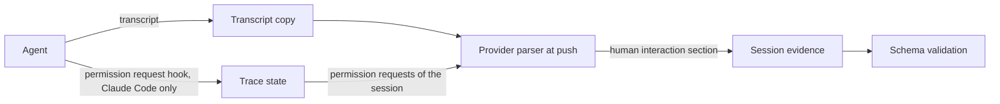

<!--
AGENT INSTRUCTIONS. Keep this comment. Read it before you change this file.

This plan says how to build the spec in the `spec:` field, or the ticket in the `ticket:` field when there is no spec. The spec holds the design and its reasons. This plan holds only the steps.

When you build a milestone, build only its steps. Each milestone merges by itself, as one PR. Cite the milestone (M1) and its requirements (R-001) in the PR. Before you add a step, a file, a dependency, an option, or a mechanism that this plan does not name, stop and ask the human. A vague word such as "secure" means the baseline the product already has for the same need, not a new mechanism.

When the code shows that a step does not work, stop and tell the human. Change this plan only after the human agrees. A change to a requirement or a decision goes in the spec, through br:eng-spec.

After each update to this plan, automatically apply br:eng-ste100 to the prose you changed, and run its linter until it reports no hard violations. Then run br:eng-plan (`--validate`) on the latest text. Do both before you commit or push. Do not wait for the human to request validation. This applies to every update, including removals and clarifications. An earlier validation does not cover later edits.

Do not answer an open question of this plan by yourself. Propose an answer to the human.
-->

# Plan issue-3829: Record the human touch points of an AI coding session

## Overview

This plan covers milestone 1 of the spec: the evidence section and Claude Code. The Claude Code parser already counts the messages of a session at push time. It will also count the human touch points and the permission modes, and write them into a new human interaction section of the session evidence. A new hook records each permission request in the Trace state, as the skill hooks record skill loads. The push reads these records and gives them to the parser.

## Architecture and impact

The components stay the same. The change adds one hook path for Claude Code and one new output of the Claude Code parser.

- Session evidence format: the new section, its schema, and its redaction rule.
- Claude Code hooks: the new permission request hook and its state record.
- Push assembly: reads the permission requests from the state and passes them to the parser.
- Claude Code parser: counts the touch points and the permission modes.
- Trace README: the new rows of the compatibility matrix.

| Impact on | What changes |
|-----------|--------------|
| Users and other parts of the product | The session evidence gets a new section. The existing conversation counts do not change. The platform can ignore the section until a later change reads it. |
| Data and migrations | None. The evidence is a material, not a table. |
| Configuration and deployment | `trace init` installs one more Claude Code hook. A repository that ran `trace init` before gets it on the next `trace init`. Until then, its evidence has no permission counts. |
| Compatibility | The section is additive and the schema version stays the same. Only the CLI runs the schema validation, with the schema in its own binary. The control plane does not validate the evidence, so a new CLI works with an old control plane, and no release order applies. |
| Rollback | Revert the CLI. Evidence that is already stored keeps the section, and the schema still accepts it. |

## Milestones

| # | Milestone | Requirements | Depends on |
|---|-----------|--------------|------------|
| M1 | Evidence section and Claude Code | R-001 to R-010 | none |

### M1: Evidence section and Claude Code

The session evidence gets the human interaction section, and its schema accepts it. The Claude Code parser fills all the counts and the permission modes, from the transcript of the session and its subagents. A new permission request hook records each request in the Trace state, with the pattern of the skill hooks (rung 2). The README matrix gets the new rows, with the cells for Claude Code set and the other cells at **No** until their milestone.

**Done when:** a pushed Claude Code session holds the section with all counts and its permission modes. An old session without the section still passes schema validation. The parser tests with new transcript fixtures and the schema validator tests prove both.

**Steps**, in build order. Open a step to see what changes and the files it touches.

<strong>01 / 06 · The session evidence can hold the human interaction section (R-009, R-010)</strong>

Add the section to the evidence data with the fields of the spec Proposal table. Each count is a pointer, and the list of permission modes is a nil slice when not recorded. So a zero stays in the JSON and a missing count stays out (R-009). The JSON schema gets the new optional property, with the same open string rule as `session.mode` for the mode names. The secret redaction keeps the mode names, as it keeps `session.mode`.

| File | Change |
|------|--------|
| `pkg/attestation/crafter/materials/aicodingsession/aicodingsession.go` | Add `StartedBy string` to `Session`, with the `started_by,omitempty` JSON tag, so an unknown starter is left out. Add `HumanInteraction` with `PermissionModes []string` and a `TouchPoints` struct of `*int` fields. Add `HumanInteraction *HumanInteraction` to `Data`. |
| `pkg/attestation/crafter/materials/aicodingsession/aicodingsession_test.go` | Add cases: a zero count stays in the JSON output, a nil count stays out, and an empty `StartedBy` gives no `started_by` key. |
| `internal/schemavalidators/internal_schemas/aicodingsession/ai-coding-session-0.1.schema.json` | Add the optional `human_interaction` property. State in its description that the mode names are native to each agent. Add the optional `session.started_by` string, open like `session.mode`, and name its values in the description. |
| `internal/schemavalidators/schemavalidators_test.go` | Add cases: evidence with the section and `started_by` validates, and evidence without them validates. |
| `pkg/attestation/crafter/materials/aicodingsession/redact.go` | Add `/data/human_interaction/permission_modes/*` and `/data/session/started_by` to the protected paths. |
| `pkg/attestation/crafter/materials/aicodingsession/redact_test.go` | Add cases: a mode name and a starter value that look like secrets stay. |

<strong>02 / 06 · Claude Code sessions record prompts, questions, plans, interrupts, and permission modes (R-001, R-002, R-004, R-006, R-007, R-008)</strong>

The parser already reads each transcript once: `scanJSONL` decodes each record into `jsonlRecord` and calls back `parseJSONL` for the main transcript and `parseSubagentUsage` for each subagent transcript. The counter adds no second read and no second loop. It is an accumulator that these two callbacks feed with each record, and `jsonlRecord` gets the fields that it reads. Prompts come from the main transcript only, because the first message of a subagent comes from the parent agent. A prompt is a record that the existing `isUserPrompt` function accepts, with no interrupt marker and no injected marker. A question is an `AskUserQuestion` tool result with an answer. A plan is an `ExitPlanMode` tool result: approved when it is not a rejection. An interrupt is the interrupt marker text. The interrupt marker that follows a rejection at a plan or permission dialog is not an interrupt (R-001). The permission modes come from the `permissionMode` field of the user records, in the order of first use. `scanJSONL` drops a line that it cannot decode before the callback runs. So it will also report how many lines it dropped. When it dropped a line, the parser leaves out the touch point counts and adds a warning (R-010).

| Rule input | Count |
|------------|-------|
| User record of the main transcript that `isUserPrompt` accepts | prompts |
| Queued prompt attachment of the main transcript that `isQueuedPrompt` accepts (a prompt sent while the agent works) | prompts |
| User record with an injected marker (command output, task notification, compact summary, command caveat) | none |
| `AskUserQuestion` result with an answer | questions_answered |
| `ExitPlanMode` result, not rejected | plans_approved |
| `ExitPlanMode` result, rejected | plans_rejected |
| Interrupt marker | interrupts |

| File | Change |
|------|--------|
| `app/cli/internal/trace/claude/types.go` | Add to `jsonlRecord` the fields that the counter reads: `isMeta`, `toolUseResult`, `sourceToolUseID`, `permissionMode`, and the attachment fields. Add `tool_use_id` and `is_error` to the content block. |
| `app/cli/internal/trace/claude/interaction.go` | New: an accumulator with one method for each record. Use the rule of `isUserPrompt` and `isQueuedPrompt`, on the typed record. |
| `app/cli/internal/trace/claude/parse.go` | Feed the accumulator from the existing `scanJSONL` callbacks of `parseJSONL` and `parseSubagentUsage`, and set `HumanInteraction`. Make `scanJSONL` report the number of lines that it dropped. |
| `app/cli/internal/trace/claude/testdata/interaction-session.jsonl` | New fixture, cut from a real interactive session, with each touch point type and a mode change. |
| `app/cli/internal/trace/claude/interaction_test.go` | Table tests for each row of the rule table and for the mode order. Also: the subagent sum has no subagent prompts, an Esc at a plan dialog, and a record that cannot be read. |

<strong>03 / 06 · Claude Code sessions record who started them (R-002, R-003)</strong>

The parser reads the first user record of the main transcript. A record whose origin names another agent session gives `agent`. An origin that the parser does not know leaves out the value. Else, the run type field gives `automation` for a headless or SDK run, and `person` for an interactive terminal. The origin wins over the run type, so a headless run that an agent started gives `agent`. When the parser cannot tell, it leaves out the value. The first prompt counts in the prompt count only for `person` (R-002).

| First user record | `session.started_by` | First prompt counted |
|-------------------|----------------------|----------------------|
| Origin is another agent session, headless or not | `agent` | no |
| Origin that the parser does not know | left out | no |
| Headless or SDK run, no agent origin | `automation` | no |
| Interactive terminal | `person` | yes |
| Cannot tell | left out | no |

| File | Change |
|------|--------|
| `app/cli/internal/trace/claude/types.go` | Add the run type field and the origin field to `jsonlRecord`. |
| `app/cli/internal/trace/claude/interaction.go` | Find the starter at the first user record, in the same pass, and skip the first prompt when the starter is not a person. |
| `app/cli/internal/trace/claude/parse.go` | Set `Session.StartedBy`. |
| `app/cli/internal/trace/claude/testdata/interaction-headless.jsonl`, `app/cli/internal/trace/claude/testdata/interaction-agent-started.jsonl` | New fixtures from a real headless run and a real session that another agent session started. |
| `app/cli/internal/trace/claude/interaction_test.go` | Table tests for each row of the starter table. |

<strong>04 / 06 · Claude Code records each permission request that it shows (R-005)</strong>

`trace init` installs a `PermissionRequest` hook. The handler appends the tool name and the tool call ID of the request to a state file of the session. It writes nothing to stdout, so the hook makes no permission decision. The handler never fails the agent. It skips the question and plan tools (R-001).

| File | Change |
|------|--------|
| `app/cli/internal/trace/claude/hooks.go` | Add the `PermissionRequest` event to `hookEvents`, with the `permission-request` command. |
| `app/cli/cmd/trace_hook.go` | Add the `claude permission-request` subcommand. |
| `app/cli/pkg/action/trace_agent_hook.go` | Add `HandleAgentPermissionRequest`: read the input, skip `AskUserQuestion` and `ExitPlanMode`, append the record. |
| `app/cli/internal/trace/state/permissions.go` | New: append and read the permission request records of a session. |
| `app/cli/internal/trace/claude/hooks_test.go`, `app/cli/cmd/trace_hook_test.go`, `app/cli/internal/trace/state/permissions_test.go` | Add tests: the hook installs and uninstalls, the command exists, records round-trip. |
| `app/cli/pkg/action/trace_agent_hook_test.go` | Add tests: the handler writes nothing to stdout, and it exits with success on input that it cannot read. |

<strong>05 / 06 · Claude Code sessions record permission approvals and rejections (R-005, R-009, R-010)</strong>

At push, the assembly reads the permission requests of the session and passes them to the parser in `ParseOpts`. For each request, the parser finds the tool result of the same call. A rejection marker gives a rejection. Any other result gives an approval, also a failed or interrupted run. No result gives neither. A request with no tool call ID cannot be matched safely, so it leaves out both counts and adds a warning (R-010). A session with no requests is normal, for example in an autonomous mode. So the session-start hook records in the session record whether the permission request hook was installed at that time. With the hook and no requests, both counts are zero. Without the hook, the parser leaves out both counts and adds a warning (R-009).

| File | Change |
|------|--------|
| `app/cli/internal/trace/provider.go` | Add `PermissionRequests` and `PermissionHookInstalled` to `ParseOpts`. |
| `app/cli/internal/trace/claude/hooks.go` | Add a function that tells if the permission request hook is installed, next to `HooksInstalled`. |
| `app/cli/internal/trace/state/session.go`, `app/cli/pkg/action/trace_agent_hook.go` | At session start, call that function and store the result in the session record. |
| `app/cli/pkg/action/trace_hook_handler.go` | In `buildSessionEvidence`, read the requests and the stored result, and set both in `ParseOpts`. |
| `app/cli/internal/trace/claude/interaction.go` | Keep the tool results by call ID during the existing pass. After the pass, match each request to its result and count approvals and rejections. |
| `app/cli/internal/trace/claude/interaction_test.go` | Add cases for approvals: approved, and approved then failed. Add cases for rejections: with feedback text, and Esc at a dialog. Also add: unanswered, no tool call ID, no requests with the hook, and no hook. |

<strong>06 / 06 · The README matrix shows which providers record the touch points (R-010)</strong>

Add one row for each touch point type, one for the permission modes, and one for the starter to the Session collection table. Set the Claude Code cells to **Yes**. Set the other cells to **No**, with the "Why not Yes" line "Not implemented yet (spec issue-3829, milestone 2)". The e2e suite reports these rows as "no check" (TRC-026). That result is correct, because the rows have no check.

| File | Change |
|------|--------|
| `app/cli/internal/trace/README.md` | Add the rows and the "Why not Yes" lines. The existing `TestTraceREADMEParses` test checks that the table still parses. |

Verify: `go test ./pkg/attestation/crafter/materials/aicodingsession/... ./internal/schemavalidators/... ./app/cli/internal/trace/... ./app/cli/pkg/action/... ./app/cli/cmd/...`

## Open Questions

- [ ] **Does the Claude Code permission request hook carry the tool call ID?** Proposed: find out in step 04. Without an ID, step 05 leaves out the approval and rejection counts and adds a warning. It does not match by tool name, because two calls of one tool can overlap.

## Skipped and risks

| Skipped step | Reason | Follow-up |
|--------------|--------|-----------|
| End-to-end checks for the new README rows | The owner cut them from the spec. The rows report "no check". | none |
| A change to the existing user message count | The spec keeps its meaning (D-001). | none |
| A view in the platform UI | A Non-Goal of the spec. | platform ticket |
| Milestone 2 of the spec: Codex, Copilot, Cursor, OpenCode, and Pi | The owner limited this plan to Claude Code. | One plan for each provider, written when the team starts it |

Not checked: some Claude Code field and marker names. No fixture in the repository holds them. They are `permissionMode`, the question and plan tool results, the rejection and interrupt markers, and the permission request hook payload. They also include the run type field and the origin of a message from another agent session. Steps 02, 03, and 04 start with real sessions for that reason: one interactive, one headless, and one that another agent session starts.

| Risk | Mitigation |
|------|------------|
| A repository with old hooks has no permission request records. | The parser leaves out the approval and rejection counts and adds a warning (M1 step 05). |
| The permission request hook writes output that Claude Code reads as a decision. | The handler writes nothing to stdout. A test in step 04 checks it. |
