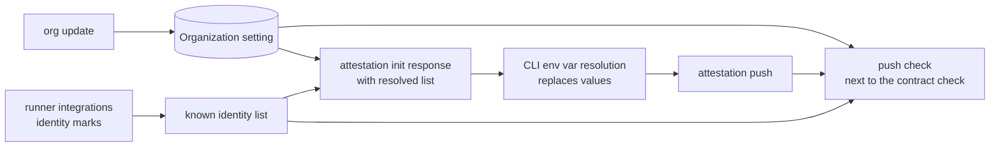

<!--
AGENT INSTRUCTIONS. Keep this comment. Read it before you change this file.

This plan says how to build the spec in the `spec:` field, or the ticket in the `ticket:` field when there is no spec. The spec holds the design and its reasons. This plan holds only the steps.

When you build a milestone, build only its steps. Each milestone merges by itself, as one PR. Cite the milestone (M1) and its requirements (R-001) in the PR. Before you add a step, a file, a dependency, an option, or a mechanism that this plan does not name, stop and ask the human. A vague word such as "secure" means the baseline the product already has for the same need, not a new mechanism.

When the code shows that a step does not work, stop and tell the human. Change this plan only after the human agrees. A change to a requirement or a decision goes in the spec, through br:eng-spec.

After each update to this plan, automatically apply br:eng-ste100 to the prose you changed, and run its linter until it reports no hard violations. Then run br:eng-plan (`--validate`) on the latest text. Do both before you commit or push. Do not wait for the human to request validation. This applies to every update, including removals and clarifications. An earlier validation does not cover later edits.

Do not answer an open question of this plan by yourself. Propose an answer to the human.
-->

# Plan issue-3841: Redaction of runner environment variables

## Overview

The new organization setting follows the path of the existing setting that removes all runner variables. It goes from the organization update API to the database, the `attestation init` response, and the local attestation state. The CLI applies the redaction where it already resolves the runner and contract variables. Each runner integration marks its identity variables in the list of variables that it already declares. The control plane checks pushed attestations next to the existing contract check at push.

## Architecture and impact

The components stay the same. The setting takes the path of the existing runner variable setting, and the push takes one more check.

- Runner integrations: mark which of their variables identify a person.
- Shared attestation module: the known identity list, and the rules to redact a value and to find a clear value.
- Control plane: stores and checks the setting, sends it at init with the resolved list, and rejects a push that does not obey it.
- CLI: the `org update` flags, the organization details, and the redaction of the resolved variables.

| Impact on | What changes |
|-----------|--------------|
| Users and other parts of the product | Organization admins get two new `org update` flags. Attestations of organizations with the setting store `[REDACTED]` for the redacted variables. |
| Data and migrations | One nullable JSON column on the organizations table. Null means no redaction. |
| Configuration and deployment | None. |
| Compatibility | The API only adds fields. A CLI without redaction support fails at push only in an organization with the setting, and only when a redacted variable has a clear value. |
| Rollback | Turn the setting off with `--env-var-redaction none`. A code rollback leaves the column unused. |

## Milestones

| # | Milestone | Requirements | Depends on |
|---|-----------|--------------|------------|
| M1 | Organization env var redaction, applied by the CLI and enforced at push | R-001, R-002, R-003, R-004, R-005, R-006 | none |

### M1: Organization env var redaction, applied by the CLI and enforced at push

An admin sets the mode, the CLI replaces the values, and the control plane rejects a push with a clear value. The milestone touches the runner integrations, the shared attestation module, the control plane organization and push paths, and the CLI. It builds on three existing parts: the runner variable setting, the env var resolution of the crafter, and the push-time contract check. This is Reuse first rung 2, an existing pattern.

**Done when:** an admin sets known identity and a GitHub Actions attestation stores `GITHUB_ACTOR: [REDACTED]`, and a push with a clear value fails. Checked by the runner, crafter, organization, and push tests.

**Steps**, in build order. Open a step to see what changes and the files it touches.

<strong>01 / 07 · Each runner says which of its variables identify a person (R-004)</strong>

The env var definition gets an `Identity` flag next to `Optional`. The definitions change to keyed fields, because a third field breaks the positional literals. `KnownIdentityEnvVars() []string` returns the union of the flags of all runners. The flags are on `GITHUB_ACTOR`, `GITLAB_USER_EMAIL` and `GITLAB_USER_LOGIN` (GitLab), `GITLAB_USER_LOGIN` (Dagger), `BUILD_REQUESTEDFOR`, `BUILD_REQUESTEDFOREMAIL`, and TeamCity `USER` and `HOME`.

| File | Change |
|------|--------|
| `pkg/attestation/crafter/runners/runners.go` | Add the `Identity` field to `EnvVarDefinition`, next to `Optional`. Add `KnownIdentityEnvVars`, which returns the names that any runner marks with `Identity`. |
| `pkg/attestation/crafter/runners/*.go` | Keyed definitions, and the identity flags. |
| `pkg/attestation/crafter/runners/*_test.go` | Expected definitions with the flags. |
| `pkg/attestation/crafter/runners/identity_test.go` | Add `TestKnownIdentityEnvVars`: the sorted union. The test of each runner checks its flags. |
| `pkg/attestation/crafter/runner_test.go` | Add `TestKnownIdentityEnvVarsCoversEveryRunner`: each runner of the runner factories has its identity variables in the union. |
| `.golangci.yml` | Turn off goconst for test files and the runners package, where env var names are data. |

<strong>02 / 07 · One set of redaction rules for the CLI and the control plane (R-002, R-004, R-005)</strong>

A new package holds the placeholder `[REDACTED]` and the mode type (`none`, `known-identity`, `custom`). `Names(mode, custom)` gives the names of a mode, and a custom list must have one non-empty name. `Apply(env, names)` replaces present values and keeps the keys. `Violations(env, names)` gives the sorted names with a non-empty value other than the placeholder.

| File | Change |
|------|--------|
| `pkg/attestation/envredaction/envredaction.go` | Add the package. |
| `pkg/attestation/envredaction/envredaction_test.go` | Add table tests for `Names`, `Apply`, and `Violations`, with empty and absent values. |

<strong>03 / 07 · An admin can set and read the redaction mode (R-001)</strong>

The API gets an `EnvVarRedaction` message (type and names) on the organization update request and on the organization item. The organization stores it in a JSON column. The update checks the setting, keeps the names only for custom, and clears the column for none. A missing value in the request changes nothing.

| File | Change |
|------|--------|
| `app/controlplane/api/controlplane/v1/response_messages.proto`, `organization.proto` | Add the message and the fields, then regenerate. |
| `app/controlplane/pkg/data/ent/schema/organization.go` | Add the JSON column, then generate and sync the migration. |
| `app/controlplane/pkg/biz/organization.go` | Add `EnvVarRedaction` with validation. |
| `app/controlplane/pkg/data/organization.go` | Set or clear the column, and read it. |
| `app/controlplane/internal/service/organization.go`, `context.go` | Convert between the API and the use case. |
| `app/controlplane/pkg/biz/organization_integration_test.go` | Add the update cases: each mode, invalid input, none, and no change. |
| `app/controlplane/internal/service/envvarredaction_test.go` | Add `TestEnvVarRedactionConversion`. |

<strong>04 / 07 · The init response gives the resolved names (R-001, R-004)</strong>

The `attestation init` response gives the names that the control plane enforces at push, also for known identity (spec D-003). The CLI copies only these names into the local attestation state.

| File | Change |
|------|--------|
| `app/controlplane/api/controlplane/v1/workflow_run.proto` | Add the list of names to the init response. |
| `pkg/attestation/crafter/api/attestation/v1/crafting_state.proto` | Add the names to redact to the attestation state. |
| `app/controlplane/internal/service/attestation.go` | Fill the list with the names of the org setting. |
| `app/cli/pkg/action/attestation_init.go` | Copy the names into the crafter options. |

<strong>05 / 07 · The CLI stores `[REDACTED]` for the runner and contract variables (R-002, R-005, R-006)</strong>

After the crafter resolves the runner variables and the env allow list of the contract, it applies the redaction to the result. This happens before it writes the state, so the real value never reaches the state. The crafter uses the names from the state, so it has no logic for each mode. The redaction also applies when the organization skips the runner variables.

| File | Change |
|------|--------|
| `pkg/attestation/crafter/crafter.go` | Add the option, and apply the redaction in `ResolveEnvVars`. |
| `pkg/attestation/crafter/crafter_test.go` | Add `TestResolveEnvVars` cases: the known identity list, names on the runner variables and the allow list, and skip plus redaction. |

<strong>06 / 07 · `org update` sets the mode, and the organization details show it (R-001)</strong>

`--env-var-redaction none|known-identity|custom` sets the mode, and the repeatable `--redacted-env-var` gives the custom list. The CLI rejects names without the custom mode before it calls the API. The context output shows the mode and the custom list.

| File | Change |
|------|--------|
| `app/cli/cmd/organization_update.go` | Add the two flags. |
| `app/cli/cmd/organization_describe.go` | Show the setting. |
| `app/cli/pkg/action/org_update.go`, `membership_list.go`, `env_var_redaction.go` | Build the request, and add the setting to the output. |
| `app/cli/pkg/action/env_var_redaction_test.go` | Add `TestNewEnvVarRedactionItem` and `TestEnvVarRedactionConversions`. |
| `app/cli/documentation/cli-reference.md` | Regenerate. |

<strong>07 / 07 · A push with a clear redacted value fails (R-003)</strong>

The push check runs after the contract check, in the save and in the check that runs before a CAS upload. It uses the setting of the organization at push time. The error names the variables. It tells the user to update the CLI, or to run the attestation again if the setting changed.

| File | Change |
|------|--------|
| `app/controlplane/pkg/biz/workflowrun.go` | Add `validatePredicate`, which runs the contract and redaction checks, and call it in `SaveAttestation` and `ValidateAttestationContract`. Load the organization one time for each call. |
| `app/controlplane/pkg/biz/workflowrun_contract_integration_test.go` | Add `TestSaveAttestationEnforcesEnvVarRedaction`: the pre-CAS check and the save both reject a clear value, accept the other cases, and store nothing on a rejection. |
| `app/controlplane/pkg/biz/workflowrun_verification_test.go` | Give the keyless verification test an organization repository mock, because the pre-CAS check now loads the organization. |

Verify: `make test`

## Open Questions

None.

## Skipped and risks

| Skipped step | Reason | Follow-up |
|--------------|--------|-----------|
| Redaction of the head commit author and the pull request logins | Not environment variables. Out of scope in the spec. | [issue 3842](https://github.com/chainloop-dev/chainloop/issues/3842) |
| A CLI fallback to its own list when the control plane sends none | Only a control plane that sends the list has the setting, so the fallback cannot run. | none |

Not checked: a manual end-to-end run in a real CI runner.

| Risk | Mitigation |
|------|------------|
| Pipelines with a CLI without redaction support fail at push after an admin turns on the setting. | The error tells the user to update the CLI. The release notes give the minimum CLI version. |
