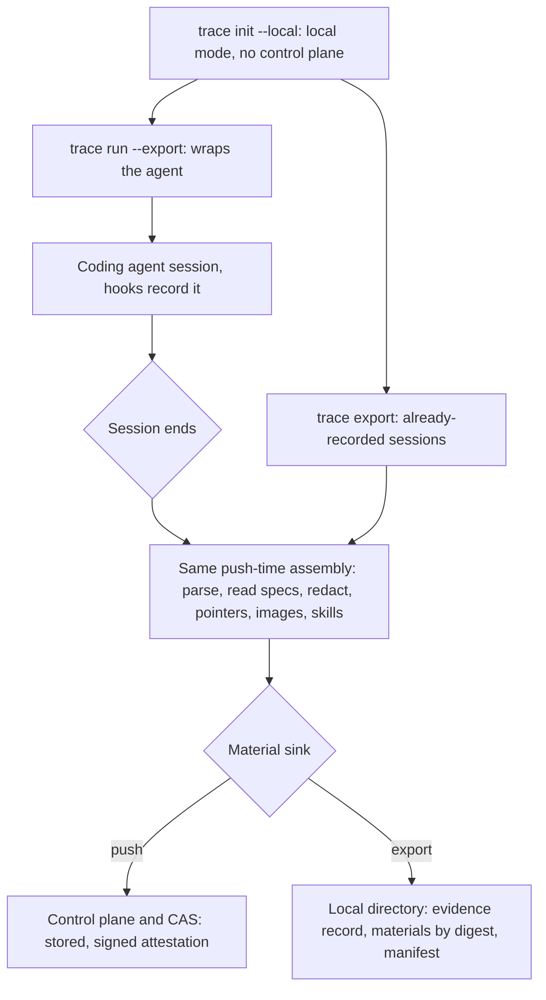

<!--
AGENT INSTRUCTIONS. Keep this comment. Read it before you change this file.

This spec records a design that humans reviewed and approved. Do not change it as part of other work. Find the status of the parent ticket (the `ticket:` field) before you change anything. If you cannot find the status, or you are not sure which case below applies, do not change the spec. Ask the human first.

- Ticket in design, and the spec PR is open: change the spec only through the br:eng-spec skill (`--revise`). Never renumber or reuse an R-xxx or D-xxx ID.
- Ticket in progress: do not rewrite the requirements, the Proposal, or existing Decision Record rows. Record a changed decision as a new Decision Record row. The owner records the differences with the shipped work through br:eng-spec (`--done`).
- Ticket done or canceled: the spec is frozen. Do not change, delete, or strike through any text. The only allowed edits are typo fixes, broken links, and the "Superseded by" line under the title. For a design change, write a new spec with br:eng-spec that supersedes this one.

When your code goes against this spec, say so in your PR. Do not edit the spec to match the code.
-->

# Spec issue-3582: Trace evidence export to disk

## Summary
Chainloop Trace records an AI coding session. On a git push, it assembles the session evidence and sends it to the control plane as a signed attestation. The assembly does real work. It reads the spec sources at push time, redacts secrets, and replaces copies with pointers. It stores each spec, skill, and image as its own material. Today that assembly runs only inside a push. The setup needs the control plane too. So a developer needs an account, credentials, and a network before they see any evidence. This spec adds a local mode. `trace init --local` sets the repository up with no control plane: no login, no organization, no workflow. In local mode the push hook sends no attestation, and the evidence is written to disk instead. `trace run --export` wraps the agent and writes the evidence when the session ends, and `trace export` writes the evidence of the sessions the hooks already recorded. Both run the same assembly a push runs. There is no attestation and no push. It gives developers and tests the exact evidence a push would produce, on disk, with no backend at all.

## Problem
- The evidence a push produces is more than the raw transcript. The push reads the spec sources, redacts secrets, and adds the pointers, the pasted images, and the skills.
- This assembly runs only inside a push. So a developer needs a running control plane, credentials, and a network to see its output.
- The setup also needs the control plane. The init step creates the workflow and needs a login, so there is no way to use Trace without a backend at all.
- A test cannot get the pushed evidence without a live backend. So the assembly is hard to test.
- No command writes the session evidence to disk. A developer cannot see what a session would send before they send it.
- The push also signs and stores the attestation. A developer who only wants to read the evidence pays for the whole backend path.

## Goals and Non-Goals
- Goal: `trace init --local` sets up the repository for local mode and contacts no control plane.
- Goal: `trace run --export` runs the full push-time assembly and writes the result to a local directory when the session ends. It needs no control plane and does no push.
- Goal: the written evidence equals what a push would upload for the same session. The fields, the redaction, the pointers, and the spec, skill, and image materials match.
- Goal: the output is laid out so a reader and a test find each material by its digest.
- Goal: a developer sets up and reads the evidence of a session with no account, no credentials, and no network.
- Non-goal: a signed attestation. The export writes the evidence set, not a signed statement or a signed bundle. A control-plane-free signed attestation needs a contract and a signing key, and it is a separate, larger effort.
- Non-goal: policy evaluation and contract-required materials. Those need a contract from the control plane.
- Non-goal: a change to the push path, or to what a push uploads.
- Non-goal: the agent or the model offline. The agent still calls its model over the network during the session. This feature is about the Chainloop backend, not the model.

## Requirements

### R-001: Write the evidence to a local directory
The export MUST run the push-time assembly and write the result to a directory the user names. It MUST make no call to the control plane and emit no attestation.
- Done when: the export reaches no control plane, needs no credentials, and writes the directory.

### R-002: The same evidence as a push
The written evidence record MUST equal the one a push would upload for the same session. The fields, the redaction, the pointers, and the spec, skill, and image materials MUST match. The one difference is the signature and the attestation wrapper, which the export does not produce.
- Done when: a session that is exported and the same session that is pushed give the same evidence record and the same material digests.

### R-003: Materials addressable by digest
The export MUST write each material under its content digest. A reader and a test MUST find each material from the reference in the evidence record.

### R-004: Redaction on by default
The export MUST redact secrets in the evidence and in the materials, as a push does. An opt-out is for a trusted local run only, and the output can then hold secrets.
- Done when: a secret in a spec source does not appear in the exported files.

### R-005: No control plane and no credentials
The export MUST NOT need a control plane, an organization, a token, or a network. The agent run that records the session still uses the network for its model.

### R-006: A manifest
The export MUST write an index. The index MUST state that the export is unsigned and is not an attestation. It MUST list each material by name, kind, and digest. A reader MUST see the whole set of materials from the index, with no need to parse each file. The evidence record holds the warnings of the run, not the index.

### R-007: Export from a recorded session
The export MUST come from the session state that the hooks recorded. It MUST NOT depend on one way of running the agent.

### R-008: Local mode set up with no control plane
`trace init --local` MUST set up the repository for local mode without contacting the control plane: no login, no organization, no workflow. In local mode the push hook MUST send no attestation. The evidence goes to disk instead. Local mode MUST be per-clone, so it does not change whether another clone of the same repository attests.
- Done when: `trace init --local` runs with no network and no credentials, and a push in that clone sends no attestation.

### R-009: Export when the session ends
`trace run --export` MUST wrap the agent and, when the session ends, write the evidence set to the named directory. It MUST NOT push an attestation.
- Done when: the agent runs, the session ends, and the directory holds the evidence with no push.

### R-010: Export a session the hooks already recorded
The CLI MUST provide a command that writes the evidence of the already-recorded sessions to a directory, without wrapping a run. A developer who set the repository up with `trace init --local` MUST be able to export the sessions the hooks recorded.
- Done when: after a recorded session, the command writes the evidence to the directory, with no push.

## Constraints
- The repository is public. The export and its code hold no internal context.
- The agent calls its model over the network during the session. The export changes the Chainloop backend path only.
- The export is not signed, so it is not proof of anything. It is for inspection and for tests.
- The export reuses the push assembly. It does not fork that logic.
- Local mode is per-clone. It is recorded in the local trace state, not in the shared repository config, so it never changes attestation for another clone.
- An export can hold the content of the session, including local files the session read. A developer keeps the output directory as they keep any working copy of the session.

## Proposal
The developer sets up the repository once with `trace init --local`. Init installs the same hooks but creates no workflow and contacts no control plane. Today init needs a login and creates the workflow the attestations target. Local mode drops that step, so a developer with no account can set up Trace. Local mode is recorded in the local trace state, not in the shared repository config. So it is per-clone, and never turns attestation off for a teammate. In local mode the push hook sends no attestation, because there is no control plane to send it to. The evidence is written to disk on demand instead.

The developer then runs the agent through `trace run --export` with an output directory. The run wraps the agent as it does today. When the session ends, instead of signing and pushing an attestation, the run executes the same assembly a push runs. It parses the session. It reads each spec source at that time. It redacts secrets. It replaces each copy in the transcript with a pointer. It gathers the pasted images and the skills. A push would store each material in the backend and send a signed attestation. Instead, the run writes each material to the output directory under its digest, writes the session evidence record, and writes a manifest.

The push path already separates the assembly from the step that stores one material. That store step is a single seam. The export gives the seam a store that writes to disk and returns the digest, in place of the store that uploads to the backend. Every assembly step runs unchanged: the spec read, the redaction, the pointers, the images, the skills, and the evidence record. So the export cannot drift from a push. It is the same assembly with a different sink.

The output directory holds three things. It holds the session evidence record, which carries the warnings of the run. It holds a folder of materials, each named by its digest. It holds a manifest that lists the materials. The layout mirrors the content-addressed store the backend uses. So a material is found by its digest, and two runs of the same session are easy to compare.

The export writes the evidence set, not a signed attestation. A signed attestation with no control plane needs a contract and a signing key. That is a separate, larger effort, and this spec puts it out of scope. The export is for a developer who reads the evidence, and for a test that checks the assembly.

The export is not named "offline". The agent still calls its model over the network during the session, so "offline" would claim something false. Two names say what the parts do. `--local` names the init mode: no control plane, evidence on local disk. `--export` names the run output: write the evidence to a directory. A standalone `trace export` command writes the evidence of the sessions the hooks already recorded. A developer who set up local mode then exports without wrapping a run.

## Decision Record

| ID | Decision | Choice | Why (and what we rejected) | Source |
|----|----------|--------|----------------------------|--------|
| D-001 | How the mode produces the evidence | Reuse the push assembly through its store seam, with a store that writes to disk | The export is then the same assembly as a push, so it cannot drift. Rejected: a new path that parses and assembles on its own (it forks the logic, and the two drift). | drafting |
| D-002 | What the mode writes | The evidence set: the evidence record and its materials. Not a signed attestation | A developer and a test need the evidence, not a signature. Rejected: a signed bundle with no control plane (it needs a contract and a signing key, which is a larger, separate effort). | drafting |
| D-003 | Output layout | Content-addressed: each material under its digest, plus a manifest | A reader maps a reference in the evidence to its material, and two runs are easy to compare. Rejected: a flat dump with ad-hoc names (hard to map, hard to compare). | drafting |
| D-004 | Secrets in the output | Redaction on by default, with an opt-out for a trusted local run | The output equals a push by default, so it holds no secret a push would drop. The opt-out serves a developer who debugs the redaction. Rejected: no redaction (the output holds secrets). Also rejected: redaction with no opt-out (a developer cannot see the raw text). | drafting |
| D-005 | Name of the mode | Name it for what it does, write the evidence to disk, for example "export" | The agent and the model are still online during the session, so "offline" claims something false. Rejected: "offline" (false claim). Also rejected: "dry-run" (it already means render without store, and it still calls the control plane). | owner request |
| D-006 | The surface and the verb | The verb is "export". The first surface is a flag on the single-session run that names the output directory. A standalone "export" command comes later | One command then gives the whole path: run the agent and write the evidence together. A standalone command serves a session the hooks already recorded, and it can wait. Rejected: a standalone command first (it does not cover the common case of running the agent and reading the evidence together). | owner request |
| D-007 | What the export carries | Everything a push uploads, including the raw transcript material | The export is faithful only when it holds what a push holds. Rejected: the evidence record and the spec, skill, and image materials only (it drops the transcript, so the export does not match a push). | owner request |
| D-008 | Determinism for a compare | The mode writes the faithful output. A shared helper normalizes the volatile fields for a compare | The export stays faithful to a push, with no special mode that hides a difference. One helper keeps each test from normalizing on its own. Rejected: a normalized form that the mode itself writes. Such a mode can drift from a push, and it can mask a real change. | owner request |
| D-009 | Primary enabling surface | `trace init --local` sets up local mode and contacts no control plane. It is the primary surface, ahead of the run flag | Today init needs a login and creates a workflow on the control plane, so a developer cannot use Trace without a backend. A local init drops that block and makes a fully backend-free path possible. This revises the ordering in D-006, which put the run flag first. Rejected: a run-only flag with no local init (init still needs the control plane, so the path is not backend-free). | owner request |
| D-010 | How local mode avoids the control plane | A reserved local organization and a project derived from the repository, in place of the control-plane workflow and contract | The run assembles with these local values and needs no control-plane lookup. Rejected: reusing a real organization and project from config (it mixes real and placeholder values, and a real organization implies a control plane). | owner request |
| D-011 | When the run writes the evidence | On session end, from `trace run --export`, with no push | The run already assembles at session end today, so the export reuses that point. One command runs the agent and writes the evidence together. Rejected: a git-push-triggered export (it adds a branch to the push hook and needs a git push, which the session-end run does not). | owner request |
| D-012 | The two names | `--local` for the init mode, `--export` for the run output | Each name says what its part does, and neither claims the model is offline. This refines D-005, which rejected "offline". Rejected: one name for both (the init mode and the run output are different actions). | owner request |
| D-013 | Where local mode is recorded | A per-clone marker in the local trace state, nothing in the shared repository config | The repository config is committed and shared. A local flag there would turn attestation off for every teammate who clones the repository and runs init. The export assembles each material with no organization or project, so none needs recording. This supersedes D-010, which put a reserved organization and project in the config. | implementation |
| D-014 | What the push hook does in local mode | It sends no attestation and returns cleanly | Local mode has no control plane to attest to. The git-push-triggered export was already rejected (D-011), so the hook does nothing on push. The evidence is exported on demand with `trace export`. | implementation |
| D-015 | When the standalone export command ships | Now, as `trace export`, together with local mode | A clone set up with `trace init --local` records sessions through the installed hooks, with no wrapped run to export them. Without the command there is no way to export them. This brings forward the standalone command that D-006 deferred. | implementation |

## Open Questions
None.

## Milestones
1. **Local init.** `trace init --local` sets up local mode without a control plane, marked per-clone, and the push hook sends no attestation in that mode.
2. **Disk sink and core export.** The assembly writes the evidence set of a session to a directory through the disk store, with no control plane.
3. **Export from the run.** `trace run --export` wraps the agent and writes the evidence when the session ends, with no push.
4. **Layout and manifest.** The content-addressed layout and the manifest have a documented structure, so a test reads the output without guessing.
5. **Standalone export.** `trace export` writes the evidence of the already-recorded sessions to a directory.

## Risks

| Risk | Mitigation |
|------|------------|
| The export drifts from a real push. | The export reuses the push assembly through its store seam, so the only difference is the sink. A test compares an export with a push for the same session (R-002). |
| The output holds secrets. | Redaction is on by default, as in a push. The opt-out is for a trusted local run, and it is documented as such (D-004). |
| A reader treats the export as a signed attestation. | The export is not signed, and the index says so (R-006). The export is for inspection and for tests. |
| A developer's local mode turns attestation off for the whole team. | Local mode is per-clone. It is recorded in the local trace state, not in the shared repository config, so it never changes attestation for another clone (D-013). |
| Timestamps and volatile paths make a test flaky. | The test normalizes the volatile fields before a compare (D-008). |
