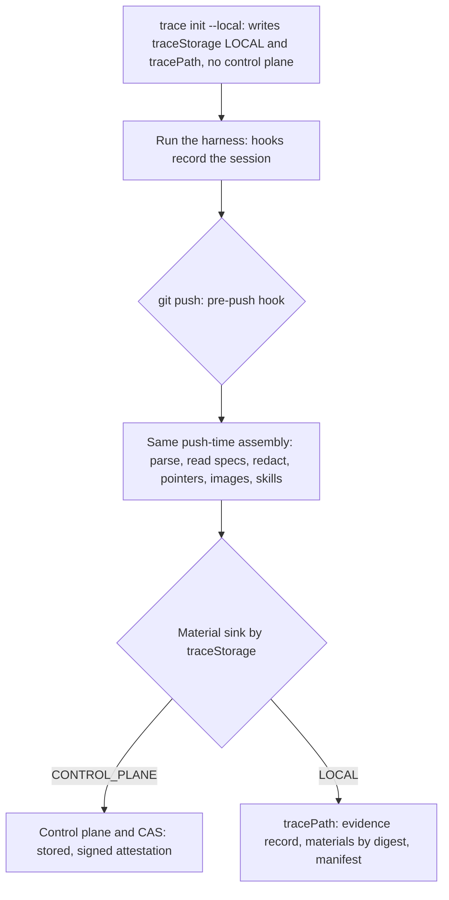

<!--
AGENT INSTRUCTIONS. Keep this comment. Read it before you change this file.

This spec records a design that humans reviewed and approved. Do not change it as part of other work. Find the status of the parent ticket (the `ticket:` field) before you change anything. If you cannot find the status, or you are not sure which case below applies, do not change the spec. Ask the human first.

- Ticket in design, and the spec PR is open: change the spec only through the br:eng-spec skill (`--revise`). Never renumber or reuse an R-xxx or D-xxx ID.
- Ticket in progress: do not rewrite the requirements, the Proposal, or existing Decision Record rows. Record a changed decision as a new Decision Record row. The owner records the differences with the shipped work through br:eng-spec (`--done`).
- Ticket done or canceled: the spec is frozen. Do not change, delete, or strike through any text. The only allowed edits are typo fixes, broken links, and the "Superseded by" line under the title. For a design change, write a new spec with br:eng-spec that supersedes this one.

When your code goes against this spec, say so in your PR. Do not edit the spec to match the code.
-->

# Spec issue-3582: Trace local mode

## Summary
Chainloop Trace records an AI coding session. Today it needs a control plane. The setup creates a workflow and needs a login, and a git push attests the session to the backend. So a developer cannot use Trace without an account, credentials, and a network. This spec adds a local mode. A repository records its sessions and stores them on disk, with no control plane. The mode is set in `.chainloop.yml` with `traceStorage: LOCAL` and an optional `tracePath`. The normal flow works. A developer runs the harness, writes code, and pushes. The pre-push hook runs the same assembly a push runs and stores the session under the path, and tells the user where it went. `traceRequired` replaces `requireTrace`. This spec is about recording a session without a control plane. Exporting an already-recorded session on demand is a separate feature, left to a future spec.

## Problem
- Trace needs a control plane. The init step creates a workflow and needs a login, so there is no way to set Trace up without a backend.
- A push attests the session to the control plane. So recording a session needs an account, credentials, and a network.
- Some teams want to record AI coding sessions with no backend at all. An evaluation, an air-gapped machine, a privacy need, or a trial before adopting the backend all want local recording.
- The evidence a push produces is more than the raw transcript. It reads the spec sources, redacts secrets, and adds the pointers, the pasted images, and the skills. A local mode has to do the same work, so the stored session matches a push.

## Goals and Non-Goals
- Goal: a repository records and stores its AI coding sessions on disk, with no control plane, no login, and no workflow.
- Goal: `.chainloop.yml` sets the storage mode: the control plane (the default) or local disk, with an optional path.
- Goal: the normal flow works. The developer runs the harness and pushes, and the session is stored locally.
- Goal: the user is told where the session is stored.
- Goal: the stored evidence equals what a push would upload for the same session, apart from the signature.
- Non-goal: exporting an already-recorded session to a directory on demand. That is a separate feature for a future spec.
- Non-goal: a signed attestation. Local mode stores the evidence set, not a signed statement. A control-plane-free signed attestation needs a contract and a signing key, and it is a separate, larger effort.
- Non-goal: policy evaluation and contract-required materials. Those need a contract from the control plane.
- Non-goal: the agent or the model offline. The agent still calls its model over the network during the session. This feature is about the Chainloop backend, not the model.

## Requirements

### R-001: Store the session evidence on disk
In local mode, Trace MUST run the push-time assembly and store the result on disk under the configured path. It MUST make no call to the control plane and emit no attestation.
- Done when: a push in a local-mode repository reaches no control plane, needs no credentials, and stores the session on disk.

### R-002: The same evidence as a push
The stored evidence record MUST equal the one a push would upload for the same session. The fields, the redaction, the pointers, and the spec, skill, and image materials MUST match. The one difference is the signature and the attestation wrapper, which local mode does not produce.
- Done when: a session stored locally and the same session pushed give the same evidence record and the same material digests.

### R-003: Materials addressable by digest
The stored session MUST write each material under its content digest. A reader and a test MUST find each material from the reference in the evidence record.

### R-004: Redaction on by default
Local mode MUST redact secrets in the evidence and in the materials, as a push does. An opt-out is for a trusted local run only, and the output can then hold secrets.
- Done when: a secret in a spec source does not appear in the stored files.

### R-005: No control plane and no credentials
Local mode MUST NOT need a control plane, an organization, a token, or a network. The agent run that records the session still uses the network for its model.

### R-006: A manifest
Local mode MUST write an index next to the stored session. The index MUST state that the stored evidence is unsigned and is not an attestation. It MUST list each material by name, kind, and digest. A reader MUST see the whole set of materials from the index, with no need to parse each file. The evidence record holds the warnings of the run, not the index.

### R-007: Store from a recorded session
The stored evidence MUST come from the session state that the hooks recorded. It MUST NOT depend on one way of running the agent.

### R-008: Local mode set up with no control plane
`trace init --local` MUST set the repository up for local mode without contacting the control plane: no login, no organization, no workflow. It MUST record the local storage mode in `.chainloop.yml` (R-011), and MAY record a path.
- Done when: `trace init --local` runs with no network and no credentials, and later pushes store the session on disk.

### R-009: Store the session on push
In local mode the pre-push hook MUST store the session on disk instead of pushing an attestation.
- Done when: a `git push` in a local-mode repository stores the session under the configured path and sends no attestation.

### ~~R-010: Export a session the hooks already recorded~~
~~The CLI MUST provide a command that writes the evidence of the already-recorded sessions to a directory, without wrapping a run.~~ Dropped. Exporting an already-recorded session on demand moved to a future spec (D-020).

### R-011: Configure trace storage
`.chainloop.yml` MUST carry the trace storage mode in `traceStorage`, one of `CONTROL_PLANE` (the default) or `LOCAL`. In `LOCAL`, Trace stores sessions on disk and contacts no control plane. An optional `tracePath` MUST name where local sessions are stored, with a default when it is absent. `traceRequired` MUST replace `requireTrace` with the same meaning: block a push when a required trace is missing. The old `requireTrace` and `localTrace` fields are deprecated, and a later change drops them.
- Done when: a repository with `traceStorage: LOCAL` stores its sessions on disk, and `traceRequired` blocks a push with no recorded session.

### R-012: Say where the session is stored
In local mode, Trace MUST tell the user where the session is stored. It MUST say so when the harness starts and when a push stores the session.
- Done when: a user who runs the harness and pushes sees the path the session was written to.

## Constraints
- The repository is public. The code holds no internal context.
- The agent calls its model over the network during the session. Local mode changes the Chainloop backend path only.
- The stored evidence is not signed, so it is not proof of anything.
- Local mode reuses the push assembly. It does not fork that logic.
- `traceStorage` is a committed repository policy, so a local-trace repository is the same for every clone of it.
- A stored session can hold the content of the session, including local files the session read. A developer keeps the storage directory as they keep any working copy of the session.

## Proposal
The developer sets the repository up once with `trace init --local`. Init installs the hooks but creates no workflow and contacts no control plane. It writes the storage mode to `.chainloop.yml`: `traceStorage: LOCAL`, with an optional `tracePath` for where the sessions go. Today init needs a login and creates the workflow the attestations target. Local mode drops that step, so a developer with no account can set Trace up. The storage mode is a committed repository policy, visible to every clone. So a local-trace repository is a deliberate, readable choice, not a hidden per-developer flag.

The developer then runs the harness as usual. When the harness starts, Trace tells the user the session is recorded and where it will be stored. The hooks record the session as they do today. On `git push`, the pre-push hook runs the same assembly a push runs. It parses the session. It reads each spec source, redacts secrets, and replaces each copy in the transcript with a pointer. It gathers the pasted images and the skills. A push would store each material in the backend and send a signed attestation. In local mode the hook instead writes each material under `tracePath`, by its digest, with the session evidence record and a manifest. It then tells the user where it stored the session. There is no attestation and no control plane.

The push path already separates the assembly from the step that stores one material. That store step is a single seam. Local mode gives the seam a store that writes to disk and returns the digest, in place of the store that uploads to the backend. Every assembly step runs unchanged. So the stored evidence cannot drift from a push. It is the same assembly with a different sink.

Under `tracePath`, each session holds three things. It holds the session evidence record, which carries the warnings of the run. It holds a folder of materials, each named by its digest. It holds a manifest that lists the materials and states the evidence is unsigned and not an attestation. The layout mirrors the content-addressed store the backend uses. So a material is found by its digest, and two runs of the same session are easy to compare.

Local mode stores the evidence set, not a signed attestation. A signed attestation with no control plane needs a contract and a signing key. That is a separate, larger effort, out of scope here. Exporting an already-recorded session to a directory on demand is also out of scope. It is a separate feature with its own surface, left to a future spec. This spec is about recording a session without a control plane.

Local mode is not named "offline". The agent still calls its model over the network during the session, so "offline" would claim something false. The name says where the evidence goes: local, on disk.

## Decision Record

| ID | Decision | Choice | Why (and what we rejected) | Source |
|----|----------|--------|----------------------------|--------|
| D-001 | How the mode produces the evidence | Reuse the push assembly through its store seam, with a store that writes to disk | The export is then the same assembly as a push, so it cannot drift. Rejected: a new path that parses and assembles on its own (it forks the logic, and the two drift). | drafting |
| D-002 | What the mode writes | The evidence set: the evidence record and its materials. Not a signed attestation | A developer and a test need the evidence, not a signature. Rejected: a signed bundle with no control plane (it needs a contract and a signing key, which is a larger, separate effort). | drafting |
| D-003 | Output layout | Content-addressed: each material under its digest, plus a manifest | A reader maps a reference in the evidence to its material, and two runs are easy to compare. Rejected: a flat dump with ad-hoc names (hard to map, hard to compare). | drafting |
| D-004 | Secrets in the output | Redaction on by default, with an opt-out for a trusted local run | The output equals a push by default, so it holds no secret a push would drop. The opt-out serves a developer who debugs the redaction. Rejected: no redaction (the output holds secrets). Also rejected: redaction with no opt-out (a developer cannot see the raw text). | drafting |
| D-005 | Name of the mode | Name it for what it does, write the evidence to disk, for example "export" | The agent and the model are still online during the session, so "offline" claims something false. Rejected: "offline" (false claim). Also rejected: "dry-run" (it already means render without store, and it still calls the control plane). | owner request |
| D-006 | The surface and the verb | The verb is "export". The first surface is a flag on the single-session run that names the output directory. A standalone "export" command comes later | One command then gives the whole path: run the agent and write the evidence together. A standalone command serves a session the hooks already recorded, and it can wait. Rejected: a standalone command first (it does not cover the common case of running the agent and reading the evidence together). | owner request |
| D-007 | What the export carries | Everything a push uploads, including the raw transcript material | The export is faithful only when it holds what a push holds. Rejected: the evidence record and the spec, skill, and image materials only (it drops the transcript, so the export does not match a push). | owner request |
| D-008 | Determinism for a compare | The mode writes the faithful output. A shared helper normalizes the volatile fields for a compare | The export stays faithful to a push, with no special mode that hides a difference. One helper keeps each test from normalizing on its own. Rejected: a normalized form that the mode itself writes. Such a mode can drift from a push, and it can mask a real change. | owner request |
| D-009 | Primary enabling surface | `trace init --local` sets up local mode and contacts no control plane. It is the primary surface, ahead of the run flag | Today init needs a login and creates a workflow on the control plane, so a developer cannot use Trace without a backend. A local init drops that block and makes a fully backend-free path possible. This revises the ordering in D-006, which put the run flag first. Rejected: a run-only flag with no local init (init still needs the control plane, so the path is not backend-free). | owner request |
| D-010 | How local mode avoids the control plane | A reserved local organization and a project derived from the repository, in place of the control-plane workflow and contract | The run assembles with these local values and needs no control-plane lookup. Rejected: reusing a real organization and project from config (it mixes real and placeholder values, and a real organization implies a control plane). | owner request |
| D-011 | When the run writes the evidence | On session end, from `trace run --export`, with no push | The run already assembles at session end today, so the export reuses that point. One command runs the agent and writes the evidence together. Rejected: a git-push-triggered export (it adds a branch to the push hook and needs a git push, which the session-end run does not). | owner request |
| D-012 | The two names | `--local` for the init mode, `--export` for the run output | Each name says what its part does, and neither claims the model is offline. This refines D-005, which rejected "offline". Rejected: one name for both (the init mode and the run output are different actions). | owner request |
| D-013 | Where local mode is recorded | A per-clone marker in the local trace state, nothing in the shared repository config | The repository config is committed and shared. A local flag there would turn attestation off for every teammate who clones the repository and runs init. The export assembles each material with no organization or project, so none needs recording. This supersedes D-010, which put a reserved organization and project in the config. | implementation |
| D-014 | What the push hook does in local mode | It sends no attestation and returns cleanly | Local mode has no control plane to attest to. The git-push-triggered export was already rejected (D-011), so the hook does nothing on push. The evidence is exported on demand with `trace export`. | implementation |
| D-015 | When the standalone export command ships | Now, as `trace export`, together with local mode | A clone set up with `trace init --local` records sessions through the installed hooks, with no wrapped run to export them. Without the command there is no way to export them. This brings forward the standalone command that D-006 deferred. | implementation |
| D-016 | What the spec is about | Recording and storing a session without a control plane, configured in `.chainloop.yml`. Not exporting an already-recorded session | A reviewer noted the value is removing the control-plane dependency, not inspecting an export. This supersedes the export framing of D-005 and D-006. Rejected: keeping the "export" framing (it reads as a dev and test tool and hides the real use case). | PR review |
| D-017 | The surface that stores locally | The pre-push hook stores the session on disk when the storage mode is local | The normal flow already runs at push time, so storing there needs no new wrapper. This supersedes D-011, which stored on session end from `trace run --export`, and the standalone command of D-015. `trace run` stays a one-off wrapper for a single run. Rejected: a `trace run --export` flag as the surface (it is a single-run command, not the normal push-time path). | PR review |
| D-018 | How local mode is configured | `.chainloop.yml` carries `traceStorage` (CONTROL_PLANE default, or LOCAL), an optional `tracePath`, and `traceRequired`. The old `requireTrace` and `localTrace` are deprecated | A committed storage mode is an explicit, visible repository policy, which is what a local-trace repository wants. This supersedes D-013, whose per-clone marker avoided an accidental shared flag. An explicit `traceStorage` is intentional, not accidental, so a shared field is right. The old boolean fields are replaced, and a later change drops them. Rejected: a per-clone-only local flag (a local-trace repository is a team choice, not a per-developer one). | owner request |
| D-019 | Where local sessions are stored | Under `tracePath`, content-addressed with a manifest, with a default path when `tracePath` is absent | A reader finds each material by its digest, and the layout matches the content-addressed store the backend uses. Rejected: a path with no default (every local repository would have to set one). | owner request |
| D-020 | Exporting an already-recorded session | Out of scope. A future spec | The value here is recording without a control plane. A command that exports an existing session on demand is a separate feature with its own surface. This reverses D-015. Rejected: folding it into this spec (it widens the scope and confuses the use case). | PR review |
| D-021 | The index of a stored session | An unsigned in-toto statement, `statement.json`, with the Chainloop predicate (`chainloop.dev/attestation/v0.2`). It has no envelope and no signature | The statement is the index a push signs, and it lists each material by name, type, and digest. The same renderer makes it, so readers and policies that read a Chainloop statement also read a stored session. A later change can sign a stored statement and push it to the control plane. The statement has no envelope, so nothing can verify it as an attestation. This refines R-006 and D-003: the index states that it is unsigned by its form, not with a field. Rejected: a custom `manifest.json` (a second format that only Trace reads). | implementation |
| D-022 | What `tracePath` sets | The trace directory, where Trace keeps its data, in every storage mode. The default is `.git/chainloop-trace`. A relative path starts at the root of the checkout. Local mode writes the sessions to the `local-sessions` folder of that directory. `--trace-path` does not turn on local mode | A path is not a storage mode, and a later change can add more modes. One directory for all the state of a checkout keeps the git hooks, the agent hooks, and the push in agreement. Each linked worktree keeps its own state, as with the default. This refines D-019. Rejected: a `tracePath` that only names the local sessions folder and turns on local mode ([review](https://github.com/chainloop-dev/chainloop/pull/3617#issuecomment-6179394948)). | PR review |
| D-023 | How `trace run` selects local mode | A `--local` flag. `trace run` does not read `traceStorage`. With `--local`, the control-plane flags are an error. `trace run` still uses `tracePath`, because the agent hooks keep the session in that directory | `trace run` takes its settings from its flags, so a single run in any directory can store its session locally. This refines D-017. Rejected: reading `traceStorage` from `.chainloop.yml` (a single run then depends on a repository policy). | implementation |
| D-024 | Setup of a clone of a local-mode repository | No `trace init`. The first traced session in the clone installs the git hooks, as in control-plane mode | `trace init` is a one-time setup for each repository. A teammate who clones gets the policy from `.chainloop.yml` and the harness hooks from the repository. Rejected: each teammate runs `trace init --local` after cloning ([review](https://github.com/chainloop-dev/chainloop/pull/3617#issuecomment-6179430560)). | PR review |

## Open Questions
- [ ] **Encrypt the stored sessions at rest?** Proposed: no by default. The stored session holds what a working copy of the session already holds, and redaction drops secrets by default. An opt-in encryption could come later. Left for reviewers.

## Milestones
1. **Config and local init.** `.chainloop.yml` carries `traceStorage`, `tracePath`, and `traceRequired`, and `trace init --local` writes the local storage mode with no control plane.
2. **Store on push.** The pre-push hook stores the session on disk in local mode, through the same assembly a push runs, with no attestation.
3. **Layout and manifest.** The content-addressed layout and the manifest have a documented structure, so a reader and a test find each material.
4. **Tell the user.** The harness start and the push say where the session is stored.

## Risks

| Risk | Mitigation |
|------|------------|
| The stored evidence drifts from a real push. | Local mode reuses the push assembly through its store seam, so the only difference is the sink. A test compares the stored output with a push for the same session (R-002). |
| The stored output holds secrets. | Redaction is on by default, as in a push. The opt-out is for a trusted local run, and it is documented as such (D-004). |
| A reader treats the stored evidence as a signed attestation. | The stored evidence is not signed, and the index says so (R-006). |
| A committed storage mode surprises a teammate. | `traceStorage` is explicit and visible in `.chainloop.yml`, so a local-trace repository is a deliberate, readable choice that a teammate sees on clone (D-018). |
| Timestamps and volatile paths make a test flaky. | The test normalizes the volatile fields before a compare (D-008). |
