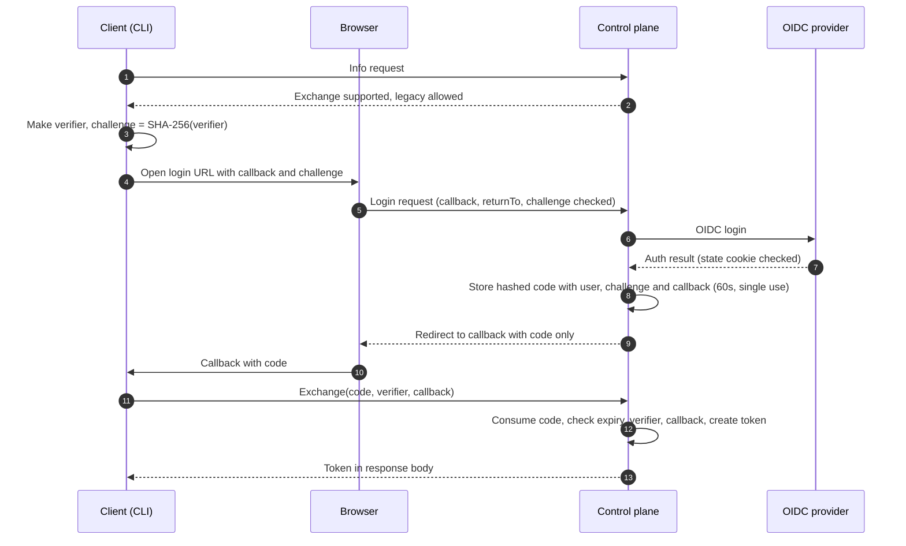

<!--
AGENT INSTRUCTIONS. Keep this comment. Read it before you change this file.

This spec records a design that humans reviewed and approved. Do not change it as part of other work. Find the status of the parent ticket (the `ticket:` field) before you change anything. If you cannot find the status, or you are not sure which case below applies, do not change the spec. Ask the human first.

- Ticket in design, and the spec PR is open: change the spec only through the br:eng-spec skill (`--revise`). Never renumber or reuse an R-xxx or D-xxx ID.
- Ticket in progress: do not rewrite the requirements, the Proposal, or existing Decision Record rows. Record a changed decision as a new Decision Record row. The owner records the differences with the shipped work through br:eng-spec (`--done`).
- Ticket done or canceled: the spec is frozen. Do not change, delete, or strike through any text. The only allowed edits are typo fixes, broken links, and the "Superseded by" line under the title. For a design change, write a new spec with br:eng-spec that supersedes this one.

Do not answer an open question or a review comment on this spec by yourself. The answer is a design decision, and a human makes it. You can propose an answer and discuss it with a human. Change the spec or reply only after the human agrees.

When your code goes against this spec, say so in your PR. Do not edit the spec to match the code.
-->

# Spec issue-3626: Login code exchange instead of a token in the callback URL

## Summary

At the end of an OIDC login, the control plane sends the user session token to the client in the callback URL (`?t=<token>`). This spec replaces that with a short-lived, single-use handoff code. The client exchanges the code for the token at a new control plane endpoint. The code is bound to the client that started the login, with a PKCE-style challenge. The control plane also rejects a post-login redirect that is not a relative path. Old CLIs keep working. The control plane supports both methods first, and clients move to the code exchange next. Then the legacy `?t=` callback is turned off by default, and later deleted.

## Problem

- The session token travels in a URL. URLs go to browser history, to proxy and server logs, and to other places that must not hold credentials.
- The callback accepts any token. It does not check that the token comes from the login that this browser or CLI started. A person can start a login, take the callback link with their own token, and send it to a victim. The victim then works in the attacker's account (session fixation).
- The control plane checks the origin of the callback, but not the post-login redirect inside it (for example `returnTo`). That value can point to another site.

## Goals and Non-Goals

- Goal: a client that supports the exchange never receives the session token in a URL.
- Goal: a callback link that another person started cannot sign a user in.
- Goal: CLIs that are already installed keep logging in, unchanged, during the transition.
- Goal: operators can see legacy use and turn it off.
- Non-goal: change the token itself, its lifetime, or its revocation. A long-lived CLI token still lives seven days.
- Non-goal: change the headless CLI login. It shows the token on a page and never puts it in a URL.
- Non-goal: change the browser artifact download flow. See D-008.
- Non-goal: change any client other than the Chainloop CLI. Other clients, for example a web app that uses the login URL override, adopt the exchange in their own work.

## Requirements

### R-001: Code instead of token for opted-in logins
A login request can carry a code challenge and a callback. For that request, the control plane MUST redirect to the callback with a handoff code. It MUST NOT put the session token in the URL.
- Done when: the callback URL of an opted-in login has `code` and no token.

### R-002: Bound, short-lived, single-use code
A handoff code MUST expire 60 seconds after it is issued and MUST work only one time. The exchange MUST succeed only with the verifier that matches the challenge of the login, and with the same callback URL. A failed exchange MUST NOT tell which check failed.
- Done when: an exchange fails for a reused code, an expired code, a wrong verifier, and a different callback.

### R-003: Token only in the exchange response
The exchange endpoint MUST return the session token only in the response body. The endpoint MUST NOT need an existing session. The token MUST be the same token the legacy flow gives for the same login, with the same lifetime.

### R-004: Legacy callback unchanged while allowed
While the legacy callback is allowed, a login request with no code challenge MUST keep the current `?t=` behavior. The control plane MUST log and count each legacy delivery.
- Done when: a CLI released before this change logs in against the new control plane with no change.

### R-005: Capability discovery
The public info endpoint (the one that gives the login URL) MUST report that the control plane supports the code exchange. It MUST also report if the legacy callback is allowed.

### R-006: Operator switch for the legacy callback
An operator MUST be able to deny the legacy callback with a configuration setting. When legacy is denied, a login with a callback and no code challenge MUST fail. The error message MUST tell the user to upgrade the client. The headless login and the same-origin download flow (D-008) are not affected.

### R-007: CLI uses the exchange
The CLI login MUST use the code exchange when the control plane reports support. While the control plane reports that legacy is allowed, the CLI MUST accept a legacy `?t=` callback and print a deprecation warning. When the control plane reports that legacy is denied, the CLI MUST reject a `?t=` callback. Against an older control plane, the CLI MUST use the legacy flow.

### R-008: Relative-only post-login redirect
The control plane MUST reject a login whose callback carries a post-login redirect (`returnTo`) that is not a relative path on the same origin. A value MUST start with a single `/`. Absolute URLs, scheme-relative values (`//host`), and values with a backslash MUST fail.

## Constraints

- Public, self-hosted product: no new external dependency. The code store uses the existing database, so it works with more than one control plane replica.
- Backward compatibility: no released CLI may break before phase 3 (see Proposal).
- A deployment that sets the login URL override to its own login page must forward the new login parameters to the control plane. If it does not, the login falls back to the legacy callback (R-004, R-007).

## Proposal

**What the user sees.** Nothing changes for the user. `chainloop auth login` opens the browser as today. With an older CLI, or against an older control plane, the login works as today. During the transition, a new CLI that gets a legacy callback prints a warning.

**Login with the code exchange.**

1. The client makes a random verifier and keeps it (the CLI keeps it in memory). It opens the login URL with the callback, a challenge (`code_challenge`, the SHA-256 of the verifier), and `code_challenge_method=S256`.
2. The control plane does the OIDC login as today. It still checks the OIDC state cookie in the browser leg, and the callback against the allowed origins.
3. The control plane does not create the session token yet. It makes a random handoff code. It keeps a hash of the code in the database. The row also holds the user, the token lifetime, the challenge, and the callback URL. It has an expiry of 60 seconds and a "used" flag. It redirects to the callback with `?code=<handoff code>`.
4. The client sends the code, the verifier, and the callback URL to the new exchange endpoint. This is an unauthenticated RPC on the auth service, with an HTTP POST mapping for clients that do not use gRPC.
5. The control plane marks the code used in one atomic step, checks the expiry, the verifier against the challenge, and the callback. It then creates the session token and returns it in the response body. Any failure gives the same error.

Why this stops fixation: a person who starts a login gets a code that is bound to their own challenge. A victim who opens that callback link does not have the matching verifier, so the exchange fails. A code that leaks from a log is useless after 60 seconds, after one use, and without the verifier.

**Legacy and detection.** The control plane decides per request. A login with a challenge gets a code. A login without one gets the legacy `?t=` callback, which is logged and counted. The info endpoint reports "code exchange supported" and "legacy allowed". A new CLI sends a challenge only when the control plane reports support. So an old CLI works against a new control plane, and a new CLI works against an old control plane.

**Post-login redirect.** The login handler keeps its check of the callback origin. It also reads the `returnTo` value inside the callback and rejects the login when that value is not a single-slash relative path. The check runs at login start and again before the redirect.

**Rollout and deprecation.**

1. Phase 1, control plane release: the exchange endpoint, the code store, the info flags, and the `returnTo` check ship. Legacy is allowed by default. Nothing breaks.
2. Phase 1, CLI release: the CLI uses the exchange (R-007). Clients that use the login URL override forward the new parameters.
3. Phase 2, a later control plane release: the default changes to "legacy denied". Operators that still have old clients can allow it again with the setting. The release notes name the oldest CLI version that works.
4. Phase 3, deletion: the project deletes the legacy callback and the setting when both conditions are true. The oldest CLI version that the project supports uses the exchange. The legacy counter shows no use in the project's own deployments for one full release cycle.

## Decision Record

| ID | Decision | Choice | Why (and what we rejected) | Source |
|----|----------|--------|----------------------------|--------|
| D-001 | Token delivery | Single-use handoff code, exchanged by the client for the token | Takes the token out of the URL. Rejected: keep `?t=` and add checks (the token is still in the URL). Rejected: token in the URL fragment (still in history, and fixation stays). Rejected: a full OAuth server with refresh tokens (much larger change). | drafting |
| D-002 | Code binding | PKCE-style challenge (S256) from the client, plus the callback URL | Works for the CLI and for a browser app, and needs no cookie at exchange time. Rejected: bind to the callback URL only (a web app has a fixed callback, so fixation stays). Rejected: require the OIDC state cookie at exchange (the CLI and a cross-origin web app do not have it). | drafting |
| D-003 | Exchange endpoint | Unauthenticated RPC on the auth service with an HTTP POST mapping | The CLI already has a gRPC connection, and other clients use HTTP. Rejected: a plain HTTP handler next to the login and callback handlers (the CLI would need a second client). | drafting |
| D-004 | Code store | Database table with the code hash, the user, expiry, and an atomic consume. No token at rest: the token is created at exchange | Works with many replicas and enforces single use. Rejected: store the created token with the code (a token at rest in the database). Rejected: memory (fails with more than one replica). Rejected: a signed code with no store (cannot enforce single use). | drafting |
| D-005 | Detection | Opt-in per request with a challenge, plus flags on the info endpoint | Old CLIs need no change. A new CLI knows what to expect and can detect a downgrade. Rejected: opt-in with no flag (the CLI cannot tell a downgrade from an old server). Rejected: version check (fails with forks and development builds). | drafting |
| D-006 | Deprecation | Three phases: allowed by default, then denied by default with an operator setting, then deleted | Gives operators time and a measured deletion condition. Rejected: delete in a fixed release with no setting (no way out for slow upgrades). Rejected: setting only, with no default change (legacy never goes away). | drafting |
| D-007 | CLI with a legacy callback | Accept `?t=` with a warning while the server reports legacy allowed. Reject it when legacy is denied | A login page that does not forward the new parameters yet must not break login. The loopback listener has a random port and a short life, so the fixation risk is low. Rejected: reject `?t=` from the first CLI release. | drafting |
| D-008 | Browser artifact download flow | No change. It stays on the legacy callback and the legacy switch does not cover it | Its callback is a relative path on the control plane itself. The token it gets is not long-lived and expires after 10 seconds. A separate change can move it to the exchange. | drafting |
| D-009 | Headless login and code life | Headless login does not change. The code lives 60 seconds | The headless page never puts the token in a URL. 60 seconds is enough for a browser redirect. | drafting |
| D-010 | Post-login redirect | The control plane checks `returnTo` inside the callback and accepts only a single-slash relative path | Closes the open redirect at the server, where the client cannot skip it. The callback origin check stays. Rejected: leave it to each client. | drafting |

## Open Questions

None.

## Risks

| Risk | Mitigation |
|------|------------|
| A deployment with its own login page does not forward the new parameters | The login falls back to the legacy callback during phases 1 and 2. The CLI warns. The legacy counter shows the gap before phase 2. |
| Phase 2 breaks users who still run old CLIs | Operators can allow legacy again with the setting. The release notes name the oldest working CLI. The counter shows the remaining use. |
| A code is used two times in a race | The consume is one atomic database step. Only one request can mark the code used. |
| Old codes fill the table | Expired and used codes are deleted on a schedule. |
| A database leak exposes sessions | The code row holds no token, only a hash of the code. The control plane creates the token at exchange time. |
