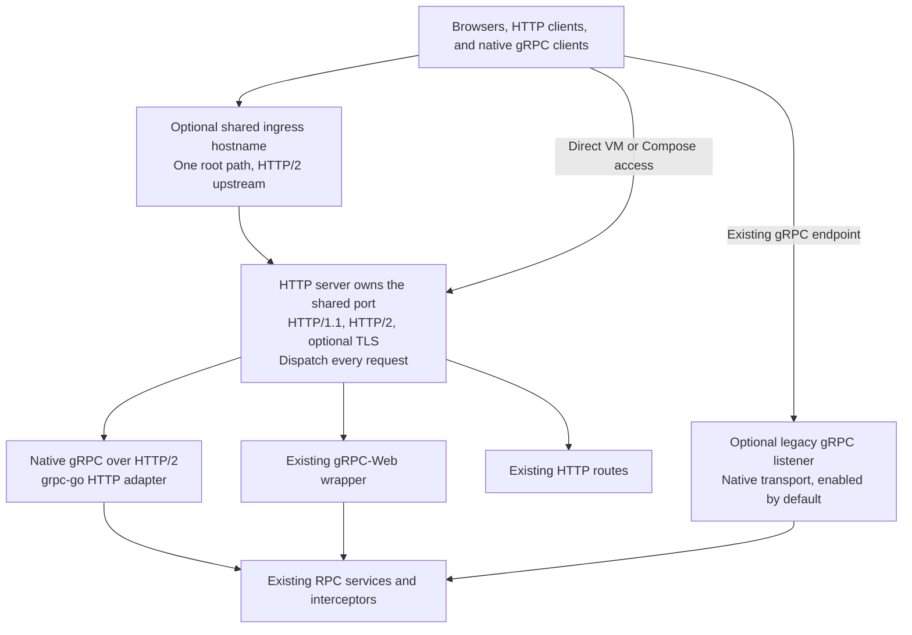

<!--
AGENT INSTRUCTIONS. Keep this comment. Read it before you change this file.

This spec records a design that humans reviewed and approved. Do not change it as part of other work. Find the status of the parent ticket (the `ticket:` field) before you change anything. If you cannot find the status, or you are not sure which case below applies, do not change the spec. Ask the human first.

- Ticket in design, and the spec PR is open: change the spec only through the br:eng-spec skill (`--revise`). The spec shows only the current design. Delete a dropped requirement, do not strike it through, and record why in a Decision Record entry that names its ID. Never renumber or reuse an R-xxx or D-xxx ID.
- Ticket in progress: never rewrite or delete existing text. When the build changes a requirement or a decision, supersede it in the implementation PR. Add an entry with the next free ID that starts "Supersedes D-xxx." (or R-xxx). Strike through the heading and text of the old entry, and add "Superseded by D-yyy." under its heading. Name both IDs in the PR body. When the Summary, the Problem, or the main flow becomes wrong, it is a redesign: stop, and ask the human for a new spec. The owner records other differences with the shipped work through br:eng-spec (`--done`).
- Ticket done or canceled: the spec is frozen. Do not change, delete, or strike through any text. The only allowed edits are typo fixes, broken links, and the "Superseded by" line under the title. For a design change, write a new spec with br:eng-spec that supersedes this one.

When you review this spec, or before you add scope to it, check three things. No requirement contradicts another requirement, a Non-Goal, a Constraint, or a Decision Record entry. The most important requirements come first. The spec solves one problem: when a part can ship or be decided on its own, propose a separate spec instead of extending this one. Report each issue to the human. Do not fix it by yourself.

Do not answer an open question or a review comment on this spec by yourself. The answer is a design decision, and a human makes it. You can propose an answer and discuss it with a human. Change the spec or reply only after the human agrees.

When your code goes against this spec, say so in your PR, and supersede the entry when the ticket is in progress.
-->

# Spec issue-3628-controlplane-http-dispatch: One control-plane ingress for HTTP and gRPC

## Summary

This spec replaces the control-plane design in [Spec issue-3628-single-endpoint](issue-3628-single-endpoint.md).
The HTTP server owns the shared endpoint and routes every request to the existing HTTP, gRPC-Web, or gRPC handlers.
HTTP and gRPC requests can share one HTTP/2 connection in either order.
The chart enables HTTP/2 upstream traffic on the existing HTTP ingress, while the legacy gRPC endpoint remains available.
CAS transport changes remain separate work under the parent ticket.

## Problem

Connection classification assigns an entire connection to one server.
A proxy can later reuse that connection for a different request type.
If the first request selects the native gRPC server, later HTTP or gRPC-Web requests fail.
Path rules cannot separate native gRPC from gRPC-Web because both use the same RPC paths.
Operators need one control-plane hostname that serves existing browser and native gRPC clients.

## Goals and Non-Goals

- Goal: HTTP, gRPC-Web, and native gRPC work through one control-plane ingress hostname.
- Goal: the same endpoint works directly on VMs, in Compose, and in Kubernetes.
- Goal: existing clients keep their endpoints during migration.
- Non-goal: migrate the service or clients to Connect, or add the Connect protocol.
- Non-goal: change the CAS listeners, ingress, or ByteStream transport in this change.
  CAS still requires bounded memory and the performance evidence from the original R-003.
- Non-goal: retire the legacy gRPC endpoint or change client defaults.

## Requirements

### R-001: Shared control-plane endpoint
The control plane MUST serve native gRPC, gRPC-Web, HTTP/1.1, and HTTP/2 on its current HTTP endpoint.
- Done when: each request type works directly with plaintext or TLS, and through the shared NGINX ingress path.
- Done when: one HTTP/2 connection serves native gRPC followed by HTTP, gRPC-Web, and CORS preflight, without a reconnect.
  The reverse order also works.

### R-002: Existing behavior
The shared endpoint MUST retain the existing authentication, authorization, validation, status, tracing, and metrics behavior.
- Done when: the authentication matrix in the original R-002 passes through the shared and legacy gRPC endpoints.
- Focused protocol tests do not establish full alignment with this requirement.

### R-003: Existing endpoints remain available
The legacy gRPC endpoint MUST remain enabled by default, with its own TLS settings and the existing disable flag.
The CAS endpoints MUST retain their current behavior.
- Done when: an upgrade needs no client endpoint changes, and clients can test the shared control-plane hostname separately.

### R-004: Shared ingress
The chart MUST support one control-plane ingress path for HTTP, gRPC-Web, and native gRPC, with HTTP/2 upstream traffic.
- Done when: the NGINX and Traefik protocol settings target the HTTP service, while legacy ingress settings remain independent.
- Done when: ordinary HTTP clients still receive their existing responses through that ingress.

## Constraints

- Keep the existing generated gRPC services, interceptors, HTTP routes, and gRPC-Web wrapper.
- Keep metrics and profiler listeners separate from the public endpoint.
- A proxy must preserve HTTP/2 upstream for native gRPC, even when a browser uses HTTP/1.1 at the edge.
- Do not claim CAS streaming parity from control-plane tests or a transport microbenchmark.

## Proposal

Operators enable the existing HTTP ingress to expose all control-plane protocols on one hostname.
Existing gRPC clients can continue to use the legacy hostname.
A client can test the shared hostname without changing other clients.

The HTTP server handles connection setup, optional TLS, HTTP/2 settings, and stream ownership.
For every request, it selects the native gRPC handler, the existing gRPC-Web wrapper, or an existing HTTP route.
A native gRPC request requires HTTP/2 and a native gRPC content type.
The native gRPC handler uses grpc-go's HTTP adapter and the existing services and interceptors.
The service contains no connection classifier, frame replay, or injected settings exchange.
On shutdown, the HTTP server drains requests before the gRPC handler stops.

The ingress sends every request on its root path to the shared HTTP service over HTTP/2.
NGINX uses its gRPC upstream setting for that path.
Traefik uses its unencrypted HTTP/2 upstream setting for the service.
F5 NGINX and NGINX Plus use their gRPC service and HTTP/2 settings.
Controller versions can require additional configuration, so the chart documentation states those prerequisites.
TLS between the ingress and the pod requires the controller's encrypted HTTP/2 settings.

## Decision Record

### D-001: HTTP owns the control-plane connection
This replaces the control-plane parts of the original D-014, D-015, and D-016.
The service routes each request through the HTTP server, including all native gRPC requests on the shared endpoint.
- Why: proxies can reuse upstream connections without depending on the first request's protocol.
  The standard HTTP server owns all HTTP/2 framing and settings.
- Alternatives considered:
  - cmux with a native gRPC fast path: requires separate upstream pools and retains custom handshake code.
  - A proxy sidecar: adds a process that this control-plane dispatch does not need.
  - Full Connect migration: changes generated service interfaces and middleware for a larger scope.
- Source: [implementation and design discussion](https://github.com/chainloop-dev/chainloop/pull/3647).

### D-002: One ingress path with HTTP/2 upstream
This replaces the control-plane ingress design in the original D-004.
The shared ingress sends all requests to the HTTP service, without path or content-type splits.
The chart keeps the separate legacy gRPC ingress and its hostname.
- Why: per-request dispatch supports all request types on the same upstream connection.
- Alternatives considered:
  - Split RPC paths: native gRPC and gRPC-Web share those paths.
  - Switch existing clients to the shared hostname: optional client testing does not require a coordinated migration.
- Source: [ingress reproduction and research](https://github.com/chainloop-dev/chainloop/pull/3647#issuecomment-6272007730).

### D-003: Defer CAS transport selection
CAS keeps its current native gRPC transport and separate endpoints.
The original CAS requirements remain open under the parent ticket.
- Why: a paused-reader probe showed that the HTTP adapter can read ahead beyond the application's receive pace.
  That result prevents an unqualified claim of bounded memory for ByteStream uploads.
- Alternatives considered:
  - Apply the control-plane design to CAS now: lacks the original R-003 benchmark and bounded-memory evidence.
- Source: [implementation and design discussion](https://github.com/chainloop-dev/chainloop/pull/3647).

## Open Questions

None for this control-plane change. CAS transport selection remains separate work under the parent ticket.

## Milestones

1. **Shared server and ingress.** The control plane dispatches every request and the chart exposes the shared hostname.
2. **Behavior qualification.** The full authentication matrix passes, and deployed controller tests check the documented configurations.

## Risks

| Risk | Mitigation |
|------|------------|
| The HTTP adapter differs from the native gRPC transport in performance or features. | Retain the legacy endpoint. Measure relevant workloads before client migration. Keep CAS on its current transport. |
| A controller uses HTTP/1.1 upstream or needs extra HTTP/2 settings. | Supply protocol annotations and document prerequisites. Test deployed controller versions before production use. |
| Focused tests miss authentication or authorization differences. | Keep the full original R-002 matrix as a qualification requirement. |
