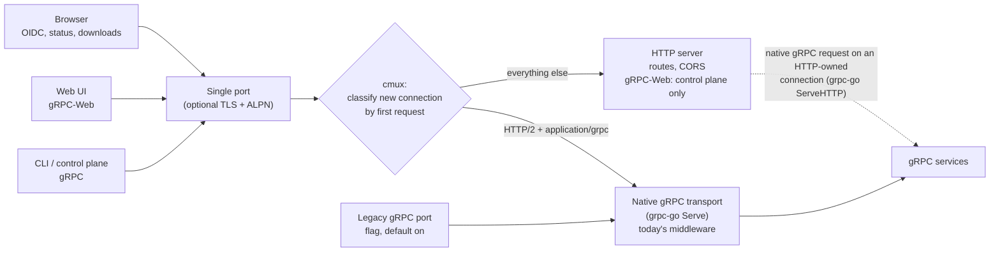

<!--
AGENT INSTRUCTIONS. Keep this comment. Read it before you change this file.

This spec records a design that humans reviewed and approved. Do not change it as part of other work. Find the status of the parent ticket (the `ticket:` field) before you change anything. If you cannot find the status, or you are not sure which case below applies, do not change the spec. Ask the human first.

- Ticket in design, and the spec PR is open: change the spec only through the br:eng-spec skill (`--revise`). The spec shows only the current design. Delete a dropped requirement, do not strike it through, and record why in a Decision Record entry that names its ID. Never renumber or reuse an R-xxx or D-xxx ID.
- Ticket in progress: never rewrite or delete existing text. When the build changes a requirement or a decision, supersede it in the implementation PR. Add an entry with the next free ID that starts "Supersedes D-xxx." (or R-xxx). Strike through the heading and text of the old entry, and add "Superseded by D-yyy." under its heading. Name both IDs in the PR body. When the Summary, the Problem, or the main flow becomes wrong, it is a redesign: stop, and ask the human for a new spec. The owner records other differences with the shipped work through br:eng-spec (`--done`).
- Ticket done or canceled: the spec is frozen. Do not change, delete, or strike through any text. The only allowed edits are typo fixes, broken links, and the "Superseded by" line under the title. For a design change, write a new spec with br:eng-spec that supersedes this one.

When you review this spec, or before you add scope to it, check three things. No requirement contradicts another requirement, a Non-Goal, a Constraint, or a Decision Record entry. The most important requirements come first. The spec solves one problem: when a part can ship or be decided on its own, propose a separate spec instead of extending this one. Report each issue to the human. Do not fix it by yourself.

Do not answer an open question or a review comment on this spec by yourself. The answer is a design decision, and a human makes it. You can propose an answer and discuss it with a human. Change the spec or reply only after the human agrees.

When your code goes against this spec, say so in your PR, and supersede the entry when the ticket is in progress.
-->

# Spec issue-3628: Serve gRPC and HTTP from one endpoint per service

Control-plane requirements and design superseded by [Spec issue-3628-controlplane-http-dispatch](issue-3628-controlplane-http-dispatch.md).
For the control plane, the requirements, constraints, proposal, diagram, decision records, milestones, and risks below are historical.
Use the replacement spec for all control-plane implementation and qualification.
Only CAS requirements remain in scope here.
The CAS transport decision is recorded below in D-017 and D-018.
CAS qualification remains open under the parent ticket.

## Summary

The control plane and the Artifact CAS will each serve gRPC and HTTP on one port. The control plane also serves gRPC-Web on it, as it does today. Today each service has a gRPC port and an HTTP port. An installation thus needs two Services, two ingresses, two hostnames, and two TLS settings per service. The service will accept all connections on its current HTTP port, the one that serves the human-facing hostname today. It will look at each new connection and give it to the gRPC server or to the HTTP server that runs today. The middleware, the authentication, and the native gRPC transport for large CAS streams do not change. The legacy gRPC port stays on by default for a deprecation period, behind a config flag. The Helm chart moves to one Service and one hostname per service.

## Problem

- Each service listens on two ports: gRPC on 9000 and HTTP on 8000 (9001 and 8001 for the CAS in local development). The Helm chart creates two Services, two ingresses, and two hostnames for each service. That is four ingresses and four hostnames for one installation.
- Operators must know which hostname carries which traffic:
  - The CLI and the control plane use gRPC to reach the CAS.
  - Browsers use HTTP for the OIDC login, the status endpoints, the referrer discovery, and the OpenAPI document.
  - The web UI uses gRPC-Web, which the control plane serves on its HTTP port.
  - CAS downloads in a browser use HTTP.
- TLS can only be set on the gRPC listener. The HTTP listener is always plain text, so operators must terminate TLS for HTTP somewhere else.
- An earlier attempt (#2642) solved this at the chart level and depended on Gateway API. The team closed it as stale. The problem stays.

## Goals and Non-Goals

- Goal: one port and one hostname per service, for all gRPC, gRPC-Web, and HTTP traffic.
- Goal: existing clients and configuration keep working without change during the deprecation period.
- Goal: large CAS uploads and downloads keep their current streaming behavior and throughput.
- Non-goal: move the services to another RPC framework (for example Connect). The single port does not need it (see D-013).
- Non-goal: merge the Prometheus metrics port or the profiler port into the single port. These ports are internal and must not be on the public hostname (see D-006).
- Non-goal: add Gateway API resources to the Helm chart. It is a separate chart feature, and the single port works without it (see D-004).
- Non-goal: change the CLI's default endpoints or its configuration format. The CLI holds hostnames on the ingress port, so it needs no change (see R-005).
- Non-goal: replace the gRPC-Web library of the control plane or change its origin policy. The single port keeps the current gRPC-Web wrapper with no change. Follow-up: a separate ticket covers the library replacement and a security review of its origin policy.

## Requirements

### ~~R-001: One port serves all protocols~~
Superseded by R-009 for the CAS. The control-plane scope moved to [the replacement spec](issue-3628-controlplane-http-dispatch.md).

~~On its single port, each service MUST serve gRPC (HTTP/2) and plain HTTP (HTTP/1.1 and HTTP/2). The control plane MUST also serve gRPC-Web. The CAS has no gRPC-Web today and does not get it (see D-011). This includes every endpoint that the gRPC port and the HTTP port serve today.~~
- ~~Done when: these clients work against only the single port:~~
  - ~~the CLI and the web UI~~
  - ~~the OIDC login and the status probes~~
  - ~~the referrer discovery and the OpenAPI document~~
  - ~~CAS browser downloads~~
- ~~Done when: the same checks pass through nginx ingress and through Traefik ingress.~~

### R-009: CAS shared endpoint protocol scope
Supersedes R-001 for the CAS. On its single port, the CAS MUST serve native gRPC over HTTP/2 and plain HTTP over HTTP/1.1, through cmux connection classification with the native gRPC transport (D-017). Plain HTTP/2 other than native gRPC is not supported on the CAS shared port: the gRPC matcher's SETTINGS injection breaks such a connection once it falls through to the HTTP server. Plain HTTP/2 and mixed connections remain control-plane scope under the replacement spec.
- Done when: focused tests cover native gRPC over h2c and TLS, HTTP/1.1 downloads, the status endpoints, and the CORS preflight through the shared port.
- Done when: the chart routes the gRPC paths and the HTTP paths into separate upstream pools, with HTTP/1.1 for the HTTP routes (D-018).
- Done when: browser downloads through a configured ingress work, and the documentation states that a browser downloading directly from a TLS-configured shared port is not a supported deployment.

### R-005: Existing configuration keeps working
An installation that does not change its configuration MUST keep working during the deprecation period. The legacy gRPC port keeps serving gRPC at its current address during that period. CLI configurations that use ingress hostnames keep working when the ingress backend moves to the single port. The control plane connection to the CAS, and any other client that uses the legacy gRPC address, MUST move to the single HTTP address before the legacy gRPC port is disabled.
- Done when: the release notes name this migration step for the CAS connection and for direct gRPC clients.

### R-002: Same behavior as today
A request on the single port MUST get the same result as the same request gets today on the separate ports. This covers authentication, authorization, validation, logging, tracing, and metrics.
- Done when: server-level tests send the same calls through the single port and get the same result as today. The calls cover:
  - no token, a user token, an API token, and a robot account or attestation token
  - CAS uploader and downloader tokens on streams and on the download endpoint
  - a validation error and a suspended organization
  - a gRPC-Web call to the control plane

  These tests merge before the listener change, so that they first record the current behavior. After the change, the gRPC calls also run against the legacy gRPC port.

### R-003: CAS streaming parity
Through the single port, CAS uploads and downloads MUST stream with bounded memory. Their throughput MUST stay within 10% of the current release for the same artifact.
- Done when: a benchmark uploads and downloads a 1 GB artifact through the single port and through the current release. The implementation PR records the results.

### R-004: One TLS setting per service
When the operator configures TLS for a service, the single port MUST serve gRPC, gRPC-Web, and HTTP over that TLS configuration. It MUST negotiate HTTP/2 and HTTP/1.1.

### R-006: Legacy gRPC port behind a flag
A configuration flag MUST control the legacy gRPC port. During the deprecation period the flag MUST default to on. When the flag is off, the service MUST listen only on the single port, plus the internal metrics and profiler ports. When the legacy gRPC port is on, the service SHOULD log a deprecation warning at startup.

### R-007: Health checks on the single port
The HTTP status endpoint (`/statusz`, including readiness) and the standard gRPC health service MUST be available on the single port.

### R-008: One Service and one hostname in the Helm chart
The Helm chart MUST create one Service and one external hostname per service. Probes MUST target the single port. The install notes and the CAS download URL MUST use the single hostname. While the legacy flag is on, the chart MAY keep the legacy gRPC port on the Service.
- Done when: a default install with nginx ingress serves the CLI, the web UI, and CAS downloads through one hostname per service.

## Constraints

- Public, open-source repository: the design must work with common ingress controllers and with no chart-level proxy.
- Backward compatibility for one deprecation period: no client, CLI configuration, or chart value may break on upgrade.
- The CAS spills uploads to disk and sends staged downloads with the kernel copy path. The design must keep both.

## Proposal

### What the operator sees

After the upgrade, nothing changes for the operator. The HTTP port now also answers native gRPC, and the legacy gRPC port still works. The operator points one hostname at the HTTP port of each service. Before the operator sets the legacy flag to off, the operator moves the control plane connection to the CAS, and any other client that uses the gRPC address directly, to the single HTTP address. Then the operator sets the flag to off, and the gRPC port closes. In a later release the flag defaults to off. A release after that deletes the legacy gRPC port.

### How the single port works

Each service opens one listener on its current HTTP address. The cmux connection multiplexer reads the start of each new connection, without consuming it. A service-owned matcher decides from the first request:

- An HTTP/2 connection whose first request has a content type that starts with `application/grpc` goes to the native gRPC server. This includes `application/grpc+proto` and content types with parameters. gRPC-Web (`application/grpc-web`) is not in this family and stays on the HTTP server. This server is the same one that runs today, with its middleware, interceptors, message size limits, and streaming transport.
- All other connections go to the HTTP server that runs today. These are HTTP/1.1, HTTP/2 without gRPC, and gRPC-Web. The HTTP server keeps its routes and its middleware. In the control plane it also keeps the gRPC-Web wrapper. In the CAS it keeps the CORS rules for browser downloads. The CAS has no gRPC-Web wrapper, and this spec does not add one.

Both servers keep their own lifecycle. They read from the classifier instead of from their own port. When the operator configures TLS, the listener terminates TLS before the classifier, and it offers HTTP/2 and HTTP/1.1 through ALPN. One certificate then covers all protocols.

The classifier speaks only when a connection stays silent. gRPC clients wait for the server's HTTP/2 settings frame before they send their first request, so after a short grace the classifier sends one. From that moment the connection belongs to the gRPC server: the client's answer to that frame would break the HTTP server's HTTP/2 framing. The classifier closes the connection when its first request is not native gRPC. Clients that send their first request without waiting never see a write.

The classifier decides once per connection, from its first request. A connection that starts with gRPC carries only gRPC: the native gRPC server cannot serve a later plain HTTP request on it. The other direction works. When a gRPC request arrives on a connection that the HTTP server owns, the HTTP server gives it to the gRPC server. The gRPC-Web wrapper already works in this way. The request gets the right result through the HTTP adapter of the gRPC server. That adapter is a separate transport. Its performance and features may differ from the native one (D-013).

Thus the single port supports clients and proxies that keep gRPC and plain HTTP on separate HTTP/2 connections. These include direct clients such as the CLI, nginx ingress, and Traefik with HTTP/1.1 for the HTTP path. A proxy that sends both on one shared upstream connection is not supported (see D-014).

CAS streams on the single port use the same native gRPC transport as today, so uploads keep their disk spill and their throughput (R-003). Browser downloads stay on HTTP/1.1 through the ingress, so the kernel copy path stays.

### Configuration

The current HTTP address becomes the single port. It gets its own TLS settings, which apply to all protocols. The existing gRPC TLS settings stay with the legacy gRPC listener. A new flag in the server configuration controls the legacy gRPC listener, which keeps its current address. The Helm chart exposes the same flag as a value for each service.

### Helm chart

- One Service per service. It exposes the single port, plus the legacy gRPC port while the flag is on.
- One hostname per service. Controllers that can speak HTTP/2 without TLS to the backend use one Ingress. nginx sets the backend protocol per Ingress object. For nginx, the chart renders a second Ingress on the same hostname. It routes the gRPC service path prefixes with the gRPC backend protocol. The body size settings that the CAS needs today move with it.
- These items use the single port and hostname:
  - the probes and the install notes
  - the CLI `config save` hint
  - the control plane connection to the CAS
  - the CAS download URL
- The current split values (the second Service and the second ingress) keep working during the deprecation period. The chart documentation marks them as deprecated.

## Decision Record

### ~~D-001: How to serve both protocols on one port~~
Superseded by D-013.

~~The service splits by connection in front of the current gRPC and HTTP servers.~~
- ~~Why: it keeps the whole middleware chain and the native gRPC transport for CAS streams, and it needs the smallest change.~~
- ~~Alternatives considered:~~
  - ~~One HTTP handler that routes each request: gRPC calls then use the HTTP adapter of the gRPC server. The gRPC library documents that path as slower and with fewer features. That puts R-003 at risk.~~
  - ~~A move to Connect: it replaces every middleware and route, which is a large migration for the same result.~~
- ~~Source: drafting~~

### D-003: Deprecation default
The legacy gRPC port is on by default, then off by default, then deleted.
- Why: no upgrade breaks, and operators move when they are ready.
- Alternatives considered:
  - Legacy gRPC port opt-in from the first release: it breaks clients that connect to that port directly.
- Source: drafting

### D-004: Ingress shape
The chart uses one Service and one hostname per service. Only where the controller needs it, the chart splits paths into two Ingress objects on the same host.
- Why: nginx sets the backend protocol per Ingress object, so one object cannot carry both protocols.
- Alternatives considered:
  - One Ingress only: it excludes nginx, the most common controller.
  - Add Gateway API in this work: it is a separate feature.
- Source: drafting

### ~~D-005: Solve in the server or in the chart~~
Superseded by D-015.

~~The services solve it in the server.~~
- ~~Why: it works with any ingress, any proxy, and outside Kubernetes.~~
- ~~Alternatives considered:~~
  - ~~A chart-level proxy or Gateway API routes (#2642): they need extra infrastructure and leave two ports in the service.~~
- ~~Source: drafting~~

### D-006: Metrics and profiler ports
The metrics and profiler ports stay separate.
- Why: they are internal and must not be on the public hostname.
- Source: drafting

### D-007: Length of the deprecation period
The legacy gRPC port defaults to off three months after the single port ships. A release three months after that deletes it. The release notes announce each step.
- Why: operators get two release windows to move their ingress and probes.
- Alternatives considered:
  - Wait for a major release: the two-port cost stays for too long.
- Source: drafting

### D-008: TLS on the single port
When the operator configures TLS, all protocols on the single port use it. An HTTP ingress must use an HTTPS backend. The legacy gRPC port keeps its own TLS settings during the deprecation period.
- Why: one certificate and one setting per service is the goal of this work.
- Alternatives considered:
  - Accept plain text and TLS on the same port: it adds a second classification step and weakens the TLS setting.
- Source: drafting

### D-009: Helm chart in the same spec
The Helm chart change stays in this spec, as milestone 2.
- Why: the goal is one port and one hostname per service. The chart gives operators the single hostname.
- Alternatives considered:
  - A separate spec for the chart: the server change alone does not delete the second hostname.
- Source: drafting

### ~~D-010: Proxies that share one connection for gRPC and HTTP~~
Superseded by D-014.

~~The single port routes each connection once. It supports only clients and proxies that keep gRPC and plain HTTP on separate HTTP/2 connections.~~
- ~~Why: a connection that the native gRPC server owns cannot pass single requests to the HTTP server. Native gRPC transport for CAS streams (R-003) needs the connection split of D-001.~~
- ~~Alternatives considered:~~
  - ~~Route each request on one HTTP/2 server: it supports every proxy. But all gRPC calls then use the slower HTTP adapter of the gRPC server, which puts R-003 at risk.~~
- ~~Source: [cubic review](https://github.com/chainloop-dev/chainloop/pull/3629#discussion_r4286475927)~~

### D-011: gRPC-Web only on the control plane
The single port serves gRPC-Web on the control plane only. The CAS serves gRPC and HTTP.
- Why: the CAS has no gRPC-Web today, and no CAS client needs it. A CAS adapter would be a new feature with its own streaming, authentication, and CORS design, and this spec is about one port per service.
- Alternatives considered:
  - Add a gRPC-Web adapter to the CAS: it adds scope that can ship on its own. A separate spec can cover it if a client needs it.
- Source: [cubic review](https://github.com/chainloop-dev/chainloop/pull/3629#discussion_r4307471522)

### D-012: The current HTTP port is the single endpoint
Drops D-002. The current HTTP port becomes the single port, not the gRPC port. The legacy listener is the gRPC port.
- Why: the human-facing hostname, with the status, download, and login endpoints, is already on the HTTP port. It becomes the one endpoint, with one URL, one certificate, and one TLS setting.
- Why: clients that use ingress hostnames do not break in either direction. During the deprecation period the legacy gRPC port keeps serving. After it closes, the gRPC ingress changes only its backend port. Direct clients, such as the control plane connection to the CAS, move to the single HTTP address (see R-005).
- Why: the ingress and chart work is the same size in both variants, so it does not decide the question.
- Cost: TLS settings move to the HTTP port, and the deprecation window applies to the gRPC port.
- Alternatives considered:
  - The gRPC port (the dropped D-002): it keeps TLS settings in place, but the human-facing hostname stays on a second port.
  - A new port: every client changes.
- Source: [PR comment](https://github.com/chainloop-dev/chainloop/pull/3629#issuecomment-6253559302)

### ~~D-013: How to serve both protocols on one port~~
Superseded by D-016.

~~Supersedes D-001. The service splits by connection in front of the current gRPC and HTTP servers, with the cmux library as the connection classifier. The library owns the connection buffering and the listener plumbing. The service owns only a small matcher and the HTTP request dispatcher. The matcher sends the server's HTTP/2 settings frame to clients that wait for it. It reads the first request's content type through the standard HTTP/2 library. The matcher closes the connection when its first request is not native gRPC. The dispatcher carries the gRPC-Web wrapper and the native-gRPC fallback.~~
- ~~Why: it keeps the whole middleware chain and the native gRPC transport for CAS streams. It also takes HTTP/2 parsing out of the code this project maintains. Argo CD and etcd run the same library split in production.~~
- ~~Why: the gRPC library documents that its HTTP adapter may differ in performance and features from the native transport. It does not document the adapter as slower, and this project has not measured a difference. The native transport stays the normal path for gRPC connections, so R-003 does not rest on the adapter.~~
- ~~Alternatives considered:~~
  - ~~The custom connection parser of the first implementation: it works, but the project then maintains its own HTTP/2 frame parsing, replay, and resource bounds.~~
  - ~~One HTTP handler that routes each request: every gRPC call, on every connection, then uses the HTTP adapter of the gRPC server.~~
  - ~~A move to Connect: it requires migrating the generated server interfaces and the interceptors. Ordinary HTTP routes can stay, but the migration is larger than the classifier swap for the same single port.~~
- ~~Source: [PR comment](https://github.com/chainloop-dev/chainloop/pull/3647#issuecomment-6266145446)~~

### D-014: Separate upstream connections, one-way fallback
Supersedes D-010. The single port routes each connection once. It supports clients and proxies that keep native gRPC and plain HTTP on separate upstream HTTP/2 connections. Supported ingress configurations use separate upstream pools for the two kinds of traffic. The chart documents and tests them for nginx and Traefik. A connection that the HTTP server owns may carry a native gRPC request later. The HTTP server then gives the request to the gRPC server through the documented fallback, on the adapter transport. The reverse is not supported: a connection that the native gRPC server owns cannot carry a plain HTTP request. Arbitrary mixed native-gRPC and plain-HTTP requests on one shared upstream connection are not required.
- Why: direct clients keep native gRPC and plain HTTP on separate transports, and no measured traffic for this product shows mixed upstream connections. The fallback keeps the HTTP-first direction working, and the separate-pool contract keeps the native transport on the normal gRPC path.
- Alternatives considered:
  - Route each request on one HTTP/2 server: it supports every proxy. But every gRPC call then uses the HTTP adapter of the gRPC server, whose performance and features may differ (D-013).
- Source: [PR comment](https://github.com/chainloop-dev/chainloop/pull/3647#issuecomment-6266145446)

### D-015: Solve in the server, with tested proxy configurations
Supersedes D-005. The services solve the multiplexing in the server process. The single port runs directly on a VM, in Docker Compose, and in Kubernetes, with no proxy or sidecar. Behind an L7 proxy, the supported configurations keep native gRPC and plain HTTP on separate upstream connections (D-014). The chart tests and documents those configurations for nginx and Traefik.
- Why: no additional process, configuration, or lifecycle in any deployment. The earlier "any ingress, any proxy" claim was broader than any test covered. The separate-connection contract is the tested and documented support boundary.
- Alternatives considered:
  - A chart-level proxy or Gateway API routes (#2642): they need extra infrastructure and leave two ports in the service.
  - A mandatory sidecar or embedded proxy: it works behind more proxy configurations, but it adds a process and its lifecycle to every deployment.
- Source: [PR comment](https://github.com/chainloop-dev/chainloop/pull/3647#issuecomment-6266145446)

### ~~D-016: Complete the classifier's SETTINGS exchange before HTTP handoff~~
Superseded by D-017.

~~Supersedes D-013. The service keeps cmux connection classification, the native gRPC server, and the HTTP request dispatcher with its gRPC-Web wrapper and native-gRPC fallback. Both native gRPC and ordinary HTTP/2 clients may wait for server SETTINGS before their first request. Silence does not identify the protocol of that request.~~
- ~~The matcher uses the standard HTTP/2 framer and HPACK decoder. It limits incoming frames to the initial 16 KiB maximum before reading their payloads, as well as limiting classification bytes, time, and concurrency.~~
- ~~When the matcher sends an empty SETTINGS frame and the first request is HTTP, it waits within the classification bounds for that SETTINGS acknowledgement. It records the validated ACK's exact offset in cmux's replay. The HTTP listener removes only that nine-byte frame before the HTTP server reads the connection. The HTTP server owns all subsequent SETTINGS exchanges. An incomplete injected handshake is closed.~~
- ~~Native gRPC connections still go to the existing native server with their original replay. HTTP connections that did not need an injected SETTINGS frame also retain their original replay. HTTP requests and later streams are not parsed again by the handoff adapter.~~
- ~~Why: rejecting every non-gRPC request after the matcher sends SETTINGS also rejects valid HTTP-only clients. Forwarding the extra ACK unchanged makes net/http reject the connection after the client acknowledges the HTTP server's own SETTINGS. Removing the one ACK preserves its ownership without adding an ongoing frame parser.~~
- ~~Evidence: focused tests cover HTTP and gRPC-Web content types over plaintext and TLS, ACKs before and after the first request, subsequent requests on the same connection, incomplete handshakes, and an oversized frame header without its payload. These tests do not establish full R-002 parity or R-003 CAS performance.~~
- ~~Source: [implementation review](https://github.com/chainloop-dev/chainloop/pull/3647#pullrequestreview-5573391966).~~

### D-017: CAS shared endpoint: cmux with the native transport, and the corrected SETTINGS contract
Supersedes D-016 for the CAS endpoint. The control-plane parts of D-014 to D-016 were already superseded by [the replacement spec](issue-3628-controlplane-http-dispatch.md).

The CAS shared endpoint is `server.http.addr`. cmux reads the start of each new connection and hands the whole connection to one of the two existing transports: an HTTP/2 connection whose first request declares a native gRPC content type goes to the existing native gRPC listener (`grpc.Server.Serve`); every other connection goes to the existing HTTP server. ByteStream uploads and downloads therefore keep the grpc-go native transport, so R-003 does not rest on the HTTP adapter.
- Why not the merged control-plane design, per-request `ServeHTTP` dispatch: the [PR #3663 1 GiB comparison](https://github.com/chainloop-dev/chainloop/pull/3663) measured about 1.25 GiB of combined client/server sampled peak live heap for adapter uploads, against about 28 MiB for the native transport, and download throughput 11.8% lower, already past the R-003 limit. grpc-go's handler transport reads the HTTP body in a separate goroutine into an unbounded receive buffer, so read-ahead is not bounded by the application's pace. CAS moves gigabyte streams; the control plane does not. The two services keep different transport designs on purpose.
- Why D-016 is superseded: D-016 assumed a classifier this project owns, which records the SETTINGS ACK offset in its own replay and removes that frame before the HTTP server reads. The cmux library owns the sniffing buffer, so that removal does not exist. Two reproductions on the CAS branch fix the contract instead. First, without SETTINGS injection, direct grpc-go clients deadlock: they send their preface and SETTINGS and wait for the server's SETTINGS before their first HEADERS frame, while the matcher waits for headers to sniff. The gRPC matcher must use cmux's SETTINGS-writing matcher. Second, that matcher writes a SETTINGS frame on every HTTP/2 connection, matched or not, because every HTTP/2 client sends SETTINGS with its preface. A plain HTTP/2 client that falls through to the HTTP server acknowledges the injected SETTINGS frame, and net/http rejects the unsolicited acknowledgement (GOAWAY, PROTOCOL_ERROR).
- Contract: once the matcher has written to a connection, the connection belongs to the native gRPC server. The HTTP side of the shared endpoint supports HTTP/1.1 only; HTTP/2 reaches the CAS only as native gRPC. Supported proxies keep native gRPC and plain HTTP on separate upstream connections (D-014) and dial HTTP/1.1 for the HTTP routes (D-018).
- Source: [PR #3663](https://github.com/chainloop-dev/chainloop/pull/3663) experiment and benchmark, and the local reproductions on its branch.

### D-018: CAS chart: one hostname, path-split upstream pools, HTTP/1.1 for the HTTP routes
The chart exposes one CAS hostname and one public port, and splits the routes by protocol into separate upstream pools: the `/cas.v1.*` paths go to the gRPC pool with an HTTP/2 upstream (nginx `backend-protocol: GRPC` and `grpc-services`; the upload body-size annotations move with them), and `/download/*`, `/statusz`, and `/infoz` go to the HTTP pool, which dials HTTP/1.1, not h2c. One certificate terminates at the edge.
- Why the path split is exact for CAS: CAS has no gRPC-Web (D-011), so its gRPC paths and its HTTP paths are disjoint. No path can carry both protocols. The control plane could not use this split because native gRPC and gRPC-Web share RPC paths; the [PR #3647 NGINX reproduction](https://github.com/chainloop-dev/chainloop/pull/3647#issuecomment-6272007730) showed the path-only split failing there with 415 on gRPC-Web. CAS does not have that failure mode.
- Why HTTP/1.1 upstream on the HTTP pool: D-017. An HTTP/2 upstream for the HTTP routes triggers the matcher's SETTINGS injection, and the client's acknowledgement then breaks the HTTP server connection with GOAWAY.
- Controller notes: community nginx merges same-host paths from multiple Ingress resources and sets the backend protocol per resource, which expresses the split. F5 NGINX conflicts on unrelated same-host Ingresses; use its VirtualServer resource. Traefik applies the `service.serversscheme` annotation per Service, so one Service cannot be dialed h2c for the gRPC routes and HTTP/1.1 for the HTTP routes; the Traefik split needs a second Service for the HTTP routes or a controller-specific resource. The browser download endpoint stays on the HTTP routes: it is published API ([docs](https://docs.chainloop.dev/api-reference/downloadservice/download-artifacts-from-cas)), and CAS does not drop it.
- Source: chart changes on the [PR #3663](https://github.com/chainloop-dev/chainloop/pull/3663) branch.

## Open Questions

- [x] **Must the single port support proxies that share one upstream connection for gRPC and plain HTTP?** Examples: Envoy-based proxies, service meshes. Answered by D-014: not required. Setups that share one upstream pool can route gRPC to the legacy gRPC port during the deprecation period. The chart documents the supported nginx and Traefik configurations, which keep the two kinds of traffic on separate upstream connections. Source: [cubic review](https://github.com/chainloop-dev/chainloop/pull/3629#discussion_r4286475927).

D-007 and D-008 record the answers to the questions from drafting.

## Milestones

1. **Single port in the servers.** Both services serve all protocols on the HTTP port. The legacy gRPC flag exists and defaults to on. The CAS benchmark (R-003) passes.
2. **Helm chart.** One Service and one hostname per service. The split values are deprecated.
3. **Deprecation.** The flag defaults to off. A later release deletes the legacy gRPC port.

## Risks

| Risk | Mitigation |
|------|------------|
| A proxy shares one upstream connection between gRPC and HTTP requests, for example an Envoy-based proxy or a service mesh. A plain HTTP request then lands on a connection that the classifier gave to gRPC, and fails. | The chart configures nginx and Traefik to use separate upstream connections. The documentation lists the supported setups. The legacy gRPC port stays available during the deprecation period. |
| A gRPC client waits for the server's HTTP/2 settings frame before it sends its first request, so the matcher cannot read it. | After a short silence the matcher sends an empty settings frame. The connection then stays on the gRPC side, because the client's answer to that frame would break the HTTP server's HTTP/2 framing. The matcher closes the connection when its first request is not native gRPC. Clients that send their first request without waiting never see a write. |
| A slow or idle client holds a connection before the classifier decides. | Put a short read deadline on classification only, and clear it when the classifier hands over the connection. The matcher reads at most a small header budget per connection. The service caps how many connections may be in classification. Long CAS streams are not affected. |
| A middleware behaves differently on the single port, for example an authentication step that does not run. | The server-level tests in R-002 merge first and record the current behavior. The same tests then run against the single port. |
| CAS throughput drops on the single port. | The benchmark in R-003 runs before release. gRPC streams use the native transport, so the expected result is no change. |
