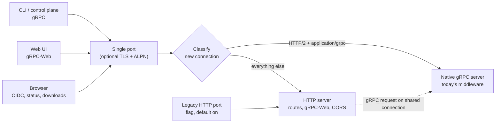

<!--
AGENT INSTRUCTIONS. Keep this comment. Read it before you change this file.

This spec records a design that humans reviewed and approved. Do not change it as part of other work. Find the status of the parent ticket (the `ticket:` field) before you change anything. If you cannot find the status, or you are not sure which case below applies, do not change the spec. Ask the human first.

- Ticket in design, and the spec PR is open: change the spec only through the br:eng-spec skill (`--revise`). Never renumber or reuse an R-xxx or D-xxx ID.
- Ticket in progress: do not rewrite the requirements, the Proposal, or existing Decision Record rows. Record a changed decision as a new Decision Record row. The owner records the differences with the shipped work through br:eng-spec (`--done`).
- Ticket done or canceled: the spec is frozen. Do not change, delete, or strike through any text. The only allowed edits are typo fixes, broken links, and the "Superseded by" line under the title. For a design change, write a new spec with br:eng-spec that supersedes this one.

Do not answer an open question or a review comment on this spec by yourself. The answer is a design decision, and a human makes it. You can propose an answer and discuss it with a human. Change the spec or reply only after the human agrees.

When your code goes against this spec, say so in your PR. Do not edit the spec to match the code.
-->

# Spec issue-3628: Serve gRPC and HTTP from one endpoint per service

## Summary

The control plane and the Artifact CAS will each serve gRPC, gRPC-Web, and HTTP on one port. Today each service has a gRPC port and an HTTP port. An installation thus needs two Services, two ingresses, two hostnames, and two TLS settings per service. The service will accept all connections on its current gRPC port. It will look at each new connection and give it to the gRPC server or to the HTTP server that runs today. The middleware, the authentication, and the native gRPC transport for large CAS streams do not change. The old HTTP port stays on by default for a deprecation period, behind a config flag. The Helm chart moves to one Service and one hostname per service.

## Problem

- Each service listens on two ports: gRPC on 9000 and HTTP on 8000 (9001 and 8001 for the CAS in local development). The Helm chart creates two Services, two ingresses, and two hostnames for each service. That is four ingresses and four hostnames for one installation.
- Operators must know which hostname carries which traffic:
  - The CLI and the control plane use gRPC to reach the CAS.
  - Browsers use HTTP for the OIDC login, the status endpoints, the referrer discovery, and the OpenAPI document.
  - The web UI uses gRPC-Web, which the control plane serves on its HTTP port.
  - CAS downloads in a browser use HTTP.
- TLS can only be set on the gRPC listener. The HTTP listener is always plain text, so operators must terminate TLS for HTTP somewhere else.
- An earlier attempt (#2642) solved this at the chart level and depended on Gateway API. The team closed it as stale. The problem stays.

## Goals and Non-Goals

- Goal: one port and one hostname per service, for all gRPC, gRPC-Web, and HTTP traffic.
- Goal: existing clients and configuration keep working without change during the deprecation period.
- Goal: large CAS uploads and downloads keep their current streaming behavior and throughput.
- Non-goal: move the services to another RPC framework (for example Connect).
- Non-goal: merge the Prometheus metrics port or the profiler port into the single port. These stay internal and separate.
- Non-goal: add Gateway API resources to the Helm chart.
- Non-goal: change the CLI's default endpoints or its configuration format.

## Requirements

### R-001: One port serves all protocols
On its single port, each service MUST serve gRPC (HTTP/2), gRPC-Web, and plain HTTP (HTTP/1.1 and HTTP/2). This includes every endpoint that the gRPC port and the HTTP port serve today.
- Done when: these clients work against only the single port:
  - the CLI and the web UI
  - the OIDC login and the status probes
  - the referrer discovery and the OpenAPI document
  - CAS browser downloads

### R-002: Same behavior on both paths
A request on the single port MUST get the same authentication, authorization, validation, logging, tracing, and metrics as the same request on the legacy port.
- Done when: server-level tests send the same calls through the single port and through the legacy port, and get the same result. The calls cover:
  - no token, a user token, an API token, and a robot account or attestation token
  - CAS uploader and downloader tokens on streams and on the download endpoint
  - a validation error and a suspended organization
  - a gRPC-Web call

  These tests merge before the listener change, so that they first record the current behavior.

### R-003: CAS streaming parity
Through the single port, CAS uploads and downloads MUST stream with bounded memory. Their throughput MUST stay within 10% of the legacy ports for the same artifact.
- Done when: a benchmark uploads and downloads a 1 GB artifact through the single port and through the legacy ports. The implementation PR records the results.

### R-004: One TLS setting per service
When the operator configures TLS for a service, the single port MUST serve gRPC, gRPC-Web, and HTTP over that TLS configuration. It MUST negotiate HTTP/2 and HTTP/1.1.

### R-005: Existing configuration keeps working
An installation that does not change its configuration MUST keep working after the upgrade. The single port MUST be the current gRPC address, so existing CLI configurations and the control plane connection to the CAS work as before.

### R-006: Legacy HTTP port behind a flag
A configuration flag MUST control the legacy HTTP port. During the deprecation period the flag MUST default to on. When the flag is off, the service MUST listen only on the single port, plus the internal metrics and profiler ports. When the legacy port is on, the service SHOULD log a deprecation warning at startup.

### R-007: Health checks on the single port
The HTTP status endpoint (`/statusz`, including readiness) and the standard gRPC health service MUST be available on the single port.

### R-008: One Service and one hostname in the Helm chart
The Helm chart MUST create one Service and one external hostname per service. Probes MUST target the single port. The install notes and the CAS download URL MUST use the single hostname. While the legacy flag is on, the chart MAY keep the legacy port on the Service.
- Done when: a default install with nginx ingress serves the CLI, the web UI, and CAS downloads through one hostname per service.

## Constraints

- Public, open-source repository: the design must work with common ingress controllers and with no chart-level proxy.
- Backward compatibility for one deprecation period: no client, CLI configuration, or chart value may break on upgrade.
- The CAS spills uploads to disk and sends staged downloads with the kernel copy path. The design must keep both.

## Proposal

### What the operator sees

After the upgrade, nothing changes for the operator. The gRPC port now also answers HTTP and gRPC-Web, and the old HTTP port still works. The operator points one hostname at the gRPC port of each service. When the operator is ready, the operator sets the legacy flag to off, and the HTTP port closes. In a later release the flag defaults to off. A release after that deletes the legacy port.

### How the single port works

Each service opens one listener on its current gRPC address. A small classifier reads the start of each new connection, without consuming it:

- An HTTP/2 connection whose first request has `content-type: application/grpc` goes to the native gRPC server. This server is the same one that runs today, with its middleware, interceptors, message size limits, and streaming transport.
- All other connections go to the HTTP server that runs today. These are HTTP/1.1, HTTP/2 without gRPC, and gRPC-Web. The HTTP server keeps its routes, its middleware, the gRPC-Web wrapper, and the CORS rules of the CAS.

Both servers keep their own lifecycle. They read from the classifier instead of from their own port. When the operator configures TLS, the listener terminates TLS before the classifier, and it offers HTTP/2 and HTTP/1.1 through ALPN. One certificate then covers all protocols.

Some proxies send gRPC and plain HTTP requests over one shared upstream connection. The classifier sees only the first request of such a connection. As a safety net, the HTTP server gives any gRPC request that it receives to the gRPC server. The gRPC-Web wrapper already works in this way. The request gets the right result but takes the slower path. The chart configures the supported ingress controllers so that they do not share connections (see Risks).

CAS streams on the single port use the same native gRPC transport as today, so uploads keep their disk spill and their throughput (R-003). Browser downloads stay on HTTP/1.1 through the ingress, so the kernel copy path stays.

### Configuration

The current gRPC address becomes the single port, and its TLS settings now apply to all protocols. A new flag in the server configuration controls the legacy HTTP listener, which keeps its current address. The Helm chart exposes the same flag as a value for each service.

### Helm chart

- One Service per service. It exposes the single port, plus the legacy port while the flag is on.
- One hostname per service. Controllers that can speak HTTP/2 without TLS to the backend use one Ingress. nginx sets the backend protocol per Ingress object. For nginx, the chart renders a second Ingress on the same hostname. It routes the gRPC service path prefixes with the gRPC backend protocol. The body size settings that the CAS needs today move with it.
- These items use the single port and hostname:
  - the probes and the install notes
  - the CLI `config save` hint
  - the control plane connection to the CAS
  - the CAS download URL
- The current split values (the second Service and the second ingress) keep working during the deprecation period. The chart documentation marks them as deprecated.

## Decision Record

| ID | Decision | Choice | Why (and what we rejected) | Source |
|----|----------|--------|----------------------------|--------|
| D-001 | How to serve both protocols on one port | Split by connection in front of the current gRPC and HTTP servers | Keeps the whole middleware chain and the native gRPC transport for CAS streams, and needs the smallest change. Rejected: one HTTP handler that gives each request to the HTTP adapter of the gRPC server. The gRPC library documents that path as slower and with fewer features, which puts R-003 at risk. Rejected: a move to Connect, because it replaces every middleware and route, which is a large migration for the same result. | drafting |
| D-002 | Which port becomes the single endpoint | The current gRPC port | CLI configurations, the control plane connection to the CAS, and the existing TLS settings keep working. Rejected: the HTTP port, because every gRPC client and address must change, and TLS must be added to it. Rejected: a new port, because every client changes. | drafting |
| D-003 | Deprecation default | Legacy HTTP port on by default, then off by default, then deleted | No upgrade breaks. Operators move when they are ready. Rejected: legacy port opt-in from the first release, because it breaks installations that send HTTP traffic to the old port. | drafting |
| D-004 | Ingress shape | One Service and one hostname. A path split into two Ingress objects on the same host only where the controller needs it | nginx sets the backend protocol per Ingress object, so one object cannot carry both. Rejected: one Ingress only, because it excludes nginx, the most common controller. Rejected: adding Gateway API in this work, because it is a separate feature. | drafting |
| D-005 | Solve in the server or in the chart | In the server | Works with any ingress, any proxy, and outside Kubernetes. Rejected: a chart-level proxy or Gateway API routes (#2642), because they need extra infrastructure and leave two ports in the service. | drafting |
| D-006 | Metrics and profiler ports | Stay separate | They are internal and must not be exposed on the public hostname. | drafting |
| D-007 | Length of the deprecation period | The legacy port defaults to off three months after the single port ships. A release three months after that deletes it. The release notes announce each step. | Gives operators two release windows to move their ingress and probes. Rejected: wait for a major release, because the two-port cost stays for too long. | drafting |
| D-008 | TLS on the single port | When the operator configures TLS, all protocols on the single port use it. An HTTP ingress must use an HTTPS backend. The legacy HTTP port stays plain text during the deprecation period. | One certificate and one setting per service is the goal of this work. Rejected: accept plain text and TLS on the same port, because it adds a second classification step and weakens the TLS setting. | drafting |

## Open Questions

None open. D-007 and D-008 record the answers to the questions from drafting.

## Milestones

1. **Single port in the servers.** Both services serve all protocols on the gRPC port. The legacy flag exists and defaults to on. The CAS benchmark (R-003) passes.
2. **Helm chart.** One Service and one hostname per service. The split values are deprecated.
3. **Deprecation.** The flag defaults to off. A later release deletes the legacy port.

## Risks

| Risk | Mitigation |
|------|------------|
| A proxy shares one upstream connection between gRPC and HTTP requests. A plain HTTP request then lands on a connection that the classifier gave to gRPC. | The chart routes gRPC and HTTP to separate backend protocols on nginx, and keeps HTTP/1.1 for the HTTP path on other controllers. Document the requirement. The HTTP server safety net handles the reverse case. |
| A gRPC client waits for the server before it sends anything, so the classifier cannot read the first request. | The classifier sends the server's HTTP/2 settings frame first when it sees an HTTP/2 preface, then reads the first request. |
| A slow or idle client holds a connection before the classifier decides. | Put a short read deadline on classification only, and clear it when the classifier hands over the connection. Long CAS streams are not affected. |
| A middleware behaves differently on the single port, for example an authentication step that does not run. | The server-level tests in R-002 merge first and record the current behavior. The same tests then run against the single port. |
| CAS throughput drops on the single port. | The benchmark in R-003 runs before release. gRPC streams use the native transport, so the expected result is no change. |
