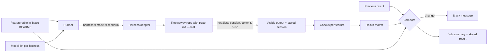

<!--
AGENT INSTRUCTIONS. Keep this comment. Read it before you change this file.

This spec records a design that humans reviewed and approved. Do not change it as part of other work. Find the status of the parent ticket (the `ticket:` field) before you change anything. If you cannot find the status, or you are not sure which case below applies, do not change the spec. Ask the human first.

- Ticket in design, and the spec PR is open: change the spec only through the br:eng-spec skill (`--revise`). Never renumber or reuse an R-xxx or D-xxx ID.
- Ticket in progress: never rewrite or delete existing text. When the build changes a requirement or a decision, supersede it in the implementation PR. Add an entry with the next free ID that starts "Supersedes D-xxx." (or R-xxx). Strike through the heading and text of the old entry, and add "Superseded by D-yyy." under its heading. Name both IDs in the PR body. When the Summary, the Problem, or the main flow becomes wrong, it is a redesign: stop, and ask the human for a new spec. The owner records other differences with the shipped work through br:eng-spec (`--done`).
- Ticket done or canceled: the spec is frozen. Do not change, delete, or strike through any text. The only allowed edits are typo fixes, broken links, and the "Superseded by" line under the title. For a design change, write a new spec with br:eng-spec that supersedes this one.

When you review this spec, or before you add scope to it, check three things. No requirement contradicts another requirement, a Non-Goal, a Constraint, or a Decision Record entry. The most important requirements come first. The spec solves one problem: when a part can ship or be decided on its own, propose a separate spec instead of extending this one. Report each issue to the human. Do not fix it by yourself.

Do not answer an open question or a review comment on this spec by yourself. The answer is a design decision, and a human makes it. You can propose an answer and discuss it with a human. Change the spec or reply only after the human agrees.

When your code goes against this spec, say so in your PR, and supersede the entry when the ticket is in progress.
-->

# Spec issue-3635: End-to-end test matrix for Chainloop Trace agents

## Summary

Chainloop Trace supports several coding agents ("harnesses"): Claude Code, Cursor, OpenCode, and soon Pi. The Trace README has a feature table that says which features each harness supports. No test checks this table against the real harnesses, and the table can miss features that Trace already has. This spec first reviews the table for completeness. Then it adds an end-to-end test suite. The suite runs each harness in headless mode with real models, in a throwaway repository with Trace in local storage mode. It checks each feature that the table marks as supported, and it builds a result matrix of harness, model, and feature. A nightly job compares the result with the previous run and posts a Slack message when a cell changes from green to red.

## Problem

- The feature table in the Trace README is written by hand. Nothing checks that it is true.
- The table is probably not complete. Some features that Trace implements have no row, so no harness column says whether they work.
- Harnesses release often. A harness upgrade can change hook behavior, and Trace can break without a code change in Chainloop. Examples: the welcome message stops showing, or a hook event stops firing. Today, the team cannot test a new harness version before it bumps it.
- Some features depend on the model. Spec capture works only when the model follows an instruction that Trace injects. A new model can follow the instruction less often, and no test sees this.
- Unit tests and golden tests check the Trace side only. They cannot show what the user sees in each harness.
- The team cannot answer simple questions with evidence, for example "does OpenCode show the welcome message?" or "does Cursor with model X capture specs?".
- New providers (Pi, and later others) need a clear, shared way to prove their column of the table.

## Goals and Non-Goals

- Goal: the feature table lists every user-visible and evidence feature that Trace implements.
- Goal: one command and one job produce a result matrix of harness, model, and feature from real harness runs.
- Goal: the team knows within one day when a supported feature stops working. The cause can be a Chainloop change, a model change, or a harness version bump.
- Goal: a new provider gets test coverage by adding a harness adapter and a column in the feature table.
- Non-goal: test features that the table marks "No" or "Not applicable". The team knows that these features are missing.
- Non-goal: test features that need a control plane, for example the session link after push or the attestation at push. The suite uses local storage mode only (D-007).
- Non-goal: run the suite on pull requests. Model API keys are not available to pull requests from forks, and the cost is too high for each change.
- Non-goal: replace the unit tests and golden tests of each provider. The suite adds a layer on top of them.
- Non-goal: test Codex or other agents with no Trace provider. A provider comes first, then its column.
- Non-goal: measure model quality in general. The suite checks only Trace features.

## Requirements

### R-001: Complete feature table
Before the suite uses it, the feature table in the Trace README MUST list each feature that Trace implements. This applies to each feature that a user or the evidence can observe. Each new row MUST have a value for each harness column. A value that nobody checked yet MUST be "Unknown", so the suite tests it (R-002).
- Done when: the team compared the table with the Trace commands, the hook behavior of each provider, and the Trace specs. The table has a row for each missing feature. The Appendix lists the first candidates.

### R-002: Expected matrix from the feature table
The suite MUST read the expected matrix from the feature table in the Trace README. It MUST test each cell marked "Yes", "Partial", or "Unknown". It MUST skip each cell marked "No" or "Not applicable", and report it as skipped. A cell whose feature needs a control plane MUST be reported as "not covered", with that reason (D-007). Each feature row MUST map to its registered checks by the feature name. A row can have no registered check. Then the suite MUST report each cell of that row as "no check", and the job MUST report it as a suite problem (R-008). The other rows still run.
- Done when: a change to a cell in the README changes which cells the next run tests, with no other edit.

### R-003: Real headless harness runs
The suite MUST run each harness in its headless mode with a real model. It MUST install a pinned version for each harness column. OpenCode 1.x and OpenCode 2 each have their own pinned version. It MUST run each harness with each model in a configured list for that harness. Each run MUST use a new throwaway git repository with Trace initialized in local storage mode. Each result MUST record the harness version, the model, and the Chainloop CLI version.

### R-004: Checks on what the user sees
For a feature the user sees, the suite MUST check the visible output of the harness, not only the hook output. Examples are the welcome message and the one-line notice after a spec capture. Sometimes the headless mode of a harness cannot show a feature that the interactive mode shows. Then the suite MUST report the cell as "not covered", not as failed.

### R-005: Checks on the stored session
For an evidence feature, the suite MUST check the session that Trace stores in local storage mode. Examples are the transcript, the token usage, the model, the line attribution, the skills, the captured spec sources, the secret redaction, and the commit trailer.

### R-006: Repeated runs for model-driven features
A cell for a feature that depends on the model following an instruction MUST run 3 times by default. The cell is green when at least 2 runs pass. The run count and the threshold MUST be configurable for each feature. The result MUST show the pass rate. A cell for a feature that does not depend on the model MUST run once.

### R-007: Change detection against the previous run
A scheduled run MUST compare its result with the expected matrix and with the result of the previous full scheduled run on the main branch. It MUST report a regression when a cell that passed in the previous run fails now. It MUST report an improvement when a cell marked "Unknown" passes, so the team can update the table. A cell that fails in two runs one after the other MUST NOT be reported a second time.

### R-008: Slack report
When a scheduled run finds a regression or an improvement, the job MUST post one Slack message. The message lists each changed cell with its harness, model, feature, harness version, and pass rate, and links the job run. When the suite cannot run at all, for example because a harness does not install, the job MUST post a different message that says so. A run with no change MUST NOT post a message.

### R-009: Schedule and manual runs
The job MUST run nightly on the main branch. It MUST also accept a manual start, with an optional filter by harness, model, or feature. Only a full scheduled run MUST update the stored previous result. A filtered manual run MUST NOT change it.

### R-010: Published result matrix
Each run SHOULD publish its full result matrix in the job summary, with one row per feature and one column per harness and model. Each cell shows pass, fail, skipped, or not covered, and the pass rate for model-driven cells.

### R-011: Shared scenarios across harnesses
A new harness SHOULD need only a harness adapter and a new column in the feature table. The scenarios and the checks are shared by all harnesses. Pi MUST be covered when its Trace provider ships.

## Constraints

- The repository is public. Model API keys and the Slack webhook are secrets of the repository. Only scheduled and manual runs on the main branch can read them. Logs and the published matrix MUST NOT show prompts or outputs that contain a secret.
- Each run costs model tokens. The configured model list and the run counts set the cost. The suite runs in parallel per harness and model, and has a time limit per scenario.
- Local storage mode only. No control plane, no organization, and no API token.
- The feature table stays readable for humans. The suite reads it as it is, and the table gets no column only for tests.

## Proposal

A maintainer opens the job summary of the last nightly run and sees the matrix. For example, the welcome message is green for Claude Code with two models and for OpenCode 2 with one model. The suite skips Cursor for that feature, because the table says "No". When something breaks, the team gets a Slack message that names the cell and links the run.

The suite has four parts.

1. **Expected matrix.** The suite reads the feature table in the Trace README. Each feature row maps to one or more checks. Each harness column maps to a harness adapter.
2. **Harness adapters.** One adapter for each harness. An adapter installs the pinned version, starts the harness in headless mode with a prompt and a model, and returns the visible output. The adapter is the only part that knows the harness. Trace itself is installed by `trace init --local` for that harness, as a user does it.
3. **Scenarios and checks.** A scenario is a scripted task in a throwaway repository. Examples: "edit a file, run a shell command, and commit", "work from the text of a pasted ticket", "use a skill". One session runs one scenario, and the checks for all the features that the scenario touches read its result. A check reads either the visible output of the harness (R-004) or the session in local storage (R-005). A push to a local bare remote starts the pre-push hook, and Trace stores the session.
4. **Runner and report.** The runner expands the expected matrix into the list of harness, model, and scenario runs. It repeats model-driven cells (R-006) and builds the result matrix. The nightly job downloads the previous result, compares it (R-007), publishes the new result, and posts to Slack (R-008).

## Decision Record

### D-001: Real harness runs in headless mode
The suite runs the real harness CLI in headless mode with a real model.
- Why: only a real run shows whether the harness fires the hooks, shows the message, and whether the model follows the instruction.
- Alternatives considered:
  - Replay recorded hook events into Trace: cheap and stable, but it cannot see the harness or the model.
  - Both tiers: the replay tier adds little over the unit tests that exist.
- Source: drafting

### D-002: The README feature table is the expected matrix
The suite reads the table in the Trace README. It does not keep a second list of expected results.
- Why: one place to keep up to date. The table already must change in the same PR as a provider change.
- Alternatives considered:
  - A separate data file that generates the table: two formats, and more tooling.
  - No expected matrix, compare with the last run only: a feature that never worked gives no signal.
- Source: drafting

### D-003: Report in Slack
Changes go to one Slack message for each run.
- Why: the team reads Slack every day, and one message per run keeps the noise low.
- Alternatives considered:
  - A GitHub issue for each regressed cell: public, and noisy for model flakiness.
  - A published matrix page only: nobody looks at it until there is a problem.
- Source: drafting

### D-004: 3 runs, 2 must pass, for model-driven cells
A model-driven cell runs 3 times by default and is green with at least 2 passes. Each feature can change the values.
- Why: one run is too noisy. "Retry until pass" hides a drop in reliability.
- Alternatives considered:
  - 5 runs, 4 must pass: better signal, about twice the cost.
  - Single run: cheapest, too many false alarms.
- Source: drafting

### D-005: A regression is a change from the previous full run
The job reports a cell when its state differs from the previous full scheduled run, and the table marks the cell for test. The previous result is stored as a job artifact of the main branch.
- Why: the team gets one message for each change, not one for each night that a cell stays red.
- Alternatives considered:
  - Expected matrix only: repeats the same alert each night.
  - Commit results to a branch: history in git, but the job needs write access and adds commits.
- Source: drafting

### ~~D-006: Latest harness release on each run~~
Superseded by D-013.

~~The suite installs the latest release of each harness and records the version.~~
- ~~Why: harness upgrades are the main cause of breakage that the team cannot see today.~~
- ~~Alternatives considered:~~
  - ~~Pinned versions: stable, but the suite misses upstream breakage until a manual bump.~~
  - ~~Pinned and latest: twice the cost.~~
- ~~Source: drafting~~

### D-007: Local storage mode only
The suite runs Trace in local storage mode and needs no control plane.
- Why: no test organization, no long-lived token in a public repository, and no dependency on a running service.
- Alternatives considered:
  - Local mode plus a test organization for control-plane cells: covers more cells, but adds a secret and a dependency.
  - A control plane started in the job: self-contained, but slow and more to maintain.
- Source: drafting

### D-008: Shared scenarios
One session runs one scenario and serves the checks of all the features it touches.
- Why: fewer model calls. The cost grows with scenarios, not with features.
- Alternatives considered:
  - One session for each feature: clearer failures, much higher cost.
- Source: drafting

### D-009: A configured model list for each harness
Each harness has a short list of models in the suite configuration, for example its default and one cheaper model.
- Why: a model change can break model-driven features. The list keeps the cost known.
- Alternatives considered:
  - The harness default only: a model change is invisible.
  - All models that a harness offers: too expensive.
- Source: drafting

### D-010: Pi is in scope
The first version includes a Pi adapter. Pi cells run when the Pi provider ships.
- Why: the suite is the way to show which Pi features work, and so to decide how the Pi provider fits.
- Source: drafting

### D-011: Nightly and manual runs only
The job runs nightly on main and on a manual start. It does not run on pull requests.
- Why: secrets are not available to pull requests from forks, and the cost per run is high.
- Alternatives considered:
  - A subset on pull requests that change Trace: does not work for forks.
- Source: drafting

### D-012: Review the feature table before the suite uses it
The table review is part of this spec and is the first milestone. A missing feature gets a row with "Unknown" cells, and the suite finds the real values.
- Why: the suite tests only what the table lists. A missing row is a feature that nobody tests.
- Alternatives considered:
  - A separate spec for the review: the review is small, and the suite depends on it.
- Source: drafting

### D-013: Pinned harness versions, bumped by hand
Supersedes D-006. The suite configuration pins one version for each harness column. A maintainer bumps a pin on purpose, and the next nightly run tests the new version.
- Why: the nightly job has access to secrets. It must not run a harness release that nobody selected. A bump is also a clear point to see a change in the matrix.
- Alternatives considered:
  - Latest release on each run: finds upstream breakage sooner, but runs code that nobody selected in a job with secrets.
  - Automated bump pull requests: less manual work, but more tooling for the first version.
- Source: [PR #3636 review](https://github.com/chainloop-dev/chainloop/pull/3636#discussion_r4293084583)

## Open Questions

- [ ] **Do we set a cost limit for each nightly run?** Proposed: measure the first Claude Code runs (milestone 2). Then set a limit for each run. The run stops when it gets to the limit.

## Milestones

1. **Feature table review.** The table lists all implemented features (R-001). New rows have "Unknown" cells where nobody checked the value.
2. **Framework and Claude Code.** The runner, the table reader, the Claude Code adapter, and the first scenarios. A manual run gives the Claude Code column.
3. **Cursor and OpenCode.** Adapters for Cursor and both OpenCode versions. All current columns are tested.
4. **Nightly job and Slack.** The scheduled job, the stored previous result, the comparison, and the Slack message.
5. **Pi.** The Pi column runs when the Pi provider ships.

## Risks

| Risk | Mitigation |
|------|------------|
| Headless mode shows less than interactive mode, for example no welcome banner. | The cell is "not covered", not failed (R-004). The table can note the difference. |
| A harness needs an account or a license to run headless in CI. | Check each harness before its milestone. A harness that cannot run in CI stays untested, and the report says so. |
| Model flakiness gives false alarms. | Repeated runs with a threshold (R-006), and one message for each change (R-007). |
| Cost grows with harnesses, models, and scenarios. | Short model lists, shared scenarios, and a time limit per scenario. |
| A secret leaks in a public job log. | Secrets only on main. Scenarios use no real secrets. The published matrix shows results, not transcripts. |
| A harness version bump breaks the adapter, not Trace. | The report marks the run as "suite cannot run", which is a different message from a regression (R-008). |

## Appendix: Candidate rows for the feature table review

A first comparison of the table with the Trace commands and the Trace specs found these features with no row. The review (R-001) checks each one, and adds others it finds.

| Candidate feature | What a user or the evidence can observe |
|-------------------|-----------------------------------------|
| Hook installation and deletion | Trace init installs the hooks of the selected harness, a second init changes nothing, and uninstall deletes only the Chainloop hooks. |
| Trace run wrapper | A wrapped agent command gets temporary hooks, and the harness configuration is the same as before when the command exits. |
| Missed session start | A session whose start hook did not fire is still recorded from its first tool hook. |
| Spec source role, title, and description | Each captured spec source carries the role, title, and description that the agent wrote. |
| Local storage welcome message | In local storage mode, the welcome message says where the session is stored, not a control-plane URL. |
| More than one harness in one repository | Two harnesses initialized in the same repository record their sessions separately, and each commit names the right sessions. |
