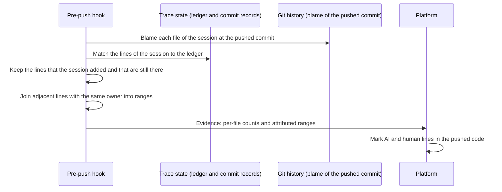

<!--
AGENT INSTRUCTIONS. Keep this comment. Read it before you change this file.

This spec records a design that humans reviewed and approved. Do not change it as part of other work. Find the status of the parent ticket (the `ticket:` field) before you change anything. If you cannot find the status, or you are not sure which case below applies, do not change the spec. Ask the human first.

- Ticket in design, and the spec PR is open: change the spec only through the br:eng-spec skill (`--revise`). The spec shows only the current design. Delete a dropped requirement, do not strike it through, and record why in a Decision Record entry that names its ID. Never renumber or reuse an R-xxx or D-xxx ID.
- Ticket in progress: never rewrite or delete existing text. When the build changes a requirement or a decision, supersede it in the implementation PR. Add an entry with the next free ID that starts "Supersedes D-xxx." (or R-xxx). Strike through the heading and text of the old entry, and add "Superseded by D-yyy." under its heading. Name both IDs in the PR body. When the Summary, the Problem, or the main flow becomes wrong, it is a redesign: stop, and ask the human for a new spec. The owner records other differences with the shipped work through br:eng-spec (`--done`).
- Ticket done or canceled: the spec is frozen. Do not change, delete, or strike through any text. The only allowed edits are typo fixes, broken links, and the "Superseded by" line under the title. For a design change, write a new spec with br:eng-spec that supersedes this one.

When you review this spec, or before you add scope to it, check three things. No requirement contradicts another requirement, a Non-Goal, a Constraint, or a Decision Record entry. The most important requirements come first. The spec solves one problem: when a part can ship or be decided on its own, propose a separate spec instead of extending this one. Report each issue to the human. Do not fix it by yourself.

Do not answer an open question or a review comment on this spec by yourself. The answer is a design decision, and a human makes it. You can propose an answer and discuss it with a human. Change the spec or reply only after the human agrees.

When your code goes against this spec, say so in your PR, and supersede the entry when the ticket is in progress.
-->

# Spec issue-3639: Line ranges that point into the pushed code

## Summary

Each file entry of the Chainloop Trace session evidence has a list of line ranges. Today these ranges are the positions that each agent edit wrote, at the time of the edit. The CLI never adjusts them, so they do not point into any version of the file that a reader can open. This spec changes the ranges to point into the file at the pushed commit. Each range also gets an attribution, AI or human. A viewer can then mark the lines of a session in the pushed code. This spec builds on the net contribution of [Spec issue-3639](issue-3639-trace-line-attribution.md) and ships after its milestone 2.

## Problem

- The ranges are positions at edit time. A later edit, a human change, or a commit moves the lines, and the ranges stay where they were.
- The CLI adds the ranges of all edits to one list. The list has overlaps and duplicates, and its total length has no meaning.
- The ranges cover only lines that an agent edit wrote. They do not show which lines of the session a human wrote.
- The AI and human counts of a file come from a content match since milestone 1 of the parent spec. The ranges no longer agree with the counts.

## Goals and Non-Goals

- Goal: A viewer can show, in the pushed code, each line that a session added and that is still there, with its owner.
- Goal: For each file, the AI ranges hold as many lines as the net AI lines added. The human ranges hold as many lines as the net human lines added.
- Goal: Platforms that read the ranges today keep working.
- Non-goal: Positions for removed lines. A removed line has no position in the pushed file. Removals stay counts only.
- Non-goal: Positions in any version other than the pushed commit, for example each commit of the session.
- Non-goal: Ranges across clones. The parent spec keeps attribution in the local clone.
- Non-goal: Build the viewer on the platform. Follow-up: a platform ticket after this spec merges.

## Requirements

### R-001: Ranges point into the pushed commit
The line ranges of each file MUST be positions in that file at the commit that the push sends. They MUST cover the lines that the session added and that are still in that file, and no other line.
- Done when: the AI writes 100 lines, and a later commit replaces 20 of them by hand. After the push of the later commit, the ranges cover 80 AI lines and 20 human lines. Each range is at its position in the pushed file.

### R-002: Each range has an attribution
Each range MUST say if its lines are AI or human, with the same rules as the counts of the parent spec. Adjacent lines with the same attribution MUST be one range. Ranges MUST NOT overlap.

### R-003: Ranges agree with the counts
For each file, the lines in the AI ranges MUST equal the net AI lines added. The lines in the human ranges MUST equal the net human lines added.

### R-004: Ranges follow session updates
When the CLI sends the evidence of a session again (parent spec R-004), the ranges MUST point into the commit of that push.

### R-005: Compatible evidence
The change MUST be additive in the evidence schema. A range with no attribution MUST keep its earlier meaning: an AI range at edit time, as older CLIs write it. A file that the pushed commit no longer holds MUST have no ranges.

## Constraints

- This spec needs the ledger match and the net numbers of milestone 2 of the parent spec. It does not need the blame step of that milestone, which covers only removed lines.
- The CLI keeps all attribution data in the trace state of the local clone, as the parent spec requires.
- The repository is public. The spec and the evidence hold no customer data.

## Proposal

The user sees no new step. After a push, the session page can mark the lines of each file in the pushed code. AI lines get one color, and human lines get another.

**Positions.** The parent spec blames only the lines that a pushed commit removed. This spec adds a blame of each file of the session at the pushed commit. The blame gives each line of the file its position and the commit that last wrote it. The CLI keeps the lines whose commit is a commit of the session. It matches each of these lines to the session's ledger first, as milestone 2 of the parent spec does. The match gives the line its owner, AI or human. A line that matches only the ledger of another session of the same commit is that session's work, and gets no range here. For a commit that joined the session under parent R-010, only the hunks that replaced the session's lines count. Then it joins adjacent lines with the same owner into one range.

**Evidence.** The ranges stay in the same list of each file entry. Each range gets one new property, its attribution. The counts of the file stay as they are, and the ranges agree with them (R-003).

**Updates.** A later commit can replace lines of a session. Then the parent spec sends the session's evidence again (its R-004). The new evidence has ranges in the newer pushed commit. The platform already replaces session data with newer evidence for the same session.

## Decision Record

### D-001: The existing range list gets an attribution property
The ranges stay in the same list of each file entry. Each range gets an attribution property, AI or human.
- Why: one list keeps the evidence small and gives readers one place to look. A new property is additive, so the change stays compatible with readers that ignore it.
- Alternatives considered:
  - A new list of AI ranges next to the old one: two lists for the same lines, and the old one stays wrong.
  - Two new lists, one for AI and one for human ranges: a reader must merge them to show a file.
- Source: drafting

### D-002: Positions are in the pushed commit
The ranges point into each file at the commit that the push sends.
- Why: the lines that later commits replaced are gone at that commit, so the ranges agree with the net counts. A reader of the pull request sees the same version.
- Alternatives considered:
  - The last commit of the session: a later commit outside the session can move or replace the lines.
  - Ranges for each commit of the session: exact, but a reader must combine them across commits.
- Source: drafting

### D-003: Ranges cover AI and human lines of the session
The list holds the session's human lines too, each range with its attribution.
- Why: a viewer can show the whole contribution of the session, and the human ranges agree with the human counts.
- Alternatives considered:
  - AI lines only: the human lines of the session stay counts only.
- Source: drafting

### D-004: A range with no attribution keeps its earlier meaning
Evidence from an older CLI has ranges with no attribution. Readers treat these as AI ranges at edit time, as before.
- Why: platforms that store evidence from older CLIs must read both forms.
- Source: drafting

### D-005: Open the schema before the CLI writes the property
A CLI release first lets each range carry the attribution property. A later release writes it.
- Why: the schema closes each range to its start and end today. The CLI checks the evidence against its own copy of the schema. A reader that checks against an older copy rejects the new property. The first release gives readers time to take the new schema.
- Alternatives considered:
  - Allow and write the property in one release: a reader with an older schema copy can reject new evidence.
- Source: drafting

### D-006: The CLI writes attributed ranges before the platform reads them
The CLI writes the attributed ranges in the attributed-ranges milestone, after milestone 2 of the parent spec and after the schema is open. It does not wait for the platform.
- Why: the evidence becomes accurate at once. Until the platform follow-up ships, a platform that treats every range as AI shows the human ranges as AI. The team accepts that for this time.
- Alternatives considered:
  - The platform reads the attribution first: no wrong view, but the CLI change waits on the platform.
- Source: drafting

## Open Questions

None.

## Milestones

1. **Open schema.** A CLI release lets each range carry the attribution property (D-005).
2. **Attributed ranges.** R-001 to R-005 in the CLI, after milestone 2 of the parent spec.
3. **Platform.** The session page reads the attribution and marks the lines, in the follow-up platform ticket.

## Risks

| Risk | Mitigation |
|------|------------|
| A reader with an older schema copy rejects evidence with the new property. | Open the schema one release before the CLI writes the property (D-005). |
| An older platform shows human ranges as AI. | Accepted until the platform follow-up reads the attribution (D-006). |
| Blame of large files makes a push slow. | Blame only the files of the sessions in the push, and blame each file one time for all its sessions. |
