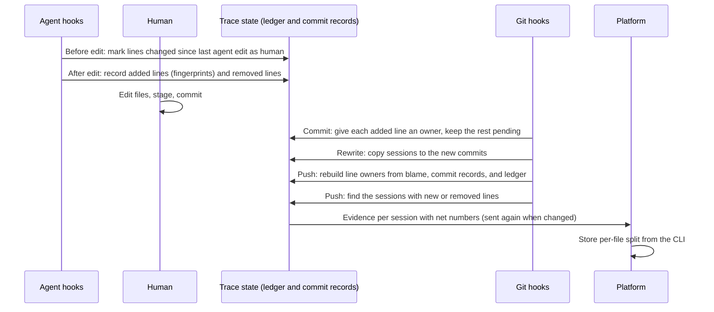

<!--
AGENT INSTRUCTIONS. Keep this comment. Read it before you change this file.

This spec records a design that humans reviewed and approved. Do not change it as part of other work. Find the status of the parent ticket (the `ticket:` field) before you change anything. If you cannot find the status, or you are not sure which case below applies, do not change the spec. Ask the human first.

- Ticket in design, and the spec PR is open: change the spec only through the br:eng-spec skill (`--revise`). Never renumber or reuse an R-xxx or D-xxx ID.
- Ticket in progress: never rewrite or delete existing text. When the build changes a requirement or a decision, supersede it in the implementation PR. Add an entry with the next free ID that starts "Supersedes D-xxx." (or R-xxx). Strike through the heading and text of the old entry, and add "Superseded by D-yyy." under its heading. Name both IDs in the PR body. When the Summary, the Problem, or the main flow becomes wrong, it is a redesign: stop, and ask the human for a new spec. The owner records other differences with the shipped work through br:eng-spec (`--done`).
- Ticket done or canceled: the spec is frozen. Do not change, delete, or strike through any text. The only allowed edits are typo fixes, broken links, and the "Superseded by" line under the title. For a design change, write a new spec with br:eng-spec that supersedes this one.

When you review this spec, or before you add scope to it, check three things. No requirement contradicts another requirement, a Non-Goal, a Constraint, or a Decision Record entry. The most important requirements come first. The spec solves one problem: when a part can ship or be decided on its own, propose a separate spec instead of extending this one. Report each issue to the human. Do not fix it by yourself.

Do not answer an open question or a review comment on this spec by yourself. The answer is a design decision, and a human makes it. You can propose an answer and discuss it with a human. Change the spec or reply only after the human agrees.

When your code goes against this spec, say so in your PR, and supersede the entry when the ticket is in progress.
-->

# Spec issue-3639: Line attribution that survives later edits

## Summary

Chainloop Trace reports, for each file in an AI coding session, how many lines the AI wrote and how many a human wrote. Today this split is wrong when a human changes AI-written lines later. The CLI records AI line ranges at edit time and never updates them. This spec changes the CLI to attribute each line to its last writer. The CLI then reports the net contribution of each session: the lines it added that no later commit replaced. When a later commit replaces lines of a session, the CLI sends that session's evidence again with the new numbers. A commit outside any session that replaces lines of a session joins that session as human work. The platform then stores the CLI split for each file. All five cases of the Appendix then give the expected result, in the clone where the work happened.

## Problem

- The CLI counts AI lines as the length of the ranges recorded at edit time, capped by the diff. A human change to AI lines in the same commit still counts as AI.
- A human commit that touches no file with a pending AI edit gets no session. The CLI drops it at push, and the AI lines it replaced still count as AI.
- The CLI adds the diffs of the session's commits. A line added in one commit and changed in the next counts two times.
- Every removed line in a file that the AI touched counts as an AI removal, also when a human removed it.
- A commit retires the whole file from the AI ledger. When a user commits only part of the AI lines, the CLI does not credit a later commit with the rest to the session.
- A rename, amend, rebase, or squash loses the line ranges, so AI lines can show as human.
- The platform splits each file row by one file-level marker and ignores the CLI split. Organization totals and per-user totals disagree for the same session. Files with both kinds of lines add zero to the organization share.

## Goals and Non-Goals

- Goal: For the example "AI writes 100 lines, a human changes 20 of them", every surface shows 80 AI and 20 human.
- Goal: The five cases of the Appendix give the expected result.
- Goal: The sum over a session's files equals the session totals, on the CLI and on the platform.
- Non-goal: A third "unknown" category. A line that the CLI cannot link to an observed agent edit counts as human, as today.
- Non-goal: Attribution across clones. A human edit in another clone, or in CI, of AI lines written elsewhere counts as human with no effect on the original session. A shared store (for example git notes) can come later in a new spec.
- Non-goal: Deduplicate lines across sessions on the platform when two sessions report the same commit.
- Non-goal: Fix the bugs where AI changes show as human. Separate tickets track them.
- Non-goal: Build the platform part in this ticket. Follow-up: a separate platform ticket, filed after this spec merges.
- Non-goal: Report the total lines that the AI generated in a session, committed or not, in the evidence. This spec keeps the data for it (R-011). Sessions with no commit send no evidence today, and a change to that also belongs to the follow-up. Follow-up: a new spec.

## Requirements

### R-001: Last writer owns the line
The CLI MUST attribute each added line of a commit to the last writer of its content. A line that a hooked agent edit wrote, and that did not change after it, is AI. A whitespace-only change does not change the owner (D-008). All other added lines are human.
- Done when: AI writes 100 lines, and a human changes 20 of them before the commit. The commit reports 80 AI and 20 human added.

### R-002: Human edits between agent edits
The CLI MUST detect human changes made between two agent edits of a file, and between the last agent edit and the commit. These changes MUST count as human, also when a later agent edit keeps them.

### R-003: Net contribution per session
For each file, the session evidence MUST report the lines that the session's commits added. It MUST subtract the lines that a later commit removed or replaced. Each line MUST count at most one time, whatever the number of commits.
- Done when: the same work as R-001 in two commits (AI 100, then human 20) reports 80 AI and 20 human for the file.

### R-004: Later replacements update the owning session
A commit can remove or replace lines that a session owns. Then the next push MUST send the evidence of the owning session again, with updated net numbers. This MUST happen when the commit is in another session, and when it is in no session. This applies while the CLI keeps the trace state of the owning session (see Open Questions). After that, the CLI does not update the session.
- Done when: cases 2, 4, and 5 of the Appendix give the expected results after the push of the later commit.

### R-010: Human commits join the session they change
At push time, a commit that is in no session and that removes or replaces lines of a session MUST join that session. Only the human lines in the hunks that replaced the session's lines MUST count for the session. A commit that changes lines of more than one session MUST join each of them, with each session's own hunks.
- Done when: in cases 2 and 5, session A reports 80 AI and 20 human, and its commit list holds commit 2.

### R-005: Removed lines by remover
An "AI removed" line MUST be a line that an observed agent edit removed. All other removed lines MUST count as human removals.

### R-006: Partial commits
The CLI MUST track AI lines one by one. A commit can hold only part of the AI lines of a file. The rest MUST stay pending for the session, and the CLI MUST credit the next commit with them to the session.

### R-007: Renames and history rewrites
Attribution MUST survive a file rename, amend, rebase, squash, and cherry-pick in the same clone. The CLI MUST match lines by content. A line with no match counts as human.

### R-008: Platform uses the CLI split
For each file row, the platform MUST store the AI and human numbers that the CLI sends. It MUST stop deriving them from the file-level marker. For one session, organization totals and per-user totals MUST then agree.

### R-009: Compatible evidence
The evidence schema change MUST be additive. A platform that does not know the new fields MUST keep working. The platform MUST keep accepting evidence from older CLIs.

### R-011: Keep the counts of every agent edit
For each agent edit, the trace state MUST keep the number of lines that the edit added and removed. The CLI MUST keep these counts also for lines that never reach a commit. A later change can then report all the lines that the AI generated in a session, and compare them with the committed result.
- Done when: the trace state of a session gives the sum of lines added and removed by all its agent edits, including discarded edits.

## Constraints

- The CLI stays a single binary. No resident daemon, no new tool to install, and no change to the global git configuration.
- All attribution data stays in the trace state of the local clone. The CLI pushes nothing new to the git remote.
- Hooks must stay fast. The work at each agent edit covers only the edited files. Owner lookups across commits happen at push time.
- The repository is public. The spec and the evidence hold no customer data.

## Proposal

The user sees no new step. They work with the agent, edit files by hand, commit, and push as today. After the push, each session shows a per-file split that matches who wrote the lines that are still in the code.

**Capture.** Before each agent edit, the CLI compares the file with the state that the last agent edit left. Lines that changed in between are human edits (R-002). After the edit, the CLI records the lines the agent added and the lines it removed, with a content fingerprint for each added line. This extends the current AI line ledger. It no longer stores only ranges and a file-level "consumed" marker.

**Commit.** At commit time, the CLI compares each added line with the ledger to find the sessions of the commit. It keeps AI lines that are not in the commit as pending (R-006). The current commit record keeps the sessions of the commit, as today. The CLI stores no separate owner data per line.

**Rewrites.** After an amend, rebase, or squash, the CLI copies the sessions of the old commits to the new commits, as today. The owners of the lines come from the content match with the ledger at push time, so they survive the rewrite. Blame with rename detection keeps the owners of a renamed file (R-007).

**Push.** At push time, the CLI rebuilds the owners of lines from git history and the trace state. For each line that a pushed commit removed, blame gives the commit that last changed the line. That commit's record names its sessions. The ledger fingerprints of these sessions show if the line was AI or human. The CLI then finds every session that owns lines in the pushed commits, or whose lines a pushed commit removed. For each one, it computes the net numbers over all its recorded commits and sends its evidence (R-003, R-004). A commit that is in no session joins each session whose lines it replaced. Only its hunks that replaced the session's lines count, as human lines (R-010). A session that the CLI already pushed gets new evidence. The platform already replaces session data with newer evidence for the same session.

**Platform.** The platform stores the per-file numbers from the CLI (R-008). The current per-file marker stays in the evidence for older platforms (R-009).

## Decision Record

### D-001: Net contribution is the reported split
The per-file and per-session AI and human numbers are the lines a session added that no later commit replaced.
- Why: it gives the expected 80/20 split. It also removes the double count across commits.
- Alternatives considered:
  - Authored lines per commit, with no net: simpler. But a replaced AI line still counts as AI, and the platform must compute the net value.
- Source: drafting

### D-002: Update the owning session after a replacement
A later commit that replaces lines of a session causes the CLI to send that session's evidence again.
- Why: the platform already replaces session data with newer evidence. The platform needs no new concept.
- Alternatives considered:
  - Separate evidence with no session for human commits: needs a new concept on the platform.
  - Do not track commits outside sessions: cases 2 and 5 stay wrong.
- Source: drafting

### D-009: Human commits with no session join the session they change
At push time, a commit with no session joins each session whose lines it replaced. Only the replacing hunks count, as human lines.
- Why: the human work gets credit in the place where it changed the session's code. Cases 2 and 5 then give 80 AI and 20 human. The evidence needs no new field.
- Alternatives considered:
  - A new field that counts the session's replaced lines: shows the rework, but the 20 human lines are in no session total.
  - Count the whole commit in the session: unrelated human work in other files would join the session.
- Source: drafting

### D-003: Extend the current trace state
The line fingerprints go into the current AI line ledger. The current commit records keep the sessions of each commit. At push time, the CLI rebuilds the owners of lines from git blame, the commit records, and the ledger. It stores no separate owner data per line.
- Why: it reuses the storage that exists, and it pushes nothing to the remote. Line owners come from data that the CLI keeps already, so no second store can disagree with it.
- Alternatives considered:
  - Git notes on a dedicated ref: works across clones, but adds push traffic, ref contention, and git configuration.
  - Store an owner map per commit: faster lookups, but it duplicates the ledger and needs its own rewrite handling.
- Source: drafting

### D-004: Detect human edits before each agent edit
The CLI compares the file with the last agent state before each agent edit and at commit time.
- Why: it finds human lines that a later agent edit would hide. The pre-edit snapshot hook exists already.
- Alternatives considered:
  - Compare at commit time only: simpler, but misses human lines that the agent changes again.
- Source: drafting

### D-005: Two categories, human by default
A line that the CLI cannot link to an observed agent edit is human.
- Why: no change to the evidence categories or the platform aggregates.
- Alternatives considered:
  - A third "unknown" category: more exact, but changes the schema and every aggregate.
- Source: drafting

### D-006: Removals count for the remover
"AI removed" counts only removals that an agent edit made. The CLI also records the owner of each removed line, for the net numbers.
- Why: a human removal in a file the AI touched is human work.
- Alternatives considered:
  - Keep "AI if the AI touched the file": simple, but wrong for human edits.
- Source: drafting

### D-007: Choose diff and blame libraries during the build
The implementation evaluates existing libraries and tools for line diffs, move detection, and blame before it writes its own.
- Why: other projects solved these problems already. The choice does not change the observable behavior.
- Source: drafting

### D-008: Whitespace-only changes keep the owner
A change that only adds, removes, or moves whitespace in a line does not change the owner of the line.
- Why: a formatter or a re-indent does not write new code.
- Alternatives considered:
  - Any change makes the editor the owner: a formatter run would turn AI lines into human lines.
- Source: drafting

### D-010: Existing session fields hold the net numbers, and files get a split
The existing AI and human fields of the session totals hold the net numbers. Each file entry of the evidence gets new AI and human added and removed counts. Today a file entry has only its total counts and the file-level marker.
- Why: older platforms then show the right session totals with no change (R-009). The platform needs the per-file split for R-008. The new file fields are additive.
- Alternatives considered:
  - New net fields next to the old session fields: the platform must switch fields, and the old fields stay wrong.
  - Derive the file split from the line ranges in the evidence: the ranges do not hold the net numbers or the removals.
- Source: drafting

### D-011: Keep generated-line counts now, report them in a later spec
The ledger keeps the added and removed counts of every agent edit (R-011). Reporting the generated totals in the evidence goes to a follow-up spec.
- Why: comparing the generated lines with the committed result is a separate metric. This spec changes the ledger already, so it keeps the data that the metric needs.
- Alternatives considered:
  - Add the generated totals to the evidence in this spec: more scope, and it also needs evidence for sessions with no commit.
  - Do nothing now: the follow-up would need a second ledger change.
- Source: https://github.com/chainloop-dev/chainloop/pull/3640#discussion_r4296029633

### D-012: Keep the trace state of a pushed session for 30 days
The CLI keeps the ledger and the commit records of a session for 30 days after the session starts. The time counts only when a push attested all the work of the session. A local branch must still reach the session's commits. After that, a replacement of its lines does not update the session (R-004).
- Why: a later human edit often comes days after the push. Thirty days covers a normal review cycle, and the state stays small.
- Alternatives considered:
  - Keep the earlier 7 days: a fix after a long review does not update the session.
- Source: answer to the open question, milestone 2 implementation

### D-013: The push sends a session again only from the branch with its commits
The push sends a session again only when its own commits are on the branch that the push sends. Take a session whose commits are only on another branch, for example the default branch. A commit that replaces its lines does not update it.
- Why: the push already reads only the commits of its branch. Finding sessions on other branches needs a walk of the history at each push.
- Alternatives considered:
  - Any session whose commits HEAD reaches: more complete, but slower pushes.
- Source: milestone 2 implementation

## Open Questions

- [x] **How long does the CLI keep the trace state of a pushed session?**
  Proposed: keep its ledger and commit records for 30 days at most. A local branch must still reach the session's commits. After that, a replacement of these lines does not update the session.
  Answered by D-012.

## Milestones

1. **Last writer and partial commits.** R-001, R-002, R-005, R-006, R-011 in the CLI. Cases 1 and 3 give the expected results.
2. **Net contribution and session updates.** R-003, R-004, R-010. Cases 2, 4, and 5 give the expected results.
3. **Rewrites and renames.** R-007.
4. **Platform.** R-008, in the follow-up platform ticket.

## Risks

| Risk | Mitigation |
|------|------------|
| Owner lookup for removed lines makes a push slow on large commits. | Run blame only for files that have ledger entries, and only on the line ranges that the pushed commits removed. Do not skip files, so the ledger ownership stays complete. |
| Sending evidence again makes a push slower and creates more attestations. | Send a session again only when its net numbers changed. |
| Content match after a rebase gives the wrong owner for repeated lines. | Match by position in the hunk first, then by content. An unmatched line is human (R-007). |
| Pushes from older CLIs and newer CLIs mix on one platform. | Additive schema (R-009). The platform falls back to the marker when the split is missing. |

## Appendix: Expected results for the five cases

The AI writes 100 lines in a file. Later a human changes 20 of these lines. "Session" means the session that recorded the work. Results are after the push of the last commit.

| Case | Today, CLI evidence | Expected after this spec |
|------|---------------------|--------------------------|
| 1. Same session, same commit | A: AI 100, human 0 | A: AI 80, human 20 |
| 2. Same session, human commit 2 outside the session | A: AI 100, commit 2 dropped | A sent again with commit 2: AI 80, human 20 |
| 3. Same session, commit 2 in the session | A: AI 100, human 20, AI removed 20 | A: AI 80, human 20, AI removed 0 |
| 4. Different sessions, commit 2 in session B (human edit) | A: AI 100. B: human 20, AI removed 20 | A sent again: AI 80. B: human 20, human removed 20 |
| 5. Commit 2 in no session | A: AI 100, commit 2 dropped | Same as case 2 |
