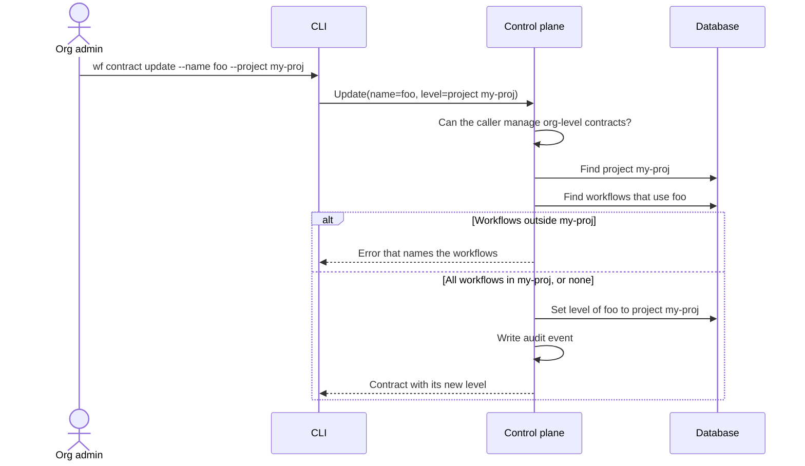

<!--
AGENT INSTRUCTIONS. Keep this comment. Read it before you change this file.

This spec records a design that humans reviewed and approved. Do not change it as part of other work. Find the status of the parent ticket (the `ticket:` field) before you change anything. If you cannot find the status, or you are not sure which case below applies, do not change the spec. Ask the human first.

- Ticket in design, and the spec PR is open: change the spec only through the br:eng-spec skill (`--revise`). The spec shows only the current design. Delete a dropped requirement, do not strike it through, and record why in a Decision Record entry that names its ID. Never renumber or reuse an R-xxx or D-xxx ID.
- Spec and implementation in the same PR, and the spec has not merged: change the spec directly so that it matches the implementation. Do not supersede or strike through. Delete a dropped requirement and record why in a Decision Record entry that names its ID. Record a changed decision as a Decision Record entry. Never renumber or reuse an R-xxx or D-xxx ID. Propose each design change to the human, and change the spec only after the human agrees.
- Ticket in progress, and the spec has merged: never rewrite or delete existing text. When the build changes a requirement or a decision, supersede it in the implementation PR. Add an entry with the next free ID that starts "Supersedes D-xxx." (or R-xxx). Strike through the heading and text of the old entry, and add "Superseded by D-yyy." under its heading. Name both IDs in the PR body. When the Summary, the Problem, or the main flow becomes wrong, it is a redesign: stop, and ask the human for a new spec. The owner records other differences with the shipped work through br:eng-spec (`--done`).
- Ticket done or canceled: the spec is frozen. Do not change, delete, or strike through any text. The only allowed edits are typo fixes, broken links, and the "Superseded by" line under the title. For a design change, write a new spec with br:eng-spec that supersedes this one.

When you review this spec, or before you add scope to it, check three things. No requirement contradicts another requirement, a Non-Goal, a Constraint, or a Decision Record entry. The most important requirements come first. The spec solves one problem: when a part can ship or be decided on its own, propose a separate spec instead of extending this one. Report each issue to the human. Do not fix it by yourself.

Do not answer an open question or a review comment on this spec by yourself. The answer is a design decision, and a human makes it. You can propose an answer and discuss it with a human. Change the spec or reply only after the human agrees.

When your code goes against this spec, say so in your PR. Supersede the entry when the spec has merged and the ticket is in progress.
-->

# Spec issue-3644: Convert a Contract Between Organization Level and Project Level

## Summary

A workflow contract gets its level when someone creates it, and the level cannot change after that. The contract is either an organization-level contract or a project-level contract. This spec lets an organization admin convert an existing contract from one level to the other. The contract keeps its name, its revision history, and its workflows. Today the only way to change the level is to delete the contract and create it again. That loses the history and the workflow links.

## Problem

- The system sets the level of a contract when a user creates it. No API call or CLI command changes it.
- Only organization admins can manage organization-level contracts. A project member, or an API token scoped to a project, gets the error "you can not manage a global contract". For example, a contract sync job that runs with a project-scoped token fails on each organization-level contract that it updates.
- The only workaround is to delete the contract and create it again at the other level. This loses the revision history, and each workflow that uses the contract must be attached to the new contract by hand.

## Goals and Non-Goals

- Goal: an organization admin converts an organization-level contract into a project-level contract with one command.
- Goal: an organization admin converts a project-level contract into an organization-level contract with one command.
- Goal: after a conversion, the contract has the same name, the same revisions, and the same workflows.
- Non-goal: move a project-level contract from one project to a different project. A reader could expect it, but nobody asked for it, and it needs its own rules for the workflows of the old project.
- Non-goal: change the level through `chainloop apply`. The contract files that `apply` reads have no level today. Follow-up: a separate ticket, if users ask for it.
- Non-goal: a level control in the web UI. This spec covers the API and the CLI.

## Requirements

### R-001: Convert an organization-level contract to project level
The system MUST let an authorized caller convert an organization-level contract into a project-level contract of a project that exists in the same organization.
- Done when: `chainloop wf contract update --name foo --project my-proj` succeeds, and `chainloop wf contract describe --name foo` shows the contract in project `my-proj`.

### ~~R-002: Convert a project-level contract to organization level~~
Superseded by R-011.

~~The system MUST let an authorized caller convert a project-level contract into an organization-level contract.~~
- ~~Done when: `chainloop wf contract update --name foo --org` succeeds, and the contract shows no project.~~

### R-011: Convert a project-level contract to organization level
Supersedes R-002. The system MUST let an authorized caller convert a project-level contract into an organization-level contract.
- Done when: `chainloop wf contract update --name foo --org-level` succeeds, and the contract shows no project.

### R-003: Keep the contract identity
A conversion MUST keep the contract ID, its name, all its revisions, and the links to all its workflows.

### R-004: Only callers that can manage organization-level contracts can convert
The system MUST allow a conversion, in both directions, only for a caller that can manage organization-level contracts today. These callers are an organization owner or admin, and an organization-level API token. A project member, a project admin, and a project-scoped API token MUST get a permission error.

### R-005: Reject a conversion that leaves workflows outside the project
When workflows of other projects use an organization-level contract, the system MUST reject its conversion to project X. The error MUST name each workflow outside project X, with its project.
- Done when: no workflow can end up linked to a contract of a different project through a conversion.

### R-010: Reject a contract of a different project on each workflow change
The system MUST reject a project-level contract of a different project when a user creates a workflow. It MUST also reject it when a user changes the contract of a workflow. This check MUST hold also when a conversion runs at the same time.
- Done when: a member of project Y cannot attach a contract of project X to a workflow of project Y. This applies to the workflow create command and to the workflow update command.

### R-006: Reject a project-to-project move
When the caller asks to convert a project-level contract to a different project, the system MUST reject the request. A request for the current level of the contract MUST succeed and change nothing. For example, a request for the organization when the contract is already at organization level.

### R-007: A level change does not create a revision
A conversion MUST NOT create a new contract revision. When the same request also changes the contract body, the body change creates a revision as usual.

### R-008: Audit the conversion
Each conversion MUST write an audit event that names the contract, the old level, and the new level. For a project level, the event names the project.

### R-009: An update without a level keeps the level
An update request that does not ask for a level change MUST keep the current level. Existing callers MUST see no change in behavior.

## Constraints

- Backward compatible API. Older CLIs and other clients send update requests with no level, and these requests must work as before (R-009).
- Public repository. The spec and the PR hold no internal links.

## Proposal

**What the user does.** The update command for contracts gets two new flags. The user can give one of them, not both:

- `--project <name>` converts the contract to the given project.
- `--org` converts the contract to the organization.

When the user gives neither flag, the command does not change the level. The flags can go together with the current flags. For example, one command can change the contract body and the level. The `--project` flag has the same name and meaning as on the create command for contracts.

**API.** The update request of the contract service gets an optional level field with two choices: a project reference, or "organization". When the field is not set, the level does not change. The project reference has the same form as the one on the create request (a project name or ID). The response is the same as today, and it shows the new level of the contract.

**Control plane.** The contract service does these steps for a request with a level:

1. Find the contract in the current organization.
2. Check that the caller can manage organization-level contracts (R-004). The check goes through the shared authorization component, as all other authorization checks do. This check replaces the normal contract access check for the request, so a project admin cannot convert a project-level contract of their own project.
3. Find the target project in the organization, when the target is a project.
4. Check the move (R-005, R-006). For an organization-to-project move, find the workflows that use the contract and are not in the target project. When there is one or more, reject the request and name them.
5. Change the level of the contract in the same database transaction as the other updates of the request. The contract ID, name, and revisions do not change (R-003, R-007).
6. Write the audit event (R-008).

**After a conversion.**

- Organization to project: members of the project can manage the contract as a normal project-level contract. Only workflows of that project can use it, as for every project-level contract (R-010).

**Workflow changes.** Today the workflow create command rejects a contract of a different project, but the workflow update command does not. This spec adds the same check to the update path (R-010). Both paths and the conversion lock the contract and check its level in one database transaction. Thus a conversion and a workflow change on the same contract run one after the other, and neither uses an old level.
- Project to organization: all projects of the organization can use the contract. Only organization admins can manage it, and project members cannot manage it any more.

## Decision Record

### D-001: The level is a field on the update request
The update request gets an optional level field. There is no separate "move" call.
- Why: one request can change the body and the level, and the CLI keeps one command for all changes to a contract.
- Alternatives considered:
  - A separate "move" call and `chainloop wf contract move` command: one more API call and command to maintain. A user also needs two calls to change the body and the level together.
- Source: drafting

### D-002: The level field has three states
The field is either not set (no change), a project reference, or "organization".
- Why: a single optional project field cannot tell "no change" from "move to the organization". An empty project name as "move to the organization" is easy to send by mistake.
- Alternatives considered:
  - An optional project field, where an empty value means the organization: easy to misuse, and not clear to a reader.
- Source: drafting

### ~~D-003: CLI flags `--project` and `--org`~~
Superseded by D-009.

~~The update command gets `--project <name>` and `--org`, and the user can give only one of them.~~
- ~~Why: `--project` matches the create command. `--org` matches the words that users see, "organization-level contract".~~
- ~~Alternatives considered:~~
  - ~~`--global` in place of `--org`: "global" is a word of the code, not of the product.~~
  - ~~`--scope org|project` with `--project`: adds a rule ("`--project` is necessary when the scope is project") and gives nothing more with only two levels.~~
- ~~Source: drafting~~

### D-004: The same callers that manage organization-level contracts can convert
Organization owners, organization admins, and organization-level API tokens can convert. Project-level callers cannot convert, in either direction.
- Why: each conversion adds a contract to the organization level or takes one out of it. Only these callers manage that level today. Organization-level API tokens let automation do the conversion.
- Alternatives considered:
  - Human organization admins only: blocks automation that already runs with an organization-level token. It gives no more safety than the current rule for organization-level contracts.
- Source: drafting

### D-005: Reject an organization-to-project move when other projects use the contract
The request fails and names each workflow outside the target project. The system has no force option.
- Why: an attestation of a workflow in another project cannot read a contract of a different project, so those workflows would break. The user must first attach a different contract to each of those workflows.
- Alternatives considered:
  - Allow it with a `--force` flag: breaks the attestations of those workflows until somebody fixes them.
- Source: drafting

### D-006: A level change does not create a revision
The level is a property of the contract, not of its content.
- Why: a revision holds the contract body. A new revision with the same body would show a change that did not happen in the content.
- Alternatives considered:
  - Always create a revision: the revision history would show copies of the same body.
- Source: drafting

### D-007: Fix the workflow update check in this spec
The workflow update command gets the project check that the workflow create command already has (R-010).
- Why: the guarantee of R-005 depends on this check. Without it, a user can attach a contract of a different project to a workflow, with or without a conversion.
- Alternatives considered:
  - A separate bug ticket: the gap exists today without a conversion, but this spec cannot keep its guarantee without the fix.
- Source: [PR #3789 review](https://github.com/chainloop-dev/chainloop/pull/3789#discussion_r4490911175)

### D-008: Workflow changes and conversions lock the contract
A conversion and each workflow change that sets a contract lock the contract, and check its level in the same transaction.
- Why: a lock only in the conversion lets a workflow change read the old level, pass its check, and write after the conversion.
- Alternatives considered:
  - Accept the race: conversions are rare and admin-only, but the result is a workflow that cannot get its contract.
- Source: [PR #3789 review](https://github.com/chainloop-dev/chainloop/pull/3789#discussion_r4490911182)

### D-009: CLI flags `--project` and `--org-level`
Supersedes D-003. The update command gets `--project <name>` and `--org-level`, and the user can give only one of them.
- Why: all commands of the CLI already have a global `--org` flag that selects the organization. A local `--org` on the update command hides that flag.
- Alternatives considered:
  - `--organization-scoped`: matches the API field, but it is long.
  - `--global`: "global" is a word of the code, not of the product.
- Source: [PR #3794 review](https://github.com/chainloop-dev/chainloop/pull/3794#discussion_r4492196064)

### D-010: The audit event uses the levels read under the lock
The old level and the new level in the audit event are the levels that the conversion read and set while it held the lock on the contract. The system writes the event only when the conversion changed the level.
- Why: a level read before the lock or after the commit can be wrong when two conversions run at the same time. Then the event shows a wrong level, or it records a change that did not occur.
- Source: [PR #3794 review](https://github.com/chainloop-dev/chainloop/pull/3794#discussion_r4492196071), [PR #3794 review](https://github.com/chainloop-dev/chainloop/pull/3794#discussion_r4492659279)

## Open Questions

None.

## Risks

| Risk | Mitigation |
|------|------------|
| After a project-to-organization move, project members cannot manage a contract that they managed before. | This is the rule for organization-level contracts. Only organization admins can do the move, and the audit event records it. |
| A user attaches the contract to a workflow of a different project while the conversion runs. | The conversion and each workflow change lock the contract and check its level in the same transaction (D-008). |
