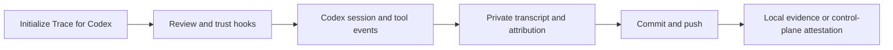

<!--
AGENT INSTRUCTIONS. Keep this comment. Read it before you change this file.

This spec records a design that humans reviewed and approved. Do not change it as part of other work. Find the status of the parent ticket (the `ticket:` field) before you change anything. If you cannot find the status, or you are not sure which case below applies, do not change the spec. Ask the human first.

- Ticket in design, and the spec PR is open: change the spec only through the br:eng-spec skill (`--revise`). The spec shows only the current design. Delete a dropped requirement, do not strike it through, and record why in a Decision Record entry that names its ID. Never renumber or reuse an R-xxx or D-xxx ID.
- Ticket in progress: never rewrite or delete existing text. When the build changes a requirement or a decision, supersede it in the implementation PR. Add an entry with the next free ID that starts "Supersedes D-xxx." (or R-xxx). Strike through the heading and text of the old entry, and add "Superseded by D-yyy." under its heading. Name both IDs in the PR body. When the Summary, the Problem, or the main flow becomes wrong, it is a redesign: stop, and ask the human for a new spec. The owner records other differences with the shipped work through br:eng-spec (`--done`).
- Ticket done or canceled: the spec is frozen. Do not change, delete, or strike through any text. The only allowed edits are typo fixes, broken links, and the "Superseded by" line under the title. For a design change, write a new spec with br:eng-spec that supersedes this one.

When you review this spec, or before you add scope to it, check three things. No requirement contradicts another requirement, a Non-Goal, a Constraint, or a Decision Record entry. The most important requirements come first. The spec solves one problem: when a part can ship or be decided on its own, propose a separate spec instead of extending this one. Report each issue to the human. Do not fix it by yourself.

Do not answer an open question or a review comment on this spec by yourself. The answer is a design decision, and a human makes it. You can propose an answer and discuss it with a human. Change the spec or reply only after the human agrees.

When your code goes against this spec, say so in your PR, and supersede the entry when the ticket is in progress.
-->

# Spec issue-3657: Codex support in Chainloop Trace

## Summary

Chainloop Trace supports developers who use Codex. Developers can select Codex during initialization or trace one command with temporary hooks. Trace records Codex sessions as AI coding-session evidence. The integration uses native Codex hooks and persisted session transcripts.

## Problem

Developers who use Codex cannot attach native Trace evidence to their commits. Codex already records conversations and exposes lifecycle hooks. Trace needs to connect those records to its existing evidence pipeline.

## Goals and Non-Goals

- Goal: Developers can record Codex sessions in local storage or the control plane.
- Goal: Evidence includes conversations, models, tokens, estimated cost, tools, and code attribution.
- ~~Non-goal: Capture child-session transcripts, track skills, or replace spec and pasted-image copies with pointers. These features need separate transcript analysis.~~ Superseded by D-004.
- Goal: Evidence includes used skills, stored spec materials, and pointers that the session viewer can resolve.
- Non-goal: Capture child-session transcripts. Milestone 2 analyzes the root session only.
- Non-goal: Attribute arbitrary MCP tools or reconstruct sessions that produced no Trace hook.
- Non-goal: Change the evidence schema, control-plane APIs, or default provider.

## Requirements

### R-001: Provider selection

Trace MUST offer Codex during initialization. Initialization and the command wrapper MUST accept the Codex provider flag. Developers MUST be able to select Codex with other providers.

### R-002: Hook lifecycle

Installation MUST preserve user hooks and produce identical content on repeated runs. Uninstall MUST delete only Trace hooks. The command wrapper MUST restore the previous hook configuration after execution. Its temporary configuration MUST omit the Trace session-end hook.

### R-003: Session evidence

Trace MUST capture session identity, timing, agent version, conversations, tool calls, and model information from persisted Codex transcripts. Missing or unreadable data MUST produce a warning or parsing error. Repeated cumulative usage records MUST count tokens once. Cost MUST use embedded API prices and identify an unknown-model fallback.

### R-004: Code attribution

Trace MUST attribute edits from native patch and shell tools. A patch that changes several files MUST preserve separate before-and-after content for each file. Attribution MUST include additions, deletions, and both paths of a move. Tool hooks MUST recover a missed session-start event.

### R-005: Private session copies

Trace MUST parse its private copy of the session transcript. Copying MUST check session identity and reject paths outside Codex session storage, including symlink escapes. A failed copy MUST preserve the previous copy. Local capture and parsing MUST require no network or login.

### R-006: Session instructions

Trace MUST send spec capture instructions at session start and reminders at each user prompt. Each hook response MUST contain at most one JSON document. Empty announcements MUST emit no output. Initialization MUST tell Codex users to review and trust the installed hooks.

### R-007: Skills used during the session

Trace MUST record the skills that a Codex session used, with their invocation counts and first-use times when available. Trace MUST capture each skill definition and its supporting files through the existing skill evidence pipeline. Trace MUST attempt capture during the session. A copy made only at push MUST carry a warning. An available skill listing alone MUST NOT count as a skill use.

### R-008: Pointers to spec sources

Trace MUST replace exact copies of stored spec sources in transcript reads and writes with pointers to the corresponding materials. Replacement MUST cover both the conversation shown by the viewer and retained native copies of the same content. Partial reads, changed content, failed operations, and unsupported formats MUST remain inline. A pointer MUST reference a successfully stored material.

### R-009: Pasted images

Trace MUST extract each distinct pasted image from the transcript and store it once as an image spec material. Trace MUST replace every inline occurrence of a successfully stored pasted image with a pointer to that material. If an existing spec material stores the same image, Trace MUST reuse it. Images from tool results MUST NOT count as pasted images. If decoding, extraction, or storage fails, Trace MUST preserve the inline data and continue evidence assembly.

### R-010: Verification and compatibility

Provider regressions and live Codex tests MUST check captured skill contents, spec pointers, and pasted-image materials and pointers. Verification MUST cover image deduplication, inline fallback, and use of the captured materials and pointers by the existing session viewer. The compatibility tables MUST reflect test results and document remaining limits. Both milestones MUST pass their required verification before the parent issue closes.

## Constraints

Native hook behavior follows Codex CLI 0.163.0. Codex requires users to trust project configuration and hook definitions. Trace does not bypass that review during normal use. The test harness bypasses hook trust only in isolated test repositories.

Milestone 2 MUST use the existing evidence schema and material storage pipeline. The provider MUST declare compile-time conformance to all three optional extensions for skills, spec pointers, and pasted images. Codex MUST support these extensions. Local evidence assembly MUST retain the offline behavior in R-005.

## Proposal

The developer selects Codex during Trace initialization, reviews the installed hooks in Codex, and starts a session. Codex sends session and tool events to Trace. Trace records each patch path separately and uses working-tree snapshots for shell changes.

Trace copies the Codex rollout into private storage at session boundaries and before evidence assembly. The parser retains native JSONL records and derives summaries from metadata, response items, turn context, and cumulative token counters. Git hooks use the existing evidence pipeline.

For milestone 2, Trace detects actual skill loads and attempts to copy their contents during the session. Evidence assembly recovers skill usage from the private transcript copy. The shared pipeline stores skill definitions and supporting files with their usage metadata.

Before storing the session evidence, Trace stores spec materials and distinct pasted images. It then replaces matching transcript copies with pointers to those materials. Replacement covers viewer messages and retained native events. Unsupported or unsuccessful matches remain inline. The viewer resolves pointers through the existing material digests.

## Decision Record

### D-001: Use native Codex hooks

Native hooks connect Codex to the existing session lifecycle.

- Why: They cover session boundaries, prompts, patches, and shell tools without a separate extension.
- Alternatives considered: A notification-only integration misses pre-edit state. A separate extension duplicates lifecycle support.
- Source: drafting, based on the [official hook contract](https://learn.chatgpt.com/docs/hooks).

### D-002: Expand patch events per file

Trace snapshots each affected file before a patch and records its changes after the patch.

- Why: Native patches can change several files, while attribution needs the original content of each file.
- Alternatives considered: Whole-worktree shell attribution loses uncommitted human content when it substitutes the last commit for the original content.
- Source: drafting.

### D-003: Parse copied rollouts

The provider reads copied native rollouts and estimates cost from embedded prices.

- Why: Evidence remains available after Codex moves or deletes its original transcript.
- Alternatives considered: Live transcript parsing depends on agent storage during assembly. Notification payloads omit conversation and usage details.
- Source: drafting.

### D-004: Include skills, spec pointers, and pasted images in milestone 2

Supersedes the original non-goal that excluded skills and replacement of spec and pasted-image copies. Child-session transcripts remain outside scope.

- Why: The parent issue requires these features for complete Codex support. Milestone 1 delivers the core provider first.
- Alternatives considered: Permanent exclusion leaves required evidence incomplete. A separate spec would separate requirements that the parent issue already groups into two milestones.
- Source: [Milestone 2 of issue #3657](https://github.com/chainloop-dev/chainloop/issues/3657).

## Open Questions

None for the initial provider scope.

Milestone 2 has no additional open questions.

## Milestones

1. **Core Codex provider.** Deliver provider selection, hooks, session evidence, attribution, local storage, control-plane uploads, and session messages. Check the behavior and document compatibility.
2. **Codex skills, spec pointers, and pasted images.** Deliver R-007 through R-010 through the shared evidence pipeline. Check the materials and pointers with live Codex sessions and the existing viewer.

## Risks

| Risk | Mitigation |
|------|------------|
| Codex changes its rollout format. | Preserve unknown records, warn about unreadable records, and test sanitized rollout fixtures. |
| Users have not trusted the hooks. | Explain the trust step during initialization and in provider documentation. |
| Estimated cost differs from billing. | Document standard API estimates and warn when the model price is unknown. |
| A skill changes or disappears before push. | Attempt capture during the session and warn when only a push-time copy is available. |
| Pointer replacement misses a retained native copy. | Check that viewer messages and native events contain no duplicate content in regression tests. |
| A pasted image cannot be decoded or stored. | Preserve its inline data and continue evidence assembly. |
