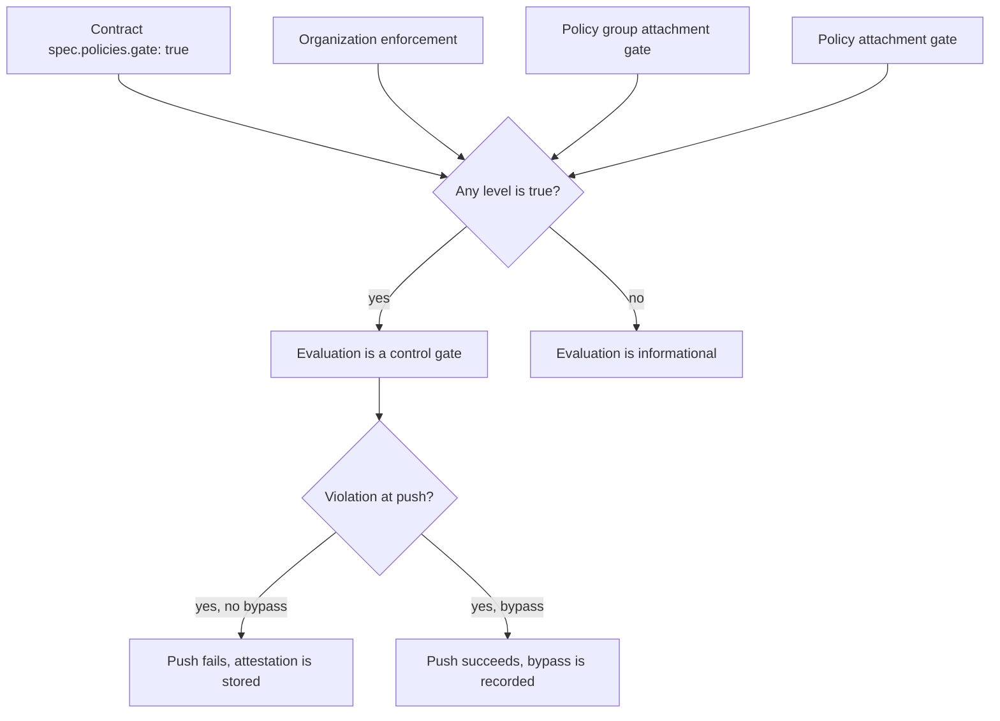

<!--
AGENT INSTRUCTIONS. Keep this comment. Read it before you change this file.

This spec records a design that humans reviewed and approved. Do not change it as part of other work. Find the status of the parent ticket (the `ticket:` field) before you change anything. If you cannot find the status, or you are not sure which case below applies, do not change the spec. Ask the human first.

- Ticket in design, and the spec PR is open: change the spec only through the br:eng-spec skill (`--revise`). The spec shows only the current design. Delete a dropped requirement, do not strike it through, and record why in a Decision Record entry that names its ID. Never renumber or reuse an R-xxx or D-xxx ID.
- Ticket in progress: never rewrite or delete existing text. When the build changes a requirement or a decision, supersede it in the implementation PR. Add an entry with the next free ID that starts "Supersedes D-xxx." (or R-xxx). Strike through the heading and text of the old entry, and add "Superseded by D-yyy." under its heading. Name both IDs in the PR body. When the Summary, the Problem, or the main flow becomes wrong, it is a redesign: stop, and ask the human for a new spec. The owner records other differences with the shipped work through br:eng-spec (`--done`).
- Ticket done or canceled: the spec is frozen. Do not change, delete, or strike through any text. The only allowed edits are typo fixes, broken links, and the "Superseded by" line under the title. For a design change, write a new spec with br:eng-spec that supersedes this one.

When you review this spec, or before you add scope to it, check three things. No requirement contradicts another requirement, a Non-Goal, a Constraint, or a Decision Record entry. The most important requirements come first. The spec solves one problem: when a part can ship or be decided on its own, propose a separate spec instead of extending this one. Report each issue to the human. Do not fix it by yourself.

Do not answer an open question or a review comment on this spec by yourself. The answer is a design decision, and a human makes it. You can propose an answer and discuss it with a human. Change the spec or reply only after the human agrees.

When your code goes against this spec, say so in your PR, and supersede the entry when the ticket is in progress.
-->

# Spec issue-3762: Policy Enforcement at the Contract Level

## Summary

A workflow contract will have one setting that enforces all of its policies. With it, a contract author can make every policy of the contract a control gate, without changes to each policy attachment and without enforcement for the whole organization. Enforcement will also only tighten. A level can turn enforcement on, but it cannot turn off enforcement that a higher level set. Today a policy attachment with `gate: false` opts out of the organization enforcement. This spec removes that opt-out.

## Problem

Today enforcement is set at two levels:

- The organization default. When it is on, each policy that does not set `gate` is a control gate, in all contracts of the organization.
- Each policy attachment and each policy group attachment, with the `gate` field.

This causes these gaps:

- To enforce all the policies of one contract, the author must set `gate: true` on each attachment. A new attachment without `gate` is not enforced, and nothing warns the author.
- The other option is to enforce the whole organization. That affects all contracts, also the contracts that are not ready.
- A contract author can turn off the organization enforcement for one policy with `gate: false`. An organization administrator who turns on enforcement expects that all policies are enforced. The documented behavior lets a contract author override this decision without notice.
- The CLI output shows the organization strategy only. It does not show when a contract or an attachment enforces policies, so the user cannot see the real state.

## Goals and Non-Goals

- Goal: A contract author can enforce all the policies of a contract with one setting.
- Goal: Enforcement set at a higher level always applies. A lower level cannot turn it off.
- Goal: The user can see the enforcement that applies to an attestation, and where it comes from.
- Non-goal: Enforcement at the project or the workflow level. The contract is the unit that defines the policies.
- Non-goal: Change the bypass flag of the push command, or the requirement exceptions of compliance frameworks. Both keep their current behavior.
- Non-goal: Enforcement for each material, or for each phase of the attestation.

## Requirements

### R-001: Contract enforcement
When a contract turns on enforcement, each policy evaluation of an attestation made with that contract MUST be a control gate. This includes the policies of the policy groups of the contract.
- Done when: a contract with enforcement on and one policy without `gate` blocks the push when that policy has a violation.

### R-002: Enforcement only tightens
A policy evaluation MUST be a control gate when the organization, the contract, the policy group attachment, or the policy attachment turns on enforcement. A `gate: false` value at a lower level MUST NOT turn off enforcement from a higher level.
- Done when: in an organization with enforcement on, a policy attachment with `gate: false` blocks the push when the policy has a violation.

### R-003: Contracts without the setting
A contract that does not set the contract enforcement MUST behave as the organization default and the attachment `gate` values decide. The only change is R-002.

### R-004: Bypass still works
The bypass flag of the push command MUST apply to gates from contract enforcement in the same way as it applies to other gates. The control plane MUST record the bypass.

### R-005: Show the enforcement that applies
The attestation status command and the workflow run describe command MUST show the strategy as enforced when the organization or the contract turns on enforcement. They SHOULD name the source: organization, contract, or both. When neither level enforces, they MUST NOT show an advisory strategy, because single policies can still be gates.

### R-006: Warn about an ignored opt-out
When a contract has `gate: false` at a level where a higher level turns on enforcement, the system SHOULD warn the user. The warning SHOULD show when the attestation starts, in the attestation status command, and when the user checks or saves the contract.

## Constraints

- Existing contracts MUST stay valid. The new setting is optional.
- The CLI decides the gate of each policy evaluation when it crafts the attestation. An older CLI does not know the contract setting.
- Public repository: the spec and the PR contain no internal links.

## Proposal

The contract author adds `gate: true` in the policies section of the contract spec:

The field has the same name and the same type as the `gate` field of the attachments. The user does not learn a new word.

**Resolution.** For each policy evaluation, the gate is true when one or more levels set it to true. The levels are the organization, the contract, the policy group attachment, and the policy attachment. A `false` value or no value at a level has the same effect: that level does not add enforcement. This replaces the current rule, where the nearest level that sets a value wins.

**Where it runs.** The CLI resolves the gate when it crafts the attestation, as it does today. The CLI already gets the contract and the organization enforcement when the attestation starts. So the change needs no new API between the CLI and the control plane. The attestation records the resolved gate of each evaluation, as it does today.

**Output.** The attestation status command shows the strategy row only when the organization or the contract enforces policies, with the source. The workflow run describe command does the same. The first part of this behavior (no advisory row) ships on its own in PR #3761.

**Documentation.** The control gates page changes its table for the `gate` field. `gate: false` no longer opts out of organization enforcement. The page adds the contract setting.

## Decision Record

### D-001: The setting is `spec.policies.gate`
An optional boolean in the policies section of the contract spec.
- Why: it is next to the policies it controls, and it uses the same name and type as the attachment `gate` field.
- Alternatives considered:
  - A top-level `spec.gate`: less clear that it applies to policies only.
- Source: drafting

### D-002: Enforcement only tightens, at every level
A level can turn enforcement on. No level can turn off enforcement from a higher level. This removes the documented opt-out of `gate: false`.
- Why: an administrator or a contract author who turns on enforcement expects that it applies to all policies under that level. A silent opt-out goes against that.
- Alternatives considered:
  - The nearest level wins, in both directions (the current model): a contract could turn off organization enforcement.
  - Only the contract level tightens, and attachments keep the opt-out: two rules for one field.
- Source: drafting

### D-003: The CLI resolves the gate
The CLI resolves the gate when it crafts the attestation, as it does today for the attachment `gate`.
- Why: the push command blocks on the CLI side, and the CLI already has the contract and the organization setting. No new API is needed.
- Alternatives considered:
  - The control plane resolves the gate at push: it cannot fail the CI job of an older CLI either. It also adds a second place that holds the rule.
- Source: drafting

### D-004: The R-002 change ships in the next release
The opt-out of `gate: false` stops working in the next release. The release notes and the control gates page announce it.
- Why: a warning period keeps the governance gap open for one more release, and the fix is a small contract change.
- Alternatives considered:
  - One release with warnings only, then the change: slower, and the gap stays open.
- Source: drafting

### D-005: Accept `gate: false` and warn
The contract stays valid when it has `gate: false`. The system warns as R-006 says.
- Why: existing contracts stay valid, and the warning tells the author that the value has no effect.
- Alternatives considered:
  - Reject `gate: false` when a higher level enforces: existing contracts fail to save.
- Source: drafting

### D-006: Detect older CLI versions
The documentation names the minimum CLI version for contract enforcement. The control plane marks the workflow run when the contract enforces policies, but the attestation does not record the enforced strategy. A supported CLI always records the enforced strategy, so the control plane marks only runs from older CLIs. The control plane does not need the CLI version for this check.
- Why: an older CLI ignores the contract setting and keeps the opt-out. The control plane cannot fail that CI job, but it can show the gap.
- Alternatives considered:
  - Documentation only: the gap stays hidden.
- Source: drafting

## Open Questions

None.

## Risks

| Risk | Mitigation |
|------|------------|
| Pipelines that rely on `gate: false` start to fail after the upgrade. | Release notes, the control gates page, and the R-006 warning (D-004). |
| An older CLI does not enforce the contract setting. | Minimum CLI version in the documentation, and control plane detection (D-006). |
