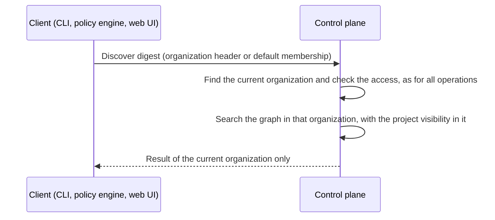

<!--
AGENT INSTRUCTIONS. Keep this comment. Read it before you change this file.

This spec records a design that humans reviewed and approved. Do not change it as part of other work. Find the status of the parent ticket (the `ticket:` field) before you change anything. If you cannot find the status, or you are not sure which case below applies, do not change the spec. Ask the human first.

- Ticket in design, and the spec PR is open: change the spec only through the br:eng-spec skill (`--revise`). The spec shows only the current design. Delete a dropped requirement, do not strike it through, and record why in a Decision Record entry that names its ID. Never renumber or reuse an R-xxx or D-xxx ID.
- Spec and implementation in the same PR, and the spec has not merged: change the spec directly so that it matches the implementation. Do not supersede or strike through. Delete a dropped requirement and record why in a Decision Record entry that names its ID. Record a changed decision as a Decision Record entry. Never renumber or reuse an R-xxx or D-xxx ID. Propose each design change to the human, and change the spec only after the human agrees.
- Ticket in progress, and the spec has merged: never rewrite or delete existing text. When the build changes a requirement or a decision, supersede it in the implementation PR. Add an entry with the next free ID that starts "Supersedes D-xxx." (or R-xxx). Strike through the heading and text of the old entry, and add "Superseded by D-yyy." under its heading. Name both IDs in the PR body. When the Summary, the Problem, or the main flow becomes wrong, it is a redesign: stop, and ask the human for a new spec. The owner records other differences with the shipped work through br:eng-spec (`--done`).
- Ticket done or canceled: the spec is frozen. Do not change, delete, or strike through any text. The only allowed edits are typo fixes, broken links, and the "Superseded by" line under the title. For a design change, write a new spec with br:eng-spec that supersedes this one.

When you review this spec, or before you add scope to it, check three things. No requirement contradicts another requirement, a Non-Goal, a Constraint, or a Decision Record entry. The most important requirements come first. The spec solves one problem: when a part can ship or be decided on its own, propose a separate spec instead of extending this one. Report each issue to the human. Do not fix it by yourself.

Do not answer an open question or a review comment on this spec by yourself. The answer is a design decision, and a human makes it. You can propose an answer and discuss it with a human. Change the spec or reply only after the human agrees.

When your code goes against this spec, say so in your PR. Supersede the entry when the spec has merged and the ticket is in progress.
-->

# Spec issue-3776: Single-organization referrer discovery

## Summary

Referrer discovery finds an artifact or a piece of evidence by its digest. It also returns the items that link to it in the Chainloop graph. Today, discovery with a user session searches every organization that the user is a member of. All other control plane operations, and discovery with an API token, work in one organization only. This spec makes discovery work only in the current organization, for all credentials. The change is in the control plane only. It applies to all clients: the discover API, the `chainloop discover` command, the policy functions, and the web UI.

## Problem

- Discovery with a user session is the only operation that crosses organization boundaries. A user expects the results of the selected organization, as in all other operations.
- The result of a policy that calls discovery depends on the credential that evaluates it. With an API token, the policy sees one organization. With a user session, it sees all organizations of that user. The same policy can pass in one case and fail in the other.
- A user cannot limit discovery to one organization. The `--org` option of the CLI selects an organization, but discovery ignores it.

## Goals and Non-Goals

- Goal: discovery returns only the data of the current organization, for every credential and every client.
- Goal: a policy that calls discovery gets the same result with a user session and with an API token.
- Non-goal: a way to search more than one organization. No client needs it, and it would bring back the problem. See D-001.
- Non-goal: change a client. The new behavior comes from the control plane only. See D-003.
- Non-goal: change project visibility in an organization, or the pagination limits of discovery. They stay as they are.
- Non-goal: change public discovery of shared referrers. It does not use the organizations of the user.

## Requirements

### R-001: Only the current organization
With a user session, discovery MUST return only the referrers of the current organization. It MUST return only their references in that organization. A digest that is in other organizations of the user, but not in the current one, MUST give a not-found error.
- Done when: a user is a member of organizations A and B, and only a run in A attested a digest. With A as the current organization, discovery finds it. With B as the current organization, discovery returns not found.

### R-004: Policy function behavior
The `chainloop.discover` policy function and the discover function of WebAssembly policies MUST return only the data of the current organization. Their inputs and their output format MUST not change.

### R-005: Same result for users and API tokens
For the same organization, digest, and project visibility, discovery MUST return the same result with a user session and with an API token. A visible project of the user in another organization MUST NOT make a referrer of the current organization visible.

## Constraints

- Compatibility with clients: the request and the response formats do not change.
- An old client against a new control plane gets results from the current organization only. This is the intended behavior. It is not an error.
- Project visibility in the organization and the pagination limits stay in place on every path.
- Public repository: no internal links, and no customer or user information.

## Proposal

The user selects the organization as for all other operations: with the `--org` option or its environment variable, or with the default organization of the user. Discovery then works in that organization only. A user who expects a result from another organization selects that organization and runs the command again. The not-found message is the same as today.

The control plane finds the current organization of the request as for every other operation. The organization comes from the organization header of the request or from the default membership of the user. The control plane makes sure that the caller can work in that organization, with the same check as all other operations. It then searches the graph in that organization only. It applies the project visibility that the caller has in that organization, and no visibility from other organizations.

The policy functions and the web UI use the same path. Policies and clients do not change.

## Decision Record

### D-001: Discovery is always single-organization
No option searches more than one organization. This replaces the first design of the implementation PR, which added an opt-in limit to the current organization.
- Why: no other operation crosses organization boundaries, and an option to cross them brings back the difference between users and API tokens.
- Alternatives considered:
  - Single organization by default, with an opt-in to search all organizations: it keeps an exception in the API that no client needs.
  - Search all organizations by default, with an opt-in limit to the current one: the problem stays for each caller without the option.
- Source: [PR #3777 review](https://github.com/chainloop-dev/chainloop/pull/3777#discussion_r4467148631)

### D-002: The current organization is the one of the request
Discovery works as every other API operation. The organization comes from the organization header of the request, or from the default membership of the user. The control plane makes sure that it is an organization of the caller, with the check of all other operations. Discovery does not take an organization of its own, and it does not add a check of its own.
- Why: one rule for all operations. The CLI `--org` option then works for discovery with no special case.
- Source: [PR #3777 review](https://github.com/chainloop-dev/chainloop/pull/3777#discussion_r4468337274)

### D-003: No client change
The change is new behavior of the control plane only. The response does not report the scope, and the CLI and the policy engine do not check it. An older control plane keeps its behavior until the operator upgrades it. This drops R-002 (the control plane reports the searched organization) and R-003 (the CLI and the policy engine fail closed). It also drops D-004 (only user-session clients check the report).
- Why: the behavior belongs to the control plane, as for every other operation. A client check adds a new failure against older control planes for a behavior that the upgrade fixes.
- Alternatives considered:
  - The control plane reports the scope, and a client with a user session fails closed without the report: it adds a client change. It also adds a new error for a temporary state.
- Source: [PR #3777 review](https://github.com/chainloop-dev/chainloop/pull/3777#discussion_r4468342762)

### D-005: One policy function
`chainloop.discover` keeps its name and becomes single-organization through the control plane. The implementation PR first added a separate current-organization function. The PR deletes it before release.
- Why: one function with one behavior. Two functions with the same result would confuse policy authors.
- Alternatives considered:
  - Keep the second function as an alias: it adds a name that does nothing different.
- Source: drafting

## Open Questions

No open questions.

## Risks

| Risk | Mitigation |
|------|------------|
| A user or a script relies on discovery across organizations with a user session, and gets not found after the upgrade. | Release note. The user selects the other organization with `--org`. |
| An older control plane keeps searching all organizations of a user until the operator upgrades it. | Release note. The upgrade of the control plane gives the new behavior to all clients. |
| The web UI graph no longer shows items that are only in other organizations of the user. | This is the intended behavior. The UI already works in one organization in all other views. |
