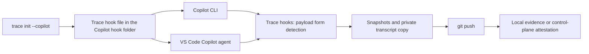

<!--
AGENT INSTRUCTIONS. Keep this comment. Read it before you change this file.

This spec records a design that humans reviewed and approved. Do not change it as part of other work. Find the status of the parent ticket (the `ticket:` field) before you change anything. If you cannot find the status, or you are not sure which case below applies, do not change the spec. Ask the human first.

- Ticket in design, and the spec PR is open: change the spec only through the br:eng-spec skill (`--revise`). The spec shows only the current design. Delete a dropped requirement, do not strike it through, and record why in a Decision Record entry that names its ID. Never renumber or reuse an R-xxx or D-xxx ID.
- Spec and implementation in the same PR, and the spec has not merged: change the spec directly so that it matches the implementation. Do not supersede or strike through. Delete a dropped requirement and record why in a Decision Record entry that names its ID. Record a changed decision as a Decision Record entry. Never renumber or reuse an R-xxx or D-xxx ID. Propose each design change to the human, and change the spec only after the human agrees.
- Ticket in progress, and the spec has merged: never rewrite or delete existing text. When the build changes a requirement or a decision, supersede it in the implementation PR. Add an entry with the next free ID that starts "Supersedes D-xxx." (or R-xxx). Strike through the heading and text of the old entry, and add "Superseded by D-yyy." under its heading. Name both IDs in the PR body. When the Summary, the Problem, or the main flow becomes wrong, it is a redesign: stop, and ask the human for a new spec. The owner records other differences with the shipped work through br:eng-spec (`--done`).
- Ticket done or canceled: the spec is frozen. Do not change, delete, or strike through any text. The only allowed edits are typo fixes, broken links, and the "Superseded by" line under the title. For a design change, write a new spec with br:eng-spec that supersedes this one.

When you implement this spec, build only what its requirements say. A vague word such as "secure" means the baseline the product already has for the same need, not a new mechanism. Propose a new mechanism to the human as a follow-up ticket.

When you review this spec, or before you add scope to it, check three things. No requirement contradicts another requirement, a Non-Goal, a Constraint, or a Decision Record entry. The most important requirements come first. The spec solves one problem: when a part can ship or be decided on its own, propose a separate spec instead of extending this one. Report each issue to the human. Do not fix it by yourself.

Do not answer an open question or a review comment on this spec by yourself. The answer is a design decision, and a human makes it. You can propose an answer and discuss it with a human. Change the spec or reply only after the human agrees.

When your code goes against this spec, say so in your PR. Supersede the entry when the spec has merged and the ticket is in progress.
-->

# Spec issue-3800: GitHub Copilot support in Chainloop Trace

## Summary

Chainloop Trace supports developers who use GitHub Copilot as their coding agent. One Copilot provider covers Copilot CLI and the Copilot agent in VS Code. Both hosts run the same Copilot agent, read the same repository hook files, and keep session transcripts on disk. Developers select Copilot during initialization, or trace one command with temporary hooks. Trace records Copilot sessions as AI coding-session evidence.

## Problem

- Developers who use Copilot cannot attach Trace evidence to their commits. Trace supports Claude Code, Cursor, OpenCode, Pi, and Codex only.
- The Copilot agent runs hooks from `.claude/settings.json` too. In a repository with Claude Code Trace hooks, a Copilot session can start the Claude Code hooks. Trace then records the session under the wrong provider.

## Goals and Non-Goals

- Goal: Developers can record Copilot sessions from Copilot CLI and from VS Code, in local storage or in the control plane.
- Goal: Evidence includes conversations, models, tokens, estimated cost, tools, code attribution, used skills, and pointers for spec sources and pasted images.
- Non-goal: Support the older VS Code agent that GitHub calls the "Local" harness. It has a different hook parser and different transcript storage. Follow-up: a new ticket, if users ask for it.
- Non-goal: Trace sessions of the Copilot cloud coding agent. It runs in GitHub Actions, not on the computer of the developer, and no developer push follows it.
- Non-goal: Record subagents as separate entries in the evidence. Copilot writes no separate child transcripts. The hooks still attribute the edits of a subagent. Follow-up: a new ticket.
- Non-goal: Record Copilot sessions on Windows. The hook file has POSIX shell commands only, as for Claude Code and Cursor. Follow-up: [#3802](https://github.com/chainloop-dev/chainloop/issues/3802).
- Non-goal: Change the evidence schema, the control-plane APIs, or the default provider.

## Requirements

### R-001: One Copilot provider for both hosts

Trace MUST offer Copilot during initialization. Initialization and the command wrapper MUST accept the Copilot provider flag. Developers MUST be able to select Copilot together with other providers. Trace MUST record a session from Copilot CLI and a session from the Copilot agent in VS Code with the same provider. Trace MUST accept each hook payload form that the Copilot agent sends.

### R-002: Hook lifecycle

Initialization MUST install the Copilot hooks in a hook file that Trace owns, in the repository hook folder of Copilot. A second installation MUST produce the same content. Installation MUST NOT overwrite a file that holds hooks that Trace did not write. Uninstall MUST delete only that file, and only when all its hooks are Trace hooks. Other hook files MUST stay unchanged. The command wrapper MUST omit the Trace session-end hook, and MUST restore the previous state after the command exits.

### R-003: One record for each session

Trace MUST record a Copilot session one time, under the Copilot provider. The Claude Code hooks MUST ignore Copilot payloads, also in a repository with no Copilot provider. They MUST NOT record a session, attribute an edit, or send a response for them.

### R-004: Session evidence

Trace MUST capture the session identity, timing, agent version, conversation, tool calls, models, and token usage from the Copilot session transcript. Missing or unreadable data MUST produce a warning. Token totals MUST come from the final session summary when the transcript holds it. When the summary is missing, token totals SHOULD come from the counts of each message, with a warning. Cost MUST use embedded API prices, the same rule as Claude Code and Codex, so that cost compares across providers. An unknown model MUST give a warning.

### R-005: Code attribution

Trace MUST attribute the edits of the Copilot file tools and shell tools. A tool hook MUST recover a session-start event that Trace did not get.

### R-006: Private session copies

Trace MUST parse its private copy of the session transcript. Copying MUST check the session identity, and MUST reject paths outside the Copilot session storage, symbolic-link escapes included. A failed copy MUST keep the previous copy. Local capture and parsing MUST work with no network and no login.

### R-007: Session instructions

At session start, Trace MUST show the user a banner that says that Trace records the session. Trace MUST also send the spec capture instructions to the model. After a push, Trace MUST show the session link to the user one time, through the post-tool channel. The message for the user MUST be a progress line, which Copilot shows to the user. Each hook response MUST have at most one output document after it, and an empty message MUST produce no output.

### R-008: Skills used during the session

Trace MUST record the skills that a Copilot session used, and capture each skill folder through the existing skill evidence pipeline. A skill listing alone MUST NOT count as a skill use.

### R-009: Pointers for spec sources and pasted images

Trace MUST replace exact copies of stored spec sources in the transcript with pointers to their materials. Trace MUST store each distinct pasted image one time as an image material, and replace its copies with pointers. Partial reads, changed content, failed operations, and data that Trace cannot decode MUST stay inline.

### R-010: Verification and compatibility

The end-to-end suite MUST have a Copilot column, run with Copilot CLI. A person MUST check a VS Code session by hand before each milestone merges. The compatibility tables MUST show the results, and MUST say which cells the VS Code check covers.

## Constraints

- The hook contract follows the GitHub reference for Copilot hooks at the time of the build. The VS Code hooks are in preview.
- The Copilot agent drops the output of the user-prompt hook. So Copilot gets no spec reminder at each prompt. It gets the full instruction at session start, as Cursor does.
- The Copilot hook payloads carry no tool call ID. Follows TRC-006: the file snapshot key is the session and the path.
- The Copilot agent stops a tool call when a pre-tool hook fails. The Trace hooks never fail, and always exit with success.

## Proposal

The developer runs Trace initialization and selects Copilot. Trace writes its own hook file into the repository hook folder of Copilot. The developer then works in Copilot CLI or in VS Code. Copilot sends session, prompt, tool, and stop events to the Trace hooks.

The event name in a hook file selects the payload form. Trace registers the camel-case event names, so Copilot CLI and VS Code send camel-case fields to the Trace hooks. The hooks that Copilot runs from the Claude Code settings get the VS Code compatible form, with snake-case fields and Pascal-case event names. Trace accepts both forms, and maps them to the same session lifecycle. It snapshots files before the file tools, and snapshots the working tree around shell commands.

Copilot keeps each session as a JSON Lines event log in its user folder. Trace copies the log into private storage at session boundaries and again before evidence assembly. Copilot writes the token totals after the last hook returns, so the copy at push time holds them. The parser keeps the native records, and derives the conversation, tools, models, and token usage.

## Decision Record

### D-001: One provider for Copilot CLI and VS Code

One Copilot provider handles both hosts, with one hook file and one transcript parser.

- Why: GitHub documents one Copilot agent for VS Code, the Copilot app, and Copilot CLI, with the same hook files and events. Another open-source trace tool uses one Copilot integration for both hosts.
- Alternatives considered:
  - Two providers: two hook files that Copilot reads together, so each session fires twice. Developers must also pick a host.
- Source: drafting.

### D-002: Trace owns a dedicated hook file

Trace writes its own file in the Copilot hook folder. Each hook in it carries the Trace marker text, and the marker text proves ownership. This follows the Pi pattern (TRC-004), which owns its extension file.

- Why: Copilot reads every file in the folder, so Trace needs no merge with the files of the user. A whole file is simple to install, find, and delete.
- Alternatives considered:
  - Merge into a file of the user, found by marker text, as Claude Code, Cursor, and Codex do: those agents read one file only. Copilot does not need it.
- Source: drafting.

## Open Questions

- [ ] **Does the Copilot agent in VS Code write the same session event log as Copilot CLI?** Proposed: yes. GitHub says that the hosts share the agent and its hooks. Milestone 1 checks this. If the log is different, VS Code sessions keep their hooks and attribution. Trace then gives a warning about the transcript, and a follow-up ticket adds a parser. This fallback supersedes the VS Code parts of R-001, R-004, R-006, R-008, and R-009, and changes the first goal.

## Milestones

1. **Core Copilot provider.** R-001 to R-007, and R-010 for these requirements. Selection, hooks, payload forms, the Claude Code guard, session evidence, attribution, local storage, control-plane uploads, and session messages.
2. **Copilot skills, spec pointers, and pasted images.** R-008, R-009, and R-010 for these requirements, through the shared evidence pipeline.

## Risks

| Risk | Mitigation |
|------|------------|
| Copilot changes its hook payloads or its event log. The VS Code hooks are in preview. | Accept both payload forms, keep unknown records, give a warning for unreadable records, and test with sanitized fixtures. |
| Developers commit the hook file. Teammates without the Chainloop CLI, and the cloud coding agent, also run the hooks. | The existing hook command guard exits with success when the CLI is not installed. |
| The estimated cost differs from the Copilot bill. | The compatibility tables say that cost is an API-price estimate. |
| The token totals are missing when the agent stops before it writes its session summary. | Use the token counts of each message, and give a warning. |
