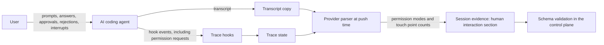

<!--
AGENT INSTRUCTIONS. Keep this comment. Read it before you change this file.

This spec records a design that humans reviewed and approved. Do not change it as part of other work. Find the status of the parent ticket (the `ticket:` field) before you change anything. If you cannot find the status, or you are not sure which case below applies, do not change the spec. Ask the human first.

After each update to a spec that has not merged, automatically run br:eng-spec (`--validate`) on this spec before you commit or push. Do not wait for the human to request validation. This applies to every update, including removals, clarifications, and improvements to an open PR. An earlier validation does not cover later edits. Validation still requires the human's agreement before it changes the design.

- Ticket in design, and the spec PR is open: change the spec only through the br:eng-spec skill (`--revise`). The spec shows only the current design. Delete a dropped requirement, do not strike it through, and record why in a Decision Record entry that names its ID. Never renumber or reuse an R-xxx or D-xxx ID.
- Spec and implementation in the same PR, and the spec has not merged: change the spec directly so that it matches the implementation. Do not supersede or strike through. Delete a dropped requirement and record why in a Decision Record entry that names its ID. Record a changed decision as a Decision Record entry. Never renumber or reuse an R-xxx or D-xxx ID. Propose each design change to the human, and change the spec only after the human agrees.
- Ticket in progress, and the spec has merged: never rewrite or delete existing text. When the build changes a requirement or a decision, supersede it in the implementation PR. Add an entry with the next free ID that starts "Supersedes D-xxx." (or R-xxx). Strike through the heading and text of the old entry, and add "Superseded by D-yyy." under its heading. Name both IDs in the PR body. When the Summary, the Problem, or the main flow becomes wrong, it is a redesign: stop, and ask the human for a new spec. The owner records other differences with the shipped work through br:eng-spec (`--done`).
- Ticket done or canceled: the spec is frozen. Do not change, delete, or strike through any text. The only allowed edits are typo fixes, broken links, and the "Superseded by" line under the title. For a design change, write a new spec with br:eng-spec that supersedes this one.

When you implement this spec, build only what its requirements say. A vague word such as "secure" means the baseline the product already has for the same need, not a new mechanism. Propose a new mechanism to the human as a follow-up ticket.

When you review this spec, or before you add scope to it, check three things. No requirement contradicts another requirement, a Non-Goal, a Constraint, or a Decision Record entry. The most important requirements come first. The spec solves one problem: when a part can ship or be decided on its own, propose a separate spec instead of extending this one. Report each issue to the human. Do not fix it by yourself.

Do not answer an open question or a review comment on this spec by yourself. The answer is a design decision, and a human makes it. You can propose an answer and discuss it with a human. Change the spec or reply only after the human agrees.

When your code goes against this spec, say so in your PR. Supersede the entry when the spec has merged and the ticket is in progress.
-->

# Spec issue-3829: Record the human touch points of an AI coding session

## Summary

The AI coding session evidence will record how often a person stepped in during the session. Each type of human touch point gets its own count: prompts, answered questions, permission approvals and rejections, plan approvals and rejections, and interrupts. The evidence will also record the permission modes of the agent, because the permission mode tells which touch points the agent could ask for. The team needs this data to compare sessions and to improve autonomous agents. A later autonomy score can use it, but this spec does not define that score.

## Problem

- The session evidence does not record how often a person had to step in. We cannot tell an autonomous session from a session that a person guided step by step.
- The existing user message count does not measure human effort. For Claude Code it counts every record in the user role, which includes tool results and messages that the agent injects.
- The evidence does not record the permission mode of the agent. A session with no permission approvals can be an autonomous mode or a session with no risky actions. A reader cannot tell which.
- The existing session mode (a coding session or a single `trace run`) is a different concept. It does not tell how the agent asked for permission.

## Goals and Non-Goals

- Goal: a reviewer can see how often a person stepped in during a session, for each type of touch point.
- In scope: the permission modes (R-006). They could be a separate spec, but the ticket names them, and a reader needs them to explain a count of zero.
- In scope: the counts of rejected permissions and plans (R-003, R-004) and of interrupts (R-005). The ticket names only approvals. A rejection and an interrupt are also times when a person stepped in, so they serve the same problem.
- In scope: all providers (milestone 2). The team compares sessions across agents, and needs the same data for each agent.
- Non-goal: an autonomy score, or a change to the AI score. A later change can calculate one from this data.
- Non-goal: a common scale of permission modes across agents (for example ask, plan, autonomous). The score needs it, so the score work defines it. Follow-up: the autonomy score ticket.
- Non-goal: a view of the touch points in the platform UI. Follow-up: a platform ticket.
- Non-goal: the time that the agent waited for a person.

## Requirements

### R-008: One count for each touch point, subagents included

Each touch point MUST count in one count only. For example, the approval of a plan is not also a permission approval, and the answer to a question is not also a prompt. The touch points of a subagent MUST count in the totals of the session, because the user acted in that session.

- Done when: the user presses Esc at a permission or plan dialog, and the evidence records one rejection and no interrupt.

### R-001: User prompts

The session evidence MUST count the messages that a person sent to the agent, typed or pasted. A slash command that a person typed counts. Tool results, messages that the agent, a hook, or the CLI injects, and messages that another agent session sends MUST NOT count.

- Done when: a session with three typed prompts, one of which holds a pasted link, records three prompts. The tool results and injected messages of the same session do not change the count.

### R-002: Answered questions

The session evidence MUST count the questions that the agent asked through its question tool and that the user answered. A question with more than one part counts once. A question that the user closed with no answer does not count, because the ticket names answered questions. A message that the user then sends counts as a prompt.

### R-003: Permission approvals and rejections

The session evidence MUST count, in two counts, the permission requests that the user approved and the ones that the user rejected. Only requests that the agent showed to the user count. An action that the permission mode or an allow rule approved without a request MUST NOT count. An "always allow" answer counts as one approval.

- Done when: a request that the user did not answer before the session ended counts in neither count. Text that the user typed with a rejection is part of the rejection, not a prompt.

### R-004: Plan approvals and rejections

The session evidence MUST count, in two counts, the plans that the user approved and the ones that the user rejected.

- Done when: text that the user typed with a plan rejection is part of the rejection, not a prompt.

### R-005: Interrupts

The session evidence MUST count the times that the user interrupted the agent while it worked. An interrupt MUST NOT also count as a prompt.

- Done when: a message that the user sends after an interrupt counts as a prompt.

### R-006: Permission modes

The session evidence MUST record each permission mode that the agent used in the session, once each, in the order of first use. The start mode alone hides a later change to an autonomous mode, and the order shows both. Each value MUST be the name that the agent itself uses for the permission mode.

- Done when: a Claude Code session starts in the default mode and then changes to the auto mode. The evidence records both permission modes, default first.

### R-007: Not recorded is different from zero

When a provider can detect a touch point type, the evidence MUST hold its count, also when the count is zero. When a provider cannot detect a type, the evidence MUST leave out that count. The same rule applies to the permission modes.

### R-009: Provider support, compatibility, and failure safety

Each provider MUST record the touch point types and the permission modes that its transcript or hook events show. Claude Code MUST record all of them. Sometimes a provider cannot tell an approval by the user from an approval by a rule. Then it MUST leave out the approval count, and MUST NOT guess. The new data MUST be additive, and the schema version of the evidence MUST stay the same. The existing conversation counts MUST keep their meaning. A failure to count MUST give a warning, MUST leave out the affected counts, and MUST NOT stop evidence creation or block the Git push.

- Done when: old evidence and new evidence both pass schema validation. The compatibility matrix in the Trace README has one row for each touch point type and one row for the permission modes. Each row has a cell for each provider. Each cell that is not **Yes** has a "Why not Yes" line. The matrix changes in the same PR as the provider code. Its cells are the expected result for each provider, and the PR of the milestone for that provider sets them.

## Constraints

- The repository is public. The evidence format is visible to all users, and readers on the platform store evidence from older CLIs.
- The transcript and hook formats of the agents are not stable interfaces.
- The hooks meet the same baseline as the existing Trace hooks. Counting adds no step that waits for the network or reads the full transcript in a hook.

## Proposal

The user works with the agent as before. Nothing changes in the agent. When the user pushes, the session evidence holds a new human interaction section next to the existing conversation counts.

| Field | Meaning |
|-------|---------|
| `permission_modes` | The permission modes that the agent used, in the order of first use (R-006) |
| `touch_points.prompts` | Messages that a person sent (R-001) |
| `touch_points.questions_answered` | Questions of the agent that the user answered (R-002) |
| `touch_points.permissions_approved` | Permission requests that the user approved (R-003) |
| `touch_points.permissions_rejected` | Permission requests that the user rejected (R-003) |
| `touch_points.plans_approved` | Plans that the user approved (R-004) |
| `touch_points.plans_rejected` | Plans that the user rejected (R-004) |
| `touch_points.interrupts` | Interrupts of the agent by the user (R-005) |

The CLI makes this section at push time, in the same step that parses the transcript for the other session data. The provider of each agent counts the touch points, because each agent records them differently. A provider that cannot detect a type leaves out its field (R-007).

**Claude Code.** The transcript records the permission mode on each user record, and the hook events carry it too. The transcript shows the prompts, the answers to the question tool, the result of each plan tool call, and the interrupt markers. A rejected permission request gives a tool result that says the user rejected the tool use. The transcript does not show whether the agent asked before an approved action, because an allow rule gives the same record. The Trace hooks will also listen to the event that Claude Code sends when it shows a permission request. A request that the tool then completes is an approval. Requests for the plan tool and the question tool are not permission requests (R-008).

**Other providers.** Each provider records the types that its transcript or hook events show, for example the approval policy of Codex. It leaves out the other types (R-007). The compatibility matrix in the Trace README records the result for each provider and type (R-009).

## Decision Record

### D-001: A new section, and the conversation counts stay the same

The touch points and the permission modes go into a new human interaction section. The existing user message count keeps its meaning.

- Why: a change to the meaning of the user message count makes old and new evidence disagree, and platform readers store both. A separate section keeps the human data apart from the message statistics.
- Alternatives considered:
  - Change the user message count to count prompts only: stored evidence then has two meanings for one field.
  - Add the counts to the conversation section: the new prompt count sits next to a user message count with a different meaning.
- Source: drafting

### D-002: Native permission mode names, with no common scale

The evidence stores the permission mode name of the agent, for example `acceptEdits` or `bypassPermissions` for Claude Code.

- Why: a mapping to a common scale can be wrong, and it loses detail that the score work can need. The score work can map the native names later, also for evidence that is already stored.
- Alternatives considered:
  - A common scale only: needs a mapping for each agent now, and signed evidence keeps a wrong mapping.
  - Both values: more scope, and the common scale is not defined yet.
- Source: drafting

### D-004: Permission requests come from a hook event, not only from the transcript

For Claude Code, the CLI finds a permission request from the hook event that the agent sends when it shows the request. It does not guess from the transcript. Follows TRC-009: the CLI makes this data from the transcript and the hook events, and the agent does not report it.

- Why: an approval by the user and an approval by an allow rule give the same transcript records. Only the request event tells them apart.
- Alternatives considered:
  - Count each completed tool call that the permission mode does not approve: needs all the allow rules that applied at that time. A wrong guess counts actions that nobody approved.
  - Ask the agent to report its touch points: the agent does not see the permission dialog. Also, the count must not depend on the model.
- Source: drafting

### D-006: Drops D-003 and D-005

D-003 (each permission mode, in the order of first use) is now part of R-006. D-005 (a dismissed question is not an answered question) is now part of R-002.

- Why: both entries only restated their requirement.
- Source: drafting

## Open Questions

None.

## Milestones

1. **Evidence section and Claude Code.** The evidence and its schema get the new section. Claude Code records all the counts and the permission modes. The README matrix gets the new rows.
2. **One milestone for each other provider:** Codex, Copilot, Cursor, OpenCode, and Pi. Each one records the types that its agent shows, and updates its cells in the README matrix. These milestones can ship in any order after milestone 1.

## Risks

| Risk | Mitigation |
|------|------------|
| A new Claude Code version changes a transcript marker or the permission request event. The provider then counts zero, and it cannot tell that the count is wrong. | We accept this risk. The counts are data for a later score, not a gate, and a wrong count does not block a push. |
| Readers compare permission modes across agents as if the names had one meaning. | The README and the evidence schema say that the names are native to each agent (D-002). |
