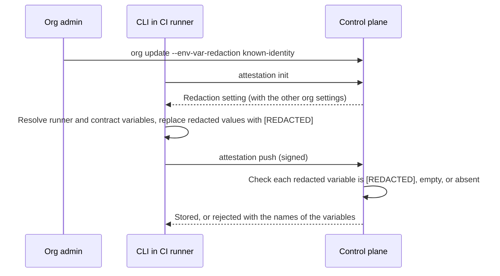

<!--
AGENT INSTRUCTIONS. Keep this comment. Read it before you change this file.

This spec records a design that humans reviewed and approved. Do not change it as part of other work. Find the status of the parent ticket (the `ticket:` field) before you change anything. If you cannot find the status, or you are not sure which case below applies, do not change the spec. Ask the human first.

After each update to a spec that has not merged, automatically run br:eng-spec (`--validate`) on this spec before you commit or push. Do not wait for the human to request validation. This applies to every update, including removals, clarifications, and improvements to an open PR. An earlier validation does not cover later edits. Validation still requires the human's agreement before it changes the design.

- Ticket in design, and the spec PR is open: change the spec only through the br:eng-spec skill (`--revise`). The spec shows only the current design. Delete a dropped requirement or decision. Do not strike it through, and do not add a Decision Record entry to drop it. Keep the R-xxx and D-xxx IDs consecutive from 001: renumber after a delete or a reorder, and update every reference. The IDs become permanent only when the spec merges.
- Spec and implementation in the same PR, and the spec has not merged: change the spec directly so that it matches the implementation. Do not supersede or strike through. Delete a dropped requirement or decision, with no Decision Record entry to drop it. Record a new or changed design choice in the Decision Record. Keep the R-xxx and D-xxx IDs consecutive from 001: renumber after a delete or a reorder, and update every reference. Propose each design change to the human, and change the spec only after the human agrees.
- Ticket in progress, and the spec has merged: never rewrite or delete existing text. When the build changes a requirement or a decision, supersede it in the implementation PR. Add an entry with the next free ID that starts "Supersedes D-xxx." (or R-xxx). Strike through the heading and text of the old entry, and add "Superseded by D-yyy." under its heading. Name both IDs in the PR body. When the Summary, the Problem, or the main flow becomes wrong, it is a redesign: stop, and ask the human for a new spec. The owner records other differences with the shipped work through br:eng-spec (`--done`).
- Ticket done or canceled: the spec is frozen. Do not change, delete, or strike through any text. The only allowed edits are typo fixes, broken links, and the "Superseded by" line under the title. For a design change, write a new spec with br:eng-spec that supersedes this one.

When you implement this spec, build only what its requirements say. A vague word such as "secure" means the baseline the product already has for the same need, not a new mechanism. Propose a new mechanism to the human as a follow-up ticket.

When you review this spec, or before you add scope to it, check three things. No requirement contradicts another requirement, a Non-Goal, a Constraint, or a Decision Record entry. The most important requirements come first. The spec solves one problem: when a part can ship or be decided on its own, propose a separate spec instead of extending this one. Report each issue to the human. Do not fix it by yourself.

Do not answer an open question or a review comment on this spec by yourself. The answer is a design decision, and a human makes it. You can propose an answer and discuss it with a human. Change the spec or reply only after the human agrees.

When your code goes against this spec, say so in your PR. Supersede the entry when the spec has merged and the ticket is in progress.
-->

# Spec issue-3841: Redaction of runner environment variables

## Summary

Each attestation stores the environment variables that the CLI finds in the CI runner. Some of these variables identify a person, for example the user who started the pipeline. This spec adds an organization setting that replaces the values of those variables with `[REDACTED]`. The setting has three modes: none, a list of identity variables that Chainloop keeps, or a custom list of variable names. The control plane rejects a pushed attestation that does not obey the setting.

## Problem

- Some organizations cannot store personal data in attestations, for example for GDPR. They must keep the other runner details.
- The only organization setting today removes all runner variables. The organization must then add each variable that it wants to keep to the env allow list of each contract.
- An empty value for an identity variable in the CI step does not work for each pipeline. The CLI requires some identity variables, and an empty value makes `attestation init` fail.

## Goals and Non-Goals

- Goal: an organization admin can hide the values of identity variables in new attestations, and keep all other runner details.
- In scope: push enforcement (R-003). It could ship after the CLI part, but the ticket proposes it.
- Non-goal: redact attestations that are already stored. The CLI signs each attestation, and a stored attestation does not change.
- Non-goal: name patterns (globs). The ticket asks for exact names only.
- Non-goal: a contract setting. Contracts cannot change or turn off the redaction.
- Non-goal: the author name and email of the head commit, and the author and reviewer logins of the pull request. They are not environment variables, and they need a different mechanism. Follow-up: [issue 3842](https://github.com/chainloop-dev/chainloop/issues/3842).
- Non-goal: redaction of materials or annotations. The ticket covers only the environment variables, and the user or the contract selects what materials and annotations contain.

## Requirements

### R-001: Organization redaction setting
An organization admin MUST be able to set the redaction mode of the organization to one of: none, known identity, or custom. The custom mode MUST have at least one variable name. The organization details MUST show the mode and the custom list. The default is none.
- Done when: `chainloop org update --env-var-redaction known-identity` sets the mode, and the organization details show it.

### R-002: Redact, do not drop
When a redacted variable has a value, the attestation MUST keep the variable name with the value `[REDACTED]`. Then the attestation shows that the value existed and that the organization hid it on purpose. The check of required runner variables also still passes. The team did not remove the variable: a required variable then fails `attestation init`, and a reader cannot tell a hidden value from a missing one.
- Done when: in an Azure Pipelines run with known identity, the attestation has `BUILD_REQUESTEDFOR: [REDACTED]`, and `attestation init` does not fail.

### R-003: Push enforcement
The control plane MUST reject a pushed attestation when a variable that the setting redacts has a non-empty value other than `[REDACTED]`. The check MUST use the setting of the organization at push time. The error MUST name the variables. It MUST tell the user to update the CLI, or to run the attestation again if the setting changed during the run.
- Done when: a CLI without redaction support pushes an attestation that has `GITHUB_ACTOR` with a real value, in an organization with known identity. The push fails.

### R-004: Known identity list
The known identity mode MUST redact each variable that a runner integration of Chainloop marks as identity (D-001). The first list is: `GITHUB_ACTOR`, `GITLAB_USER_EMAIL`, `GITLAB_USER_LOGIN`, `BUILD_REQUESTEDFOR`, `BUILD_REQUESTEDFOREMAIL`, `USER`, and `HOME`. TeamCity marks `USER` and `HOME`, because `HOME` often contains the user name.

### R-005: Custom list
The custom mode MUST redact only the listed variables. It MUST NOT add the known identity list.

### R-006: Scope of the redaction
The redaction MUST apply to the variables that the runner finds and to the variables in the env allow list of the contract. A contract MUST NOT be able to show a redacted value.

## Constraints

- Compatibility: the API change only adds fields.
- The setting does not change the existing setting that removes all runner variables. Both can be on at the same time.
- Public repository: no internal links, and no customer or user information.

## Proposal

An organization admin sets the mode with `chainloop org update --env-var-redaction none|known-identity|custom`. The repeatable `--redacted-env-var NAME` flag gives the custom list.

The CLI gets the setting from the control plane in the response of `attestation init`, as for the existing runner variable setting. The CLI keeps the setting in the local attestation state. When the CLI resolves the variables of the runner and of the contract, it replaces each redacted value with `[REDACTED]`. It does this before it writes the state. Thus the real value does not go to the state, the signed attestation, or the control plane.

For the known identity mode, the `attestation init` response also gives the resolved list of names, and the CLI applies that list (D-003). At push, the control plane runs the redaction check next to the existing contract check.

## Decision Record

### D-001: Identity marks live in each runner integration, and the list is their union
Each runner integration marks which of its variables identify a person. The known identity list is the union of the marks of all runners, and it applies to each attestation.
- Why: the person who adds or changes a runner integration sees the marks next to the variables. The union does not depend on the runner type that the attestation reports. Thus a client cannot skip the push check with a different runner type.
- Alternatives considered:
  - One central list, apart from the runner integrations: it gets out of date when a runner integration changes.
  - Only the identity variables of the runner of the attestation: push enforcement then depends on a runner type that the client reports.
- Source: drafting

### D-002: The control plane enforces the setting at push
The control plane rejects an attestation that does not obey the setting. It does not trust the client to redact.
- Why: the CLI applies the redaction and signs the result, so an older CLI ignores the setting and nothing else stops the personal data.
- Alternatives considered:
  - Document a minimum CLI version: nothing stops an older CLI, so the setting is only advice.
- Source: drafting

### D-003: The control plane sends the resolved known identity list
In the known identity mode, the `attestation init` response gives the names of the variables to redact. The CLI applies that list.
- Why: the push check uses the list of the control plane. A later control plane release can mark a new identity variable. If the CLI used its own list, each push from a current CLI would then fail until the pipeline updates the CLI.
- Alternatives considered:
  - Each side uses its own copy of the list. A new mark ships in the CLI one release before the control plane enforces it. This depends on the release order and on the CLI update of each pipeline.
- Source: drafting

## Open Questions

No open questions.

## Risks

| Risk | Mitigation |
|------|------------|
| An organization turns on redaction, and pipelines with an older CLI fail at push. | The error names the variables and tells the user to update the CLI. The release notes give the minimum CLI version. |
| An admin changes the setting while an attestation is in progress. The push uses the new setting, which the CLI did not apply. | The push fails with the error from R-003, and a new run of the pipeline uses the new setting. Changes to the setting are rare. |
| A personal value is in a variable that is not on the known identity list. | The custom mode covers it. A runner integration can mark more variables in a later release. |
